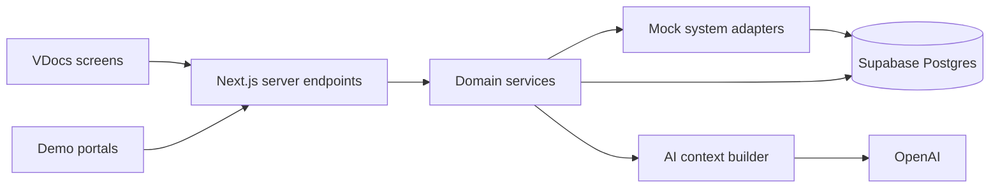

# VDocs — Fortis Internal Demo Product and Technical Plan

Status: Planning only. Implementation has not been approved or started.

Source of truth: [findings.txt](findings.txt), containing both Fortis discovery documents.

## Opinion and recommended direction

The thesis is strong, but the proposed feature list is too large for two days unless we make the demo much narrower than the product vision.

The most convincing demonstration is:

> Open Rahul → understand what changed → order an investigation → receive its result → request specialist input → receive the response → keep discharge work visible.

That proves VDocs can connect information and action around a patient. The AI helps explain the record; the working workflows carry the product argument.

The product thesis remains:

> VDocs is the patient-centric clinical workflow and intelligence layer on top of the hospital's existing systems.

Throughout this plan:

- **OBSERVED AT FORTIS** means documented in the discovery material. The documents do not consistently distinguish direct observation from clinician reports, so we should not imply independently verified system audits.
- **PROPOSED VDocs SOLUTION** means functionality we introduce.
- **HYPOTHESIS / FUTURE VALIDATION** means an expected benefit, integration assumption, or unresolved operational question.

All specifications below are proposed VDocs solutions, unless explicitly classified otherwise. These are single-site findings and must not be generalized to other hospitals without validation.

## SECTION A — The smallest impressive product for two days

Build **one polished clinical workspace with two working feedback loops and a persistent discharge list**.

The main application needs only these destinations:

| Destination | Purpose |
|---|---|
| Login | Enter the seeded Dr. Ananya Mehta account |
| My Day | Attention, schedule, and outstanding work |
| Patients | Search and open a patient |
| Patient workspace | Review information and perform actions |
| Requests | Shared request/referral visibility |
| Discharges | Persistent working list and simple history |

Supporting dummy systems use lightweight table-and-detail interfaces.

**The two working loops:**

1. **Investigation:** VDocs order → dummy Lab → published result → VDocs attention → doctor review.
2. **Coordination:** VDocs request → department queue → acceptance/progress/response → requester review.

**Recommended scope adjustment:** promote a basic discharge queue from P2 into the required demo. It directly represents one of the clearest Fortis findings and gives the story a strong ending. Keep discharge-summary generation optional.

Protect these features first:

- Patient workspace, labs, imaging reports, timeline.
- Source-linked summary.
- Deterministic “What changed?”
- Attention with meaningful review actions.
- Both working loops.
- Persistent discharge queue.
- Simple clinician-approved prescription.

Add typed handover only after that works. Voice comes last.

**Two-day assumption:** approximately 18–20 focused engineering hours, working Supabase/OpenAI access, desktop-first design, and fixed synthetic fixtures. This is an implementation budget, not a guarantee that the entire original scope fits.

## SECTION B — Exact Fortis findings represented

References below use **Case Study finding numbers** and **Workflow Discovery section numbers** from `findings.txt`.

| OBSERVED AT FORTIS | Evidence | PROPOSED VDocs SOLUTION | HYPOTHESIS / FUTURE VALIDATION |
|---|---|---|---|
| Separate HIS, Lab and PACS access with repeated UHID searching | Case Study 1; Workflow 1 | One patient context with lab and imaging report access | Actual integration permissions and retrieval-time savings |
| Doctors reconstruct the patient journey across records | Case Study 6; Workflow 2, 7 | Curated longitudinal timeline | Whether the selected events provide enough context |
| Manual review; missing automated summaries/abnormal flags | Case Study 10; Workflow 3 | Source-linked summary and structured result flags | Summary usefulness and local alert rules |
| Returning doctors need changes since review | Workflow 15 | Explicit “Since your last review” view | How clinicians define a completed review |
| Outstanding work lacks a central view | Workflow 16 | Doctor Attention Center | Ownership, escalation and reminder expectations |
| Interdepartmental coordination happens through calls/physical communication without shared tracking | Case Study 7; Workflow 8, 9, 12 | Request → response → requester review | Whether teams adopt the workflow and who owns responses |
| OPD/IPD referrals lack central status, urgency and team visibility | Case Study 8; Workflow 10, 11 | Department queue using the same request engine | Assignment and consultant/resident responsibilities |
| Investigation ordering can require leaving patient context | Workflow 13 | Patient-context order placement | Real order-entry interfaces and permissions |
| Prescription workflow can require repeated navigation/entry | Workflow 14 | Medication/allergy context beside prescription editor | Actual formulary and approval workflow |
| Discharge working lists are not conveniently persistent; manual/WhatsApp workarounds occur | Case Study 2; Workflow 4, 5 | Persistent discharge queue | Measurable time saved and effect on discharge processing |
| Previous discharged patients lack browsable history | Case Study 3 | Date-filtered discharge history | Required retrieval filters |
| Handover is informal and verbal | Case Study 4; Workflow 6 | Optional typed, structured handover | Adoption and required approval/receipt process |
| Specialties need different information first | Case Study 6; Workflow 17 | Optional Nephrology emphasis | Which fields each specialty actually prioritizes |

**Evidence correction:** Case Study Finding 5, voice-to-structured handover, explicitly describes **our proposed direction**. It is not an existing Fortis capability or an independently observed adoption result.

Likewise, reduced length of stay, fewer errors, faster bed turnover and improved revenue are **hypotheses to measure**, even where the discovery documents discuss them under ROI.

## SECTION C — Findings to leave out of the first demo

| Exclude or defer | Reason |
|---|---|
| Downtime continuity/cached access | Real finding, but credible handling needs freshness, access, outage and reconciliation decisions |
| Angiography-specific viewing | Narrow finding; does not strengthen the Internal Medicine/Nephrology story |
| Seven specialty views | Duplicates interface work before validating the information hierarchy |
| Voice recording/transcription | Adds permissions, audio handling and failure states; typed handover proves the structured workflow |
| AI discharge-summary generation | Distracts from the actual persistent-list problem |
| Advanced team hierarchy | Assignment and department visibility are enough for the demo |
| Automated escalation | Requires hospital-specific operating rules |
| Full clinical document ingestion | Structured synthetic records are sufficient |
| Imaging ordering | Existing report visibility proves the core issue; Lab already demonstrates ordering |
| Pharmacy dispensing workflow | Prescription visibility is sufficient |
| Follow-up creation workflow | A seeded follow-up appointment can demonstrate visibility |

Keep all original P3 exclusions: billing, TPA, patient app, insurance, real ABDM integration, real PACS integration, real hospital APIs, complex analytics, complex administration, advanced role management and production infrastructure.

Do not discard downtime or angiography from the evidence file; defer their implementation.

## SECTION D — Exact doctor journey

1. **Enter the demo.** Dr. Ananya Mehta signs in to the seeded Fortis account.
2. **Orient to the day.** My Day shows results requiring review, pending requests, and discharge work.
3. **Open Rahul from an attention row.** The patient opens with the relevant section selected.
4. **Understand his current context.** Identity, allergies, diagnoses, encounter, medications and summary are immediately available.
5. **Inspect changes.** Compare new information against an explicit previous-review checkpoint.
6. **Verify a summary claim.** Open the source results behind the creatinine comparison.
7. **Order KFT.** Patient identity stays attached; review and submit.
8. **Create a prescription.** Inspect existing medication/allergy information, review the draft, approve.
9. **Request Nephrology input.** Enter the question, inspect attached context, submit.
10. **Review the arriving result.** A new result appears and links directly to the report.
11. **Review the specialist response.** Completion and requester review are separate states.
12. **Optionally approve a typed handover.**
13. **Open the discharge queue.** Rahul remains visible with ownership and outstanding work.

**Critical distinction:** a specialist request being completed does not mean Rahul is medically ready for discharge. His discharge row stays active until the appropriate clinician explicitly updates it.

## SECTION E — Patient workspace, section by section

**Layout:** desktop-first, approximately 1440px target width, compact navigation rail, broad clinical content area, contextual drawers.

### 1. Sticky identity and encounter header

Display:

- Rahul Sharma · 52M · UHID `F-DEMO-0001`
- Current IPD encounter and bed/location.
- Internal Medicine · Dr. Ananya Mehta.
- **Penicillin allergy**, with reaction as documented in the synthetic record.
- Active diagnoses: Type 2 Diabetes, Hypertension, CKD.
- Current medication names; expand for dose/history.

Actions:

**Order Lab · Prescribe · Request Department · More**

“More” contains handover and discharge actions. Avoid eight competing primary buttons.

### 2. AI summary

A compact section, approximately four bullets:

- Current encounter context.
- Documented conditions and relevant history.
- Important recent investigation changes.
- Outstanding work.

Every factual bullet has a source control.

Example:

> Creatinine increased from 1.8 to 2.1 mg/dL between the two latest available results. **[2 results]**

Show **generated at** and **based on data through** separately.

No conversational avatar or chatbot-first layout.

### 3. What changed

Heading:

> **Since your last review — yesterday, 18:00**

Suggested rows:

| Type | Information | Action |
|---|---|---|
| Changed | Creatinine 1.8 → 2.1 mg/dL | Compare results |
| New | CT report available | Open report |
| Completed | CBC completed | Open result |
| Medication | Documented prescription change | View change |
| Pending | Outstanding work | Open item |

Keep **new changes** visually separate from **still pending**. A long-standing pending item should not falsely appear new.

Provide **Mark reviewed through this point**. Opening the page must not silently advance the checkpoint.

### 4. Patient attention

A compact work list:

- New reports needing review.
- Requests awaiting response.
- Completed responses needing requester review.
- Discharge blockers.

Each row includes source, timestamp, owner where applicable, and a concrete action.

“Open result” and “Mark reviewed” are different actions.

### 5. Clinical tabs

| Tab | Contents |
|---|---|
| Overview | Latest relevant results, active conditions, current encounter note |
| Labs | Date-aligned values, units, reference intervals, trends, report details |
| Imaging | Modality, body region, report date, impression, full report |
| Medications | Current, previous, allergies, approved prescriptions |
| Orders | Investigation orders, status, linked results |
| Requests / Referrals | Incoming/outgoing context, owner, priority, status, response |
| Timeline | Meaningful longitudinal clinical events |

### 6. Source drawer

A summary citation, attention row or timeline event opens the same reusable drawer.

Display:

- Record title and identifier.
- Source system label.
- Clinical date and availability date.
- Author or reporting department where present.
- Full structured content.
- Related order, report or request.

For imaging, show the report. Do not imply CT interpretation or a working diagnostic image viewer.

### 7. Timeline

Group by encounter and day, newest first.

Events include orders, results, prescriptions, diagnoses, consultations, requests and handovers.

Do not include login events, AI generation attempts or every technical field update. Those belong in audit records.

### 8. Optional specialty emphasis

A two-option control: **Internal Medicine / Nephrology**.

Nephrology reorders relevant labs and context. It does not duplicate records or hide allergies and important outstanding work.

## SECTION F — Exact dashboard

Header:

> **Good morning, Dr. Mehta**  
> Internal Medicine · Fortis · Monday, 7 September

Use a scenario date consistently throughout the demo.

One compact summary strip:

**3 results require review · 2 requests pending · 1 discharge requires action**

Those counts must be computed from records, not hard-coded independently.

**Main area: Attention**

| Priority/type | Patient | Reason | Updated | Action |
|---|---|---|---|---|
| Critical · unreviewed | A supporting patient | Lab-marked critical result | Time | Review |
| New result | Rahul Sharma | KFT report available | Time | Review |
| New report | Rahul Sharma | CT report available | Time | Open |
| Pending request | Supporting patient | Department response outstanding | Time | Track |
| Discharge | Rahul Sharma | Review/summary pending | Time | Open queue |

**Secondary area: Today’s schedule**

A compact table with time, patient, visit type and status. Follow-ups are appointments marked as follow-up, not a separate subsystem.

Navigation:

**My Day · Patients · Requests · Discharges**

There is no operational analytics dashboard, revenue chart or hospital-wide KPI wall.

The attention ordering is a proposed demo rule. Actual critical-result handling and escalation need Fortis validation.

## SECTION G — Minimum dummy-system interfaces

All portals display:

> **Demo simulator · synthetic data**

They should resemble separate simple applications through navigation and typography, without pretending to reproduce actual Fortis screens.

| Route | Minimum interface | Working action |
|---|---|---|
| `/demo/his` | UHID search; patient demographics, encounter, notes; links to separate Lab/Radiology searches | Search and open source records |
| `/demo/lab` | Orders table; UHID search; order detail; result preview | Publish a synthetic result for an existing order |
| `/demo/radiology` | UHID search; CT/X-ray report list and report detail | Open existing report |
| `/demo/pharmacy` | Approved prescriptions table and detail | Show the prescription created in VDocs |
| `/demo/referrals` | Department selector; incoming queue; patient-context panel | Assign, accept, progress, respond, complete |

Important differences:

- HIS, Lab and PACS fragmentation is grounded in discovery.
- The specific simulated screens are our representation.
- A separate pharmacy portal is a demo device; the discovery does not establish that exact Fortis application.
- The structured department portal is **a new VDocs workflow**, not an existing Fortis referral system.

Use a presenter-only launcher outside normal clinical navigation to switch portals.

A single seeded authenticated account may operate the simulators, but audit entries should say **simulated Lab/Nephrology action initiated by the presenter**, rather than pretending a second real clinician logged in.

## SECTION H — Complete demo data model

This is the complete model for the proposed demo scope, not a production hospital schema.

**Shared rules**

- UUID identifiers.
- `hospital_id` on every hospital-owned record.
- `patient_id` on patient-owned records.
- `encounter_id` when an event belongs to an encounter.
- UTC timestamps, displayed in Asia/Kolkata.
- Hospital-scoped UHID uniqueness.
- Parent-child constraints prevent cross-hospital or wrong-patient links.
- Source-bearing records include `source_system`, `source_record_id`, `recorded_at`, `available_at`, and `version`.
- Synthetic records are explicitly identifiable.

### Tables

| Table | Essential fields and purpose |
|---|---|
| `hospitals` | Name, timezone |
| `departments` | Hospital, code, name |
| `profiles` | Supabase Auth user, hospital, department, display name |
| `patients` | UHID, name, DOB, sex |
| `encounters` | Patient, OPD/IPD, owner, department, admission/visit date, discharge date, status, location |
| `clinical_entries` | Patient/encounter, kind, author, effective date, typed payload for diagnosis, note, consultation, procedure or vital observation |
| `allergies` | Substance, documented reaction, status |
| `medications` | Drug, dose, route, frequency, instructions, start/end, current/previous status, originating prescription item |
| `appointments` | Doctor, patient, scheduled time, visit/follow-up type, status |
| `orders` | One row per test/panel or imaging study; batch ID, catalog code, kind, requester, priority, status, indication |
| `lab_reports` | Patient, encounter, optional linked order for historical imports, specimen time, published time, final/amended status |
| `lab_observations` | Report, analyte code/name, numeric or text value, unit, reference bounds, source flag |
| `imaging_reports` | Patient, encounter, optional order, modality, body region, performed/reported times, findings, impression |
| `prescriptions` | Patient, encounter, author, draft/approved status, approver, approved time |
| `prescription_items` | Drug, dose, route, frequency, duration, instructions, optional link to existing medication |
| `care_requests` | Kind, sender, target department, assignee, urgency, reason, status, due time, context snapshot, response, requester review time |
| `discharges` | Encounter, owner, target date, priority, workflow status, typed checklist, completed time |
| `handovers` | Optional: input text, structured sections, source references, draft/approved status, approver |
| `timeline_events` | Patient, encounter, event type, actor, source reference/version, clinical time, recorded time |
| `review_checkpoints` | Doctor/patient, explicitly reviewed-through patient revision, review timestamp |
| `item_reviews` | Doctor, source record/version, reviewed timestamp |
| `ai_artifacts` | Task, patient, context revision/hash, structured output, source references, generation time, model/prompt version |
| `audit_logs` | Actor, action, entity, before/after status, timestamp, simulation identity |
| `demo_scenarios` | Seed version, scenario date, reset metadata |

Use validated typed payloads only where useful; do not put orders, request states or lab values into an unstructured universal JSON blob.

**Avoid duplicate models:**

- `care_requests.kind = consultation_referral | interdepartmental_request`.
- `requestService` and `referralService` use the same table and lifecycle.
- Attention is derived from orders, results, requests, appointments and discharges.
- Discharge history queries completed discharge records.
- Medication history and approved prescriptions have distinct meanings.
- No separate generic `tasks` table is necessary initially.

### Lifecycle rules

**Lab**

`placed → processing → completed`

For the demo, publishing a final result completes the matching order atomically. A repeated publish cannot create another result accidentally.

**Request/referral**

`received → accepted → in_progress → completed`

Also support `cancelled`.

Urgency, assignment and requester review are separate fields:

- **Urgent** is priority.
- **Assigned** means an assignee exists.
- **New** means newly received.
- **Seen/in review** can be a display label for the appropriate underlying progress state.

Completion requires a response. Requester acknowledgment does not erase that response.

**Discharge**

`planned → in_progress → ready → discharged`

A blocker/checklist explains pending work. Only explicit clinician action changes readiness or completion.

**Prescription / handover**

`draft → approved`

Drafts never silently become clinical actions.

## SECTION I — Service architecture and API contracts

Use **one Next.js application, one Supabase project, and modules with explicit responsibilities**.

The requested implementation stack is Next.js, TypeScript, Tailwind, shadcn/ui, Supabase/Postgres, Supabase Auth and OpenAI.

No microservices, message broker, integration console or separate deployments for five portals.

### Service responsibilities

| Service | Responsibility |
|---|---|
| `patientService` | Search, identity, encounter and workspace assembly |
| `labService` | Orders, results, trend comparisons |
| `imagingService` | Report retrieval |
| `medicationService` | Current/previous medication context |
| `prescriptionService` | Draft validation and explicit approval |
| `requestService` | Shared request lifecycle and context snapshots |
| `referralService` | Referral-specific view over the shared engine |
| `timelineService` | Clinical events and changes since checkpoint |
| `dischargeService` | Persistent queue, checklist and history |
| `handoverService` | Optional draft/review/approval |
| `aiService` | Bounded context, generation, validation, cache |

Small dashboard and attention query functions compose these services; they do not need their own framework.

### Adapter boundaries

- `MockHIS`: patient, encounter and historical chart reads.
- `MockLIS`: investigation placement and report publication.
- `MockRIS`: imaging report reads.
- `MockPharmacy`: approved prescription delivery/readback.
- `MockReferral`: shared department request handling.

These are replaceable function interfaces. They demonstrate where integrations would attach; they do not establish real API compatibility.

### Proposed HTTP contracts

All patient paths below are under `/api/patients/:patientId`.

| Method and endpoint | Input / result |
|---|---|
| `GET /api/patients` | Search/filter → patient rows |
| `GET /api/dashboard` | Authenticated doctor → counts, attention, schedule |
| `GET /workspace` | Aggregated chart, sources, snapshot revision |
| `GET /changes` | Checkpoint → new/changed events and separately pending work |
| `GET /labs` / `/imaging` / `/timeline` | Filtered source records |
| `POST /lab-orders` | Encounter, selected catalog codes, priority, indication → order IDs |
| `POST /prescriptions` | Encounter and medication items → draft |
| `POST /api/prescriptions/:id/approve` | Expected version and explicit approval → approved prescription |
| `POST /requests` | Encounter, kind, target department, urgency, reason, selected context references → request |
| `GET /api/requests` | Department/direction/status/priority → queue |
| `PATCH /api/requests/:id` | Expected version, allowed status/assignment/response update |
| `POST /api/requests/:id/review` | Response version → requester review |
| `POST /reviews` | Exact displayed patient revision → checkpoint |
| `POST /api/reviews` | Source reference/version → item review |
| `GET /api/discharges` | Active/history/date/owner/status filters |
| `PATCH /api/discharges/:id` | Expected version, status/checklist/owner changes |
| `POST /ai/summary` | Current context → cited summary |
| `POST /ai/changes` | Review checkpoint → cited explanation |
| `POST /handovers` | Optional text → draft; separate approval endpoint |
| `POST /api/demo/lab/orders/:id/publish` | Validated fixture/result payload → published report |
| `POST /api/demo/reset` | Protected demo-only reset → restored initial scenario |

**Contract rules**

- Resolve actor and hospital from the authenticated session.
- Validate patient/encounter/source relationships server-side.
- Require idempotency keys for order, prescription approval, request creation and result publication.
- Use expected versions for mutable workflow updates; return a conflict on stale submissions.
- Write business change, timeline event and audit entry in one transaction.
- Return readable validation errors; never show a success toast before persistence succeeds.

For this small demo, poll active screens approximately every five seconds and refresh on window focus. Refresh immediately after local writes. That is sufficient to demonstrate arrival without adding subscription complexity.

Supabase Auth and hospital-scoped RLS should protect data access; privileged credentials stay server-side. Supabase documents RLS as the mechanism for restricting row access, including use with Auth. [Supabase RLS documentation](https://supabase.com/docs/guides/database/postgres/row-level-security)

## SECTION J — AI retrieval and summarization

**The database determines what happened. AI explains the selected evidence.**

### 1. Retrieve bounded context

For a summary:

- Identity essentials, active encounter and documented conditions.
- Allergies and current medications.
- Latest relevant encounter notes.
- Recent relevant imaging reports.
- Selected longitudinal lab observations.
- Open orders and requests.
- Current discharge work.

For “What changed?”:

- Events newly available since the review checkpoint.
- Relevant preceding values for comparisons.
- Medication and request state changes.
- Separately, unresolved work.

For Nephrology context:

- Relevant renal investigations and trend dates.
- Available urine studies/vitals.
- Documented history and medications.
- Request reason and relevant notes.

Do not assume missing urine studies or vitals exist.

### 2. Compute facts before generation

Application logic computes:

- Latest and previous comparable lab values.
- Units, dates and differences.
- Newly published reports.
- Order and request status changes.
- Items pending or overdue against explicit timestamps.

Abnormal/critical indicators come from structured result metadata or explicit synthetic rules. The model does not invent critical thresholds.

Only compare compatible analytes and units.

### 3. Generate a small structured response

Use a strict output schema containing:

- `summary_items`
- `change_items`
- `pending_items`
- `limitations`

Each factual item contains text and allow-listed source references. Numeric change objects include the supporting values and units.

OpenAI Structured Outputs can enforce the response structure, but schema compliance does not establish factual correctness. We still validate the output and its evidence. [OpenAI Structured Outputs documentation](https://developers.openai.com/api/docs/guides/structured-outputs)

### 4. Validate and render

Check:

- Sources belong to the patient and hospital.
- Sources were actually included in the context.
- Referenced versions exist.
- Numerical statements match retrieved observations.
- Required evidence is present.
- The output contains no newly invented diagnoses, prescriptions or orders.

Citations alone are not proof that a sentence is supported. Manually review the hero fixture summaries and test deliberate unsupported-output cases.

Treat note/report text as data, never instructions to the application.

### 5. Cache with a visible data boundary

Cache by patient context hash, task and prompt version.

When new data arrives:

- Update deterministic changes and attention immediately.
- Mark the old summary as based on an earlier snapshot.
- Regenerate independently.

If AI fails, show source data and deterministic changes. Any pre-generated summary must be labeled and must match the current fixture state.

### 6. Keep AI interaction focused

Offer:

- **Summarize patient**
- **Explain changes since review**
- **Draft handover**, if implemented

The doctor can click the second action to ask the exact question from the story. An unrestricted chat surface is unnecessary.

AI has no order-writing or prescribing tools.

## SECTION K — Exact synthetic dataset

Use **21 patients: Rahul plus 20 supporting patients**.

### Rahul

| Field | Fixture |
|---|---|
| Identity | Rahul Sharma, male, 52 at the scenario date |
| UHID | `F-DEMO-0001` |
| Conditions | Documented Type 2 Diabetes, Hypertension, CKD |
| Allergy | Penicillin; documented synthetic reaction |
| Current encounter | IPD, Internal Medicine, owner Dr. Ananya Mehta |
| Discharge | Planned; clinical review and summary pending |
| Medication context | Metformin, Atorvastatin, Amlodipine, Losartan |
| Previous medication example | One discontinued prescription with documented start/end and author |
| Historical encounters | Three OPD visits, one previous admission, current admission |
| Imaging | Previous CT report and current chest X-ray; separate performed and published times |
| Historical investigations | Four longitudinal measurement points; completed CBC; prior KFT and HbA1c orders |
| Previous coordination | One completed historical consultation |
| Review baseline | Yesterday at 18:00, with explicit included-record revision |

Medication dose, route, frequency and dates must be populated in fixtures. They represent synthetic historical documentation, not treatment recommendations derived by AI. A clinician should review the final clinical script before presentation.

### Exact trend spine

Let **D** be the scenario date.

| Measurement | D−180 | D−90 | D−30 | D−1 / D |
|---|---:|---:|---:|---:|
| HbA1c, % | 7.1 | 7.4 | 7.8 | 8.2 at D−1 |
| Creatinine, mg/dL | 1.4 | 1.6 | 1.8 | 2.1 at D, 08:00 |
| Potassium, mmol/L | 4.6 | 4.8 | 5.0 | 5.4 at D, 08:00 |

The initial “since review” comparison is **1.8 → 2.1**. The full historical trend is **1.4 → 2.1**. Never interchange those statements.

During the demo, the newly ordered KFT publishes another dated panel, for example creatinine **2.2** and potassium **5.5**, using explicit synthetic report flags. It does not automatically declare a clinical emergency or change treatment.

Other panel fields, units and reference intervals must be internally consistent.

### Initial state versus live state

At reset:

- Rahul has a new KFT report and CT report needing review.
- His older CBC is completed and reviewed.
- He has no outstanding duplicate KFT order.
- His new Nephrology request has not yet been submitted.
- The discharge row already exists.

During the story:

- KFT becomes pending, then completed.
- Nephrology request becomes pending, then completed.
- Its response becomes reviewed.

This deliberately makes Rahul’s pending request a **live-created state**. Seeding the same request as pending and then creating it again would weaken the story.

### Supporting patients

All names and conditions below are synthetic.

| Patient | Age/sex | Seeded role |
|---|---|---|
| Priya Patel | 46F | Today’s follow-up |
| Amit Verma | 61M | Lab-marked critical potassium report, unreviewed |
| Sunita Rao | 58F | Pending Nephrology request |
| Rajesh Nair | 64M | Pending Cardiology referral |
| Farah Khan | 39F | CBC processing |
| Vikram Singh | 55M | Today’s OPD visit |
| Meena Joshi | 67F | Today’s follow-up |
| Arjun Desai | 34M | Today’s OPD visit |
| Kavita Iyer | 49F | Today’s OPD visit |
| Rakesh Gupta | 70M | Reviewed imaging report |
| Asha Menon | 62F | Discharged yesterday |
| Imran Ali | 45M | Discharged yesterday |
| Pooja Shah | 31F | Discharged three days ago |
| Suresh Kulkarni | 73M | Discharged six days ago |
| Nisha Thomas | 42F | Discharged fourteen days ago |
| Deepak Mishra | 57M | Discharged twenty-nine days ago |
| Leela Das | 69F | Completed referral |
| Sameer Kapoor | 50M | Active admission, reviewed results |
| Anjali Bose | 36F | Upcoming follow-up |
| Manoj Reddy | 60M | Previous medication/history example |

Every supporting patient gets at least one encounter, one documented condition and sufficient context for their visible row.

Exact opening dashboard counts:

- **3 result reports needing review:** Rahul KFT, Rahul CT, Amit’s report.
- **2 pending requests:** Sunita and Rajesh.
- **1 active discharge requiring action:** Rahul.
- **5 scheduled visits today:** Priya, Vikram, Meena, Arjun and Kavita.

Count reports, not each analyte in a panel.

Use one shared scenario clock and an idempotent reset so “today” and “yesterday” remain coherent.

## SECTION L — Demo sequence, click by click

Target approximately **8–10 minutes**, with handover as an optional extension.

| Step | Click/action | What it proves |
|---|---|---|
| 1 | In presenter mode, open dummy HIS and search Rahul | Existing patient context |
| 2 | Copy UHID; open dummy Lab; paste/search | Repeated identification |
| 3 | Repeat in dummy Radiology | Fragmentation; explicitly presented as a reconstruction |
| 4 | Open VDocs and sign in | Dr. Mehta’s working day |
| 5 | Click Rahul’s attention row | Direct navigation to relevant patient work |
| 6 | Read summary and What Changed | Information assembled in context |
| 7 | Click the creatinine sources | Verifiable comparison |
| 8 | Open the CT report in a drawer | Imaging access without leaving the patient |
| 9 | Click “Explain changes since review” | Focused AI assistance |
| 10 | Mark the inspected reports reviewed | Attention reflects actual review |
| 11 | Click Order Lab → KFT → review → submit | Patient-context ordering |
| 12 | Click Prescribe → prepare draft → review → approve | Human-controlled prescribing |
| 13 | Click Request Department → Nephrology | Specific question, urgency and attached context |
| 14 | Review context → submit | Shared request created |
| 15 | Presenter switches to dummy Lab; opens matching order | Persisted order in underlying simulator |
| 16 | Click Publish synthetic result | Real database transition |
| 17 | Return to VDocs | New-result indicator and updated trend |
| 18 | Open result → mark reviewed | Order-to-result-to-review loop completed |
| 19 | Open dummy department portal → Nephrology → Rahul | Request and patient context available |
| 20 | Assign team → Accept → In Progress | Ownership and status visible |
| 21 | Enter response → Complete | Persisted specialist response |
| 22 | Return to VDocs → open response → mark reviewed | Coordination loop completed |
| 23 | Optionally type handover → structure → edit → approve | Reviewed continuity document |
| 24 | Open Discharges → Rahul | Work remains visible |
| 25 | Open Rahul from queue, then return | No exact-search reconstruction needed |
| 26 | Open History → Yesterday | Browsable previous discharges |

The discharge ending should show the remaining work honestly. Do not resolve clinical readiness just to produce a celebratory final screen.

The pharmacy portal is available for a brief optional verification of the approved prescription; it need not interrupt the main narrative.

## SECTION M — Two-day implementation plan by dependency

### Day 1 — Establish the record and prove one complete loop

| Budget | Work | Exit condition |
|---|---|---|
| 45 min | Freeze scenario, screen structure, statuses and acceptance criteria | One consistent demo script |
| 75 min | Next.js shell, design primitives, Supabase connection and seeded Auth | Login and protected app route work |
| 2 hours | Schema, constraints, fixtures and reset | Counts and patient relationships are consistent |
| 2½ hours | Patient workspace, labs, imaging drawer, medication context, timeline | Rahul can be understood without portal navigation |
| 1 hour | Review checkpoints, deterministic changes, dashboard attention | New versus reviewed state behaves correctly |
| 1½ hours | KFT ordering, dummy Lab publication, refresh | First complete feedback loop works |
| 1 hour | Bounded AI context and source-linked summary | Summary cites actual records |

**Day 1 gate:** login → Rahul → compare source results → order KFT → publish result → review in VDocs.

If this fails, do not spend time on voice, specialty controls or decorative dashboard work.

### Day 2 — Complete coordination and rehearse

| Budget | Work | Exit condition |
|---|---|---|
| 2 hours | Shared requests/referrals and department portal | Create → accept → respond → requester review |
| 1 hour | Prescription draft/approval and pharmacy readback | Approved record is persisted and visible |
| 1 hour | Discharge queue and date-filtered history | Rahul remains visible; past patients are browsable |
| 45 min | Minimal HIS/Radiology simulator shells | Before/after contrast works |
| 1 hour | AI changes explanation and stale/error states | No unsupported or silently stale claims |
| 1½ hours | UX refinement | Consistent density, typography, drawers and empty states |
| 1¾ hours | Integration tests and full rehearsals | Both loops work after refresh and reset |
| 1 hour | Contingency; typed handover only if core is stable | Optional extension or bug fixes |

**Cut order if behind:** voice → specialty view → typed handover → extra simulator polish → optional screen filters.

Keep the last rehearsal block protected.

Required verification focuses on meaningful behavior:

- Wrong-patient and cross-hospital references are rejected.
- Double submit does not duplicate an order or result.
- New results remain visible even if they arrive during a review.
- Request completion and requester review remain distinct.
- AI source references and numerical comparisons are valid.
- Refresh preserves workflow state.
- Reset reliably restores the scripted opening.

## SECTION N — Absolute minimum for success

The demo is ready only when:

1. Dr. Mehta can sign in and open Rahul.
2. Rahul’s labs, imaging reports, medications and history are accessible in one workspace.
3. Summary claims open their sources.
4. What Changed uses a real review baseline.
5. Attention reflects persisted state and explicit review.
6. KFT can be ordered, published from dummy Lab and reviewed in VDocs.
7. A department request can be created, handled, answered and acknowledged.
8. A prescription can be reviewed and approved.
9. Rahul remains in a persistent discharge queue.
10. Refresh and reset work predictably.

**A beautiful page with disconnected buttons does not meet this bar.**

Voice, specialty emphasis, imaging orders and generated discharge summaries are not release gates.

## SECTION O — What to change in the original thinking

### 1. The story and priority list currently conflict

Handover and discharge appear in the promised ending but are P2. Make the discharge list required and handover explicitly optional.

### 2. Five dummy systems must not become five product builds

Two need meaningful state transitions: Lab and the department portal. The others need small source/readback interfaces.

### 3. Requests and referrals should share an engine

Preserve the clinical distinction through type and wording, without maintaining duplicate lifecycle code.

### 4. “Urgent,” “assigned” and “completed” are different dimensions

Combining them into one status list creates confusing transitions and broken filters.

### 5. What Changed is primarily a data problem

A polished AI answer cannot compensate for an incorrect review baseline, missing timestamps or duplicated events.

### 6. Attention requires review semantics

A result remains new until reviewed. A pending request remains pending until answered. One universal “dismiss” action would undermine the workflow.

### 7. A citation is necessary but insufficient

The source must actually support the claim. Keep the generated output short enough to verify.

### 8. The synthetic clinical story needs deliberate continuity

Do not accidentally seed duplicate pending KFT orders, create the same Nephrology request twice, or imply specialist completion automatically permits discharge.

### 9. One authenticated doctor and multiple simulated department actors must be represented honestly

Presenter simulation is sufficient; fake multi-user authentication is not.

### 10. Shared storage proves workflow behavior, not integration feasibility

Real deployment still needs source-system access, identifiers, permission mapping and reconciliation validation.

### 11. ROI should be measured, not announced

For the next Fortis session, measure navigation steps, report retrieval time, source verification, and ability to locate outstanding work. Bed turnover, error reduction and time savings require actual validation.

### 12. The patient page deserves most of the design effort

The dashboard should get the doctor into the right patient context. It should not become the centerpiece.

## Approval boundary

The recommendation is to approve **the focused scope in Section A, with the release gates in Section N**.

Saving this planning document does not authorize implementation. Wait for explicit approval before coding.
