# VDocs: An AI-Assisted Clinical Workflow Architecture for Patient-Centric Hospital Operations

<!-- Paper-style source. Explicit page breaks preserve the reference document's A4 format. -->

Hospital work is organized around patients, but its supporting information is often spread across reports, clinical notes, departmental requests, discharge paperwork, shift communications and insurance documents. A useful clinical workspace must connect these records without confusing a published result with a reviewed result, a prepared document with an approved document, or a financial authorisation with a clinical decision.

This document describes VDocs, a TypeScript-based clinical workflow application that combines a patient workspace, validated command processing, longitudinal synthetic records, investigation tracking, referral and coordination queues, discharge summaries, shift handovers and a cashless-claims demonstration. The interface uses React and Ant Design, while application services express record queries, state transitions, persistence and derived worklists. Local demonstrations use browser storage; an optional Supabase configuration provides authenticated access and a shared hospital workflow snapshot.

The architecture also includes provider-backed chart assistance and speech input. Server handlers connect to configured model and transcription services, while the interface exposes supporting records and preserves explicit user actions. AI-generated text is assistance rather than an automatic clinical command. Structured discharge prefill and handover drafting are distinct deterministic features that can work without a language-model request.

The report explains the implemented system, its data and execution boundaries, and each major clinical flow. It then develops a production evolution based on trusted backend commands, hospital isolation, transactional records, versioned documents, durable integration delivery and measured operational controls. A separate lean deployment describes one server and database shared by up to five hospitals, with shared infrastructure and hospital-specific access.

The evidence is a review of repository source and existing documentation at commit 7dd2f79. No live hospital integration, production capacity result, model-accuracy benchmark, clinical effectiveness result or regulatory certification is claimed. Proposed production components are explicitly distinguished from implemented demonstration behavior.

**Keywords:** Clinical workflow; patient workspace; hospital information systems; TypeScript; command validation; discharge; care coordination; human-reviewed AI; production architecture.

<!-- PAGEBREAK -->
<!-- CONTENTS -->

<!-- PAGEBREAK -->
## 1 Introduction

The central problem addressed by VDocs is continuity of operational context. A clinician can have access to a patient's history and still lack a reliable answer to a practical question: which investigations remain pending, which specialist responses need review, what prevents discharge, or which actions must pass to the next shift? These questions span several records and cannot be answered accurately by a single free-text summary.

VDocs therefore treats the patient chart as the entry point to a set of linked workflows. An investigation has an order, a lifecycle and a published report. A consultation has a sender, recipient, assessment response and separate review acknowledgement. Discharge requires clinical checks and a signed summary. Handover captures source context and outstanding work. Each screen is a view over related records rather than a separate copy of clinical truth.

### 1.1 Architectural objectives

- Present longitudinal patient information together with current-encounter work.
- Represent important actions as typed commands with explicit validation.
- Preserve distinctions between preparation, completion, review and acknowledgement.
- Connect generated summaries to supporting chart records where available.
- Support a reproducible synthetic demonstration without external hospital systems.
- Provide a practical migration path to a trusted, centrally operated product.

### 1.2 Scope of this report

The document first explains the checked-in application and then describes work needed for production. Current implementation statements are grounded in the route table, domain schemas, service code, server handlers, SQL migrations and developer handbook. Proposed service boundaries and deployment configurations are engineering plans rather than deployed assets.

The intended readers are incoming developers, engineering leads, product owners and technical reviewers. A reader should finish with an understanding of where a feature belongs, how an action changes data, which neighboring workflows depend on it, and which controls must move to the backend before real operational use.

<!-- PAGEBREAK -->
## 2 System Context and Clinical Scope

### 2.1 Users and responsibilities

The application represents the work of treating clinicians, receiving specialists, ward staff, diagnostic teams, insurance-desk staff and incoming or outgoing shift teams. In the current demo, some actor names and role choices are supplied by browser state or synthetic fixtures. They communicate intended workflow responsibility but do not constitute a complete identity and permission system.

| Participant | Main responsibility |
| --- | --- |
| Treating clinician | Review patient context, place orders, act on results, plan discharge |
| Receiving specialist | Accept a consultation, assess the question, document a response |
| Ward team | Record findings, prepare documents and contribute shift information |
| Source-system operator | Produce laboratory or imaging results through demo integration contracts |
| Insurance/accounts staff | Assemble, review, submit and reconcile synthetic claim packets |
| Incoming clinician | Read and acknowledge the approved handover |

### 2.2 Clinical encounter as the unit of work

A patient can have several visits and admissions. Encounter identifiers separate the current admission from historical episodes. Orders, notes, requests, reports, discharges and handover records refer to the appropriate encounter. A relevant historical result may be useful context without belonging to the current admission's discharge checklist.

An inpatient encounter supports ward rounds, discharge planning and shift handover. An outpatient visit supports its own chart review and investigation activities. The weekly schedule remains a synthetic roster rather than a complete appointment-management subsystem.

### 2.3 Operational boundaries

This repository includes synthetic clinical data and fictional payer behavior. Source-portal endpoint contracts exist, but their presence does not establish that a real hospital HIS, LIS, RIS, payer or bank is connected. Diagnostic-image viewing, real prescription fulfilment and live finance integrations require separately scoped implementation and verification.

<!-- PAGEBREAK -->
## 3 Technology Stack and Repository Structure

The frontend is React 19 with TypeScript and Vite. Ant Design supplies reusable interface primitives, React Router maps clinical routes, and TanStack Query manages asynchronous reads and cache state. Zod describes and validates application records and command contracts. Supabase provides the optional browser authentication and PostgreSQL access path.

Node-compatible handlers support patient AI, transcription, voice cleanup and the synthetic insurer. Hosted entry points use Vercel request/response wrappers. The local Vite server mounts selected middleware; it does not automatically execute every file in the api directory. PDF generation inside clinical features uses pdf-lib. Unit tests use Vitest; browser smoke tests use Playwright.

| Repository area | Responsibility |
| --- | --- |
| src/app and src/main.tsx | Startup, routes, authentication gate, theme and synchronization |
| src/pages and src/components | Screens, clinical forms, report drawers and evidence presentation |
| src/domain | Schemas, types, workflow commands and structured documents |
| src/services | Reads, workflow engine, persistence, selectors and feature logic |
| src/data and src/adapters | Synthetic fixtures and earlier repository implementations |
| src/lib and src/hooks | Browser utilities, environment, caches and voice recording |
| api and server | Hosted HTTP wrappers, shared Node handlers and provider adapters |
| supabase and scripts | Ordered SQL migrations, export and synthetic seeding tools |

The services directory is not an independent backend deployment. Several modules depend on browser APIs. Similarly, the existence of reusable server handlers does not mean a dedicated always-running API service has already been created.

The most useful starting files are App.tsx, domain/workflow.ts, services/clinical.ts, services/useWorkflow.ts, services/workflowStore.ts and services/workflowEngine.ts. From there, a developer can trace a screen through its command and persistence path. The file-by-file developer guide provides the extended inventory [2].

<!-- PAGEBREAK -->
## 4 Implemented System Architecture

The current application combines a browser clinical layer, a shared workflow state abstraction and selected HTTP services. Clinical pages read through clinical.ts or useWorkflow. Mutations pass through useWorkflowAction and dispatchWorkflow. The store selects browser or Supabase persistence and invokes the command engine to calculate the next validated state.

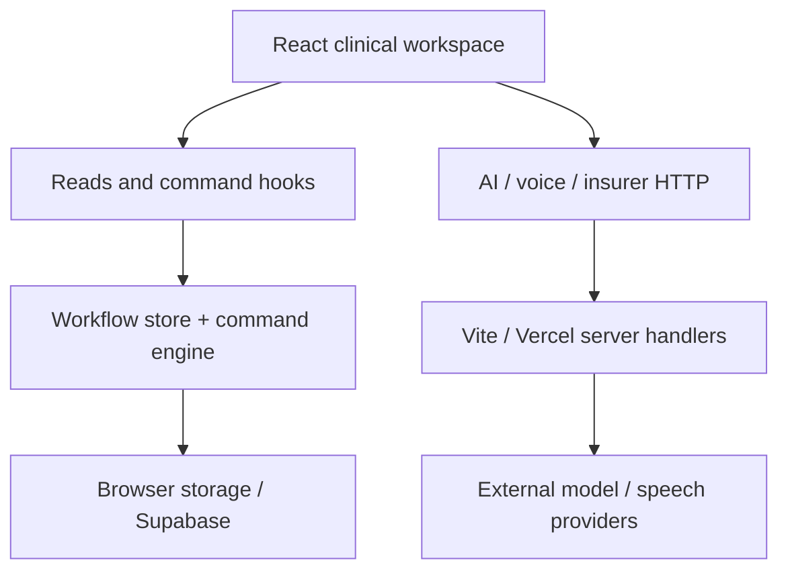

### 4.1 Startup and route separation

main.tsx initializes React, Ant Design, QueryClient and BrowserRouter. App.tsx installs the clinical shell and routes. AuthGate permits mock mode directly or waits for a Supabase session. WorkflowSync subscribes to workflow events and checks for changes while the page is visible.

The insurer route branch is selected separately before the clinical AuthGate. It represents an independent demonstration interface and needs its own trusted access model in a product. A protected clinical page does not automatically protect every HTTP endpoint or database grant.

### 4.2 Execution environments

Vite development supplies selected local API middleware. A static preview serves built frontend files without that middleware. Vercel can host the frontend and api entry points. These environments differ; copying dist to a static host does not deploy the server functions.

<!-- PAGEBREAK -->
## 5 Clinical Data Model

VDocs uses validated TypeScript records for patients, reports, longitudinal history and workflow entities. The complete workflow snapshot collects patients, histories, reports, discharges, handovers, reviews, command IDs and audit metadata. This conceptual model is larger than the set of independently normalized production tables currently maintained by workflow writes.

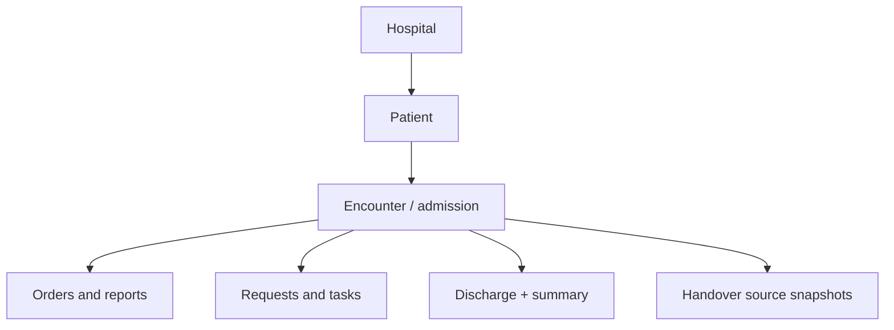

### 5.1 Identifiers and provenance

The internal patient UUID is distinct from the readable UHID. Hospital identifiers establish organizational scope, while encounter identifiers attach events to a visit or admission. Reports and notes carry source and timing metadata. Source identifiers allow a summary, chart view or handover entry to refer back to supporting records.

Entity versions protect edits to individual records. The snapshot revision protects a whole saved hospital state against overwriting a concurrent save. These are related but separate counters. A fresh snapshot can still contain an entity version different from the form the user opened.

### 5.2 History and active context

PatientHistory aggregates context, encounters, notes, observations, medications, orders, requests, work items, timeline and immunizations. The active encounter selects current operational work; historical records remain available as context. Product migrations must preserve these distinctions rather than collapsing each patient's history into one mutable text field.

<!-- PAGEBREAK -->
## 6 Command Processing and Workflow Rules

A clinical write is represented as a command such as order.place, request.update or discharge.summary.sign. Domain schemas validate the accepted shape. The engine then checks relevant patient scope, encounter conditions, record version and transition rules. A successful transition returns a new validated state and updates relevant timeline/audit metadata.

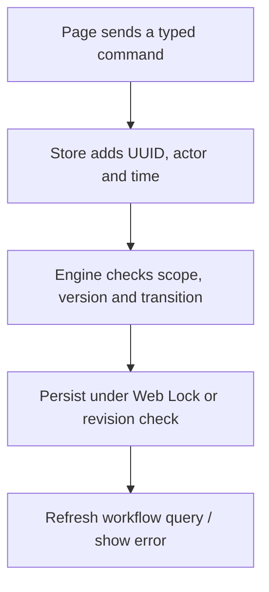

### 6.1 State-transition model

The operation can be described as:

```text
S_next = F(S_current, command)                  (1)
```

Here F is the validated transition function, not an AI model. Some commands are idempotent through stored command identifiers; demo seeding commands have specialized behavior. The exact command case and its tests determine the invariant that applies.

### 6.2 Boundaries of current validation

In the normal UI path, trusted clinical authorization is not fully enforced by a dedicated server: browser code constructs the next snapshot. Actor display names and some roles are client supplied. SQL revision and scope checks do not independently reproduce every clinical rule. Production must execute commands and derive actor permissions on a trusted backend [4].

<!-- PAGEBREAK -->
## 6.3 Persistence and Concurrent Saves

In mock mode, workflowStore reads browser localStorage or constructs the initial synthetic cohort. Browser Web Locks serialize clinical writes across same-origin tabs. The codec supports compressed snapshots and legacy data. Missing-patient merges, legacy discharge cleanup and synthetic read overlays can affect what the user sees before a new explicit command is saved.

In Supabase mode, the store reads demo_workflow_state for the configured demo hospital. When no snapshot exists, it loads normalized source tables, constructs an initial state and attempts installation. Subsequent clinical mutations usually change the snapshot rather than rewriting all normalized source rows.

The remote save uses an expected revision and a patch RPC, with a full-state fallback for the designated patch condition. A revision conflict causes rereading and bounded retry. The browser store attempts up to three times; the separate integration helper has its own five-attempt compare-and-swap loop.

```text
Commit permitted when expected_revision = stored_revision       (2)
```

An entity's expected_version adds a more specific edit check. A conflict should prompt review of the newer record instead of silently replacing another user's changes.

### 6.4 Synchronization and separate stores

WorkflowSync listens for custom/storage events and checks visible-page changes every five seconds. This is polling and cache invalidation, not a guaranteed real-time message stream. Query families such as workflow, workspace and history have different cache behavior.

| Record category | Current persistence boundary |
| --- | --- |
| Clinical workflow | Browser snapshot or shared Supabase snapshot |
| Hospital-side claims | Separate browser storage |
| Conversation, brief cache and scratch notes | Separate browser keys |
| Local insurer intake | Server filesystem |
| Hosted insurer intake | Demo Supabase insurer records/files |

Enabling Supabase clinical mode does not migrate every store into the database. This distinction is essential when diagnosing cross-device differences or planning a product data migration.

<!-- PAGEBREAK -->
## 7 Patient Workspace and Clinical Context

The patient workspace connects the directory to the current chart, historical encounters, reports, medications, observations, care requests and pending investigations. PatientPage.tsx combines clinical service queries with workflow state. PatientDirectoryTable supplies search, filters and encounter-focused views. Worklist selectors determine how patients in discharge processing differ from the normal clinical list.

### 7.1 Reading the chart

The clinical facade retrieves patient, history and reports from the workflow snapshot. Components render deterministic chart summaries, lab trends, report drawers, medication context and care-team information. Historical values remain labeled by their records and timing. A trend point can open its source report; a referenced report link can focus a particular result in the chart.

The AI brief is a separate component from the deterministic chart overview. A clinician should be able to inspect recorded data even when an external AI provider is missing or unavailable. The presence of an AI card does not make every screen interaction a paid inference.

### 7.2 Notes and ward rounds

The round.create command requires an active IPD encounter and records findings and a plan as a progress note. The chart displays ward-round notes, including authored synthetic overlays. The note.create command adds a clinical progress note for an active encounter.

Scratch notes saved through doctorNotesStore are browser-local and separate from workflow clinical notes. They have different sharing, persistence and provenance implications. A product should make unsaved or personal draft text distinguishable from centrally saved clinical documentation.

### 7.3 Updates and acknowledgements

doctorUpdates derives an inbox from workflow events. Read receipts are recorded by updates.read. Reading an inbox item does not automatically review a laboratory result or a completed specialist response. Those clinical acknowledgements have their own commands and affect discharge/handover independently.

The production read path should become tenant-authorized, encounter-scoped and paginated. It should preserve the UI's useful context while reducing the need to load a whole hospital snapshot into each browser.

<!-- PAGEBREAK -->
## 8 Investigation and Result Lifecycle

Investigation ordering separates the clinician's request from the source team's result and the clinician's subsequent review. Lab and imaging worklists share engine behavior, with kind-specific result requirements.

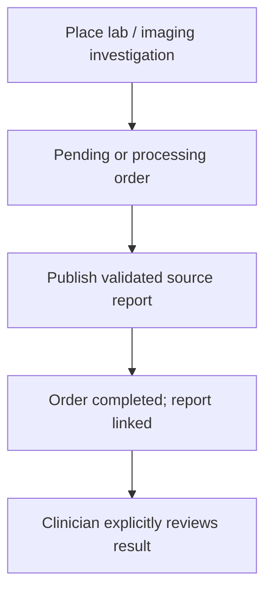

### 8.1 Placement and publication

order.place supports a basket with a shared batch identifier, indication and priority. It requires an active encounter, checks catalog matches, and rejects duplicate active investigation titles. Custom lab items need specimen information; custom imaging items need modality information. Integration paths can use the simpler order.create command.

An open order may be processed or cancelled with a reason. order.publish validates its version and collection/study time. Lab reports require observation values with unique test names. Successful publication links the report to the order and changes the order to completed.

### 8.2 Clinical review and integration boundary

report.review stores a reviewer and time separately from report publication. Unreviewed current-encounter results remain relevant to discharge blockers and shift handover. Imaging reports contain findings and study metadata, rather than a full diagnostic-image viewer.

The api/orders functions define source-portal listing, creation, walk-in and publication contracts. Ordinary Vite development does not mount these hosted functions automatically. Product adapters need authenticated source identities, patient/encounter mapping, duplicate protection and amended-result handling before the contracts become reliable external interfaces.

<!-- PAGEBREAK -->
## 9 Specialist Referral Lifecycle

A specialist referral asks another clinician or department to assess a patient and return a documented opinion. VDocs represents it as a request record with kind referral. Creating one does not automatically transfer the admission or replace the primary clinical department.

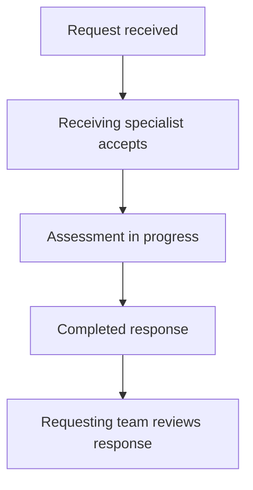

### 9.1 Creation and ownership

The shared creation form captures patient, destination, owner, reason, priority and supporting reports. request.create requires an active encounter and a supported destination different from the primary department. Attached reports must belong to the patient. An identical open request for the same encounter, kind, destination and reason is rejected.

CoordinationPage is configured for the referral route, while referralViews computes incoming/outgoing and date scope. Doctor selection and the pinned default are view preferences, not backend permissions. RequestDetail presents the question, context, assignment, attached reports and response form.

### 9.2 Response and review

request.update enforces progression through received, accepted, in_progress and completed. Completion needs a response; cancellation needs a reason. Saving a draft or assignment need not advance status. request.review records explicit review of a completed response.

An open referral or an unreviewed completed response can block discharge. The same records contribute to care context and shift sources. Product implementation should verify sender/receiver identities, retain assignment and response amendments, and define delivery/escalation responsibilities rather than relying on a refreshed worklist alone.

<!-- PAGEBREAK -->
## 10 Care Coordination and Task Management

Care coordination records a focused collaboration request: answer a question, perform an action, or clarify a patient's plan. Specialist referrals and coordination share the request engine, but their purpose differs. Coordination uses kind request; referral uses kind referral.

### 10.1 Shared request mechanism

CareCoordinationCard summarizes patient requests and pending work items, and provides an add-request entry point. The department worklist is the requests route. A record begins as received, can be accepted and moved into progress, and must contain a response before completion. A completed response remains separately reviewable by the requesting team.

The shared command schema also accepts optional purpose and callback/contact context. These fields help the receiving team understand the requested collaboration. They do not expand the configured destination model by themselves: current validation still restricts destinations to configured departments and rejects the patient's primary department.

### 10.2 Requests are not generic task checkboxes

| Record | Meaning | Completion mechanism |
| --- | --- | --- |
| Referral | Specialist consultation | Request lifecycle and final response |
| Coordination request | Specific departmental collaboration | Request lifecycle and action response |
| Work item | A separate task or review obligation | work.complete, when permitted |
| Discharge process | Readiness and encounter completion | Dedicated discharge checklist and commands |

work.complete cannot finish a discharge work item through a shortcut. Likewise, completing a task does not review a result or acknowledge a specialist response. Each action represents a different clinical fact.

### 10.3 Cross-workflow effects

Outstanding collaboration is carried into patient context, handover and discharge checks. A future product should introduce stable team identifiers, clear ownership and due times, response amendment history and durable notification delivery. Adding a nursing, pharmacy or finance destination requires deliberate changes to the product contracts and authorization policy, not only a new dropdown label.

<!-- PAGEBREAK -->
## 11 Discharge Planning and Completion

Discharge is an explicit process for an active IPD encounter. It begins when a patient is added to the discharge working list. It is not synonymous with a finished task, payer approval or receipt of money.

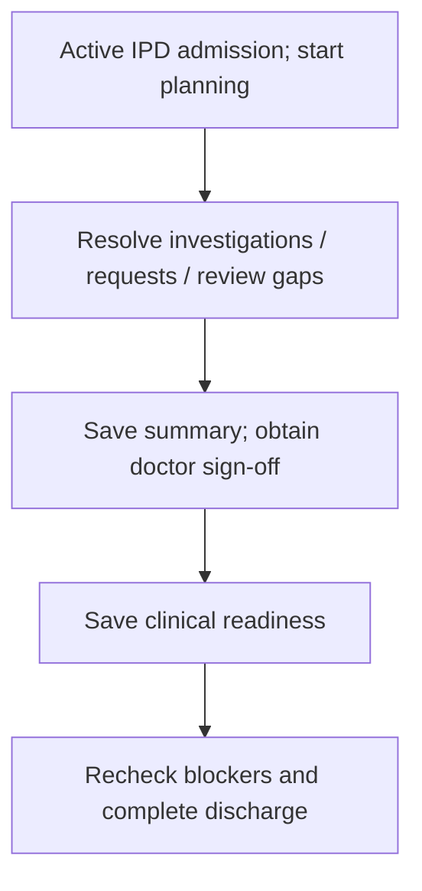

### 11.1 Readiness conditions

discharge.create requires an active IPD admission and rejects a duplicate non-cancelled process for that encounter. The engine's blocker function checks pending investigations, open requests, unreviewed reports, completed-but-unreviewed responses, pending review tasks, clinical clearance and its rationale, summary text, medication reconciliation, follow-up and document checks.

The intended lifecycle is planned, in_progress, ready and discharged, with cancelled as a closed alternative. The engine's strict completion gate is previous ready status, a signed summary document and no remaining blockers. Not every preceding adjacent step is separately required in all update cases.

### 11.2 Completion effects

Completion timestamps the discharge, completes the associated encounter, changes the patient's encounter display and completes relevant discharge work items. It also writes a discharge note. A new result or request introduced after readiness can block final completion, so ready is not a permanent exemption from current checks.

Claims and payment do not appear as automatic gates in the current clinical blocker function. Any hospital-specific financial/discharge policy must be scoped and implemented explicitly rather than inferred from the demo.

<!-- PAGEBREAK -->
## 11.3 Summary Documents, Sign-off and Reversal

The structured summary editor separates chart-based preparation from final clinical approval. dischargeSummaryBuilder builds patient information, diagnoses, history, investigations, course, procedures, condition, medications, advice, warning signs and follow-up from available chart records. Individual sections can be reset from the chart while preserving other reviewed edits.

### 11.4 Saving and signing

discharge.summary.save stores the structured document and its rendered plain text. Any save clears an existing signature and returns the document to draft. The final wording must therefore be signed again after editing. This avoids presenting modified text as though it retained the earlier sign-off.

The sign command requires a supplied doctor role, a saved summary and no missing required document fields. It stores supplied actor and credential information, then updates document metadata. This is useful demonstration behavior, but it does not independently verify professional identity or provide a legally qualified digital-signature service.

PDF preview, download and printing use dischargeSummaryPdf in the browser. A product should bind a signed artifact to the exact approved document version and checksum, rather than regenerate an old signed record from later-changing chart data.

### 11.5 Controlled reopening

discharge.reopen applies only to a completed discharge, with matching version, no other active encounter and eligibility as the latest admission. It reactivates that encounter, cancels the old discharge record and records a reversal note with its reason. Historical discharge information is not simply erased.

Product implementation needs trusted signatory authorization, immutable approved versions, amendment policy and transactional completion/reversal. The clinical team must define who may reverse a completed discharge and which downstream systems must receive that correction. The current TypeScript workflow is the behavior reference, not the final production trust boundary.

<!-- PAGEBREAK -->
## 12 Shift Handover Architecture

A shift handover carries patient context and unfinished work from an outgoing clinician to an incoming clinician. The main screen groups per-patient records under a shift identifier. A legacy individual-handover view remains accessible inside the same feature.

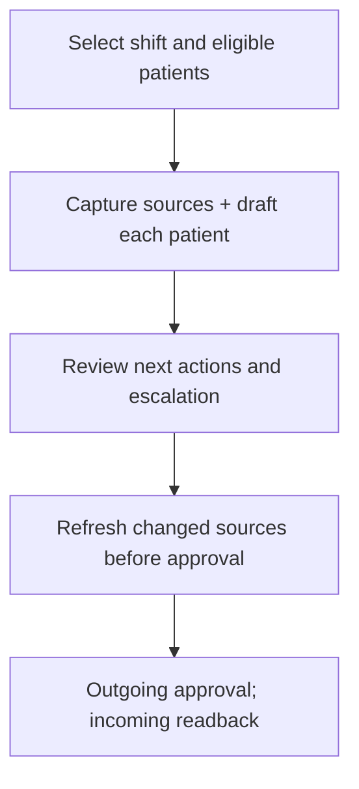

### 12.1 Source capture and draft preparation

shift.create validates a started shift no longer than 24 hours and eligible distinct patients with active IPD encounters. captureShift collects encounter context, notes, orders, reports, requests, medications, vitals, pending tasks and discharge-process records. It distinguishes events in the selected shift from relevant carried-forward work.

Draft sections summarize situation, background, recent events, completed actions, pending items and next actions. Manual doctor/nurse entries retain their supplied authorship. The draft is deterministic source-based preparation, not a claim of autonomous AI clinical interpretation.

### 12.2 Freshness, approval and receipt

Refreshing retains manual entries but recaptures chart sources and clears review flags. Approval checks expected revision, outgoing actor, ended shift, unchanged sources, patient review, next actions and escalation instructions. The named incoming actor acknowledges an approved packet with readback.

Production should preserve source versions and approved packet artifacts, verify identities and deliver escalation/acknowledgement reliably. It must define the operational meaning of receipt without assuming that reading a packet automatically transfers every clinical responsibility.

<!-- PAGEBREAK -->
## 13 Claims and the Synthetic Insurer

The claims demonstration has two sides: the hospital worklist and a separate fictional insurer portal. Hospital claims remain browser-persisted even when the clinical snapshot uses Supabase. Insurer packets and files use a local filesystem backend in development or demo Supabase tables in the hosted implementation.

### 13.1 Packet lifecycle

The hospital prepares a claim, resolves missing documents, checks fields and attachments, and submits a packet. claimsExport renders PDFs, computes checksums and sends the request to the insurer API. The insurer validates required data, file headers, byte counts, sizes and hashes before issuing a receipt reference.

A query introduces supporting response preparation and review. Subsequent authorisation, settlement, remittance and reconciliation are synthetic scenario events. Clinical discharge, payer authorisation and payment received remain separate facts.

| Stage | Meaning |
| --- | --- |
| Preparation and review | Staff assemble and inspect the proposed packet |
| Submission receipt | The fictional insurer accepted a packet for processing |
| Query and response | Supporting evidence is requested and returned |
| Authorisation | A synthetic payer decision, not a bank receipt |
| Reconciliation | Demo accounts compare bill, liability, authorisation and payment |

### 13.2 Consistency and product migration

Remote submission and local claim saving are separate operations. Likewise, some events save locally before mirroring to the insurer, and a failed mirror produces a warning. Existing duplicate detection is useful but does not supply fully transactional idempotency under concurrent requests.

A product needs centrally persisted claims, frozen submitted packet versions, payer receipts and message history, authenticated callbacks, durable delivery and finance reconciliation. Store document bytes privately with metadata and checksums in the database. The mock insurer must remain clearly separated from actual payer adapters and verified remittances.

<!-- PAGEBREAK -->
## 14 AI Assistance and Evidence Handling

Chart AI provides optional patient briefs and question answering. The browser service sends the configured endpoint patient, history, report and conversation context. Reusable Node handlers construct prompts and call the selected Anthropic, OpenAI or Gemini adapter using server-side credentials.

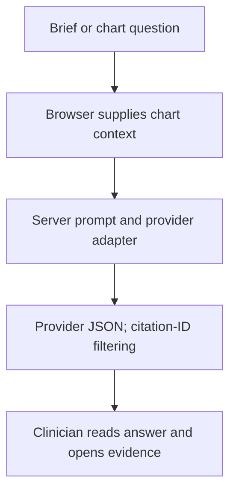

### 14.1 Output handling

The prompt requests record-grounded JSON output. The handler parses the response and filters citations whose record type or ID is absent from the supplied context. The interface can open evidence records and separately stores conversation/brief caches in browser storage.

```text
valid_citation = known_type AND record_id_in_supplied_context     (3)
```

This membership test does not establish that a sentence is supported by its cited record, or that the supplied chart was authorized and complete. The top-level answer and summary are not fully clinically fact-checked by citation filtering. They require user review and dedicated evaluation.

### 14.2 Product boundary

The production API should retrieve permitted context from authoritative records and call an internal AI service. Record source versions, model/prompt configuration, generation metadata and validation outcome. Do not let generated language execute workflow commands or change a signed record without an explicit authorized user action.

<!-- PAGEBREAK -->
## 14.3 Voice Input and Conservative Cleanup

Voice input is a text-entry aid rather than an automatic chart write. The app supports short push-to-talk recording and live streaming, then a conservative cleanup stage and user-controlled insertion into the form.

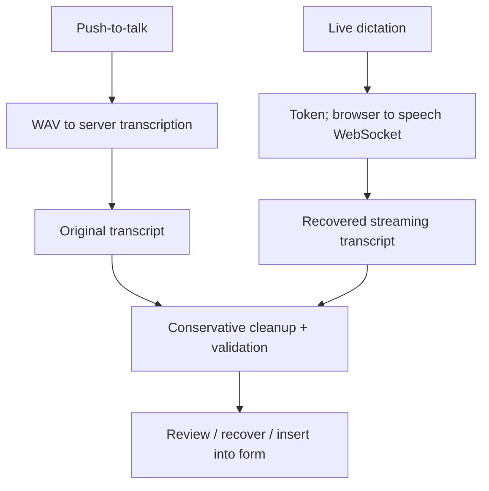

### 14.4 Capture and recovery

Push-to-talk records microphone audio, converts it to WAV and sends it to the server's AssemblyAI Sync transcription path. Live capture requests a temporary token and streams PCM directly from the browser to the speech provider. Disconnect handling attempts to return recovered text with an incompleteness warning.

Cleanup uses Gemini and shared validation checks intended to preserve medication terms, numbers, units, negation and uncertainty. A missing key, timeout, failed request or rejected cleanup retains original dictation. The field hook avoids overwriting a field that changed while processing, offers original-text recovery and supports undoing cleanup under its state checks.

These protections do not prove perfect recognition or semantic preservation. Production needs bounded sessions, access/usage controls, approved provider routing and evaluations with clinically representative speech. User review remains part of the save workflow.

<!-- PAGEBREAK -->
## 15 Security, Identity and Audit Boundaries

Security for a shared hospital product requires a trusted boundary around each patient and action. The present implementation has an optional Supabase login, membership-related database policies and typed validation, but it also retains deliberate demonstration shortcuts.

### 15.1 Current boundaries to address

- Normal browser commands calculate the next clinical state on the client.
- Supplied actor names and demo author/role selection are not stable verified identities.
- Some integration helpers use a fixed hospital/project and a service-role client.
- An anonymous-read migration grants selected fixed-hospital demo reads if applied.
- AI, speech and insurer wrappers lack a complete shared authorization/quota layer.
- Audit entries and sign-off metadata are part of an editable demo snapshot.

CORS rules restrict certain browser requests; they do not authenticate a source system or prevent a direct HTTP caller. Similarly, a frontend AuthGate cannot revoke database grants or authorize every server function.

### 15.2 Required production request context

The backend must verify the access token and resolve stable user identity, hospital membership and applicable action permission. It must then verify that every target patient, encounter, document and related record belongs to the permitted scope. Server time and actor identity should be derived on the backend.

```text
allow = verified_identity AND membership AND permission AND scope (4)
```

Maintain append-only audit records under restricted write paths, together with versioned document provenance and controlled access logs. Avoid default logging of charts, audio, provider credentials or raw prompts. Hospital isolation must apply to caches, jobs and AI retrieval as well as ordinary SQL queries.

The current SQL and client tests are useful evidence of intended behavior. They are not a substitute for deployed policy testing, identity validation or a security review of the actual runtime [5].

<!-- PAGEBREAK -->
## 16 Validation Strategy and Available Evidence

The repository contains meaningful tests for clinical transitions, ordering, discharge documents, handovers, worklists, referral views, persistence-related behavior, claims and insurer intake. TypeScript and Zod also catch contract errors at different boundaries. These mechanisms support development confidence, but their scope must be stated accurately.

### 16.1 Evidence categories

| Evidence | What it can establish | What it cannot establish alone |
| --- | --- | --- |
| Type checking | Accepted static code contracts | Correct clinical policy or runtime authorization |
| Unit tests | Behavior of exercised rules and fixtures | Live database/RLS correctness or real provider quality |
| Build | Frontend/server code compiles as configured | A complete product deployment or uptime guarantee |
| Browser smoke tests | Selected synthetic UI journeys | End-to-end correctness of every external integration |
| AI/voice evaluation | Measured performance on reviewed cases | Universal safety or accuracy on unseen clinical inputs |

### 16.2 Production evaluation plan

Test complete patient journeys: order to report review; referral to response review; discharge preparation, signing and completion; shift approval and acknowledgement; claim receipt and reconciliation. Add cross-hospital and role-denial cases, duplicate requests, concurrent saves, partial integration failure, migration rehearsal and backup restoration.

For AI, measure unsupported statements, citation support, current-versus-historical confusion, omission of important pending work and prompt-injection resistance. For voice, measure medication, number, unit and negation preservation, noisy input and interrupted-session recovery. Record model/prompt versions and reviewed test cases.

### 16.3 Reporting results honestly

This report does not report a new test run, clinical trial, model-accuracy percentage, capacity benchmark or production availability measurement. Existing test files establish test coverage intentions; a release record must capture the checks actually executed for that release. Synthetic demonstration success should not be presented as evidence of clinical effectiveness.

<!-- PAGEBREAK -->
## 17 Proposed Production Architecture

The production direction preserves the React interface and reusable clinical rules while moving trusted state changes to a dedicated backend. A modular clinical API should initially own related features that share transactional patient facts. An internal AI service and a worker can have separate runtime boundaries without immediately creating a microservice for every clinical feature.

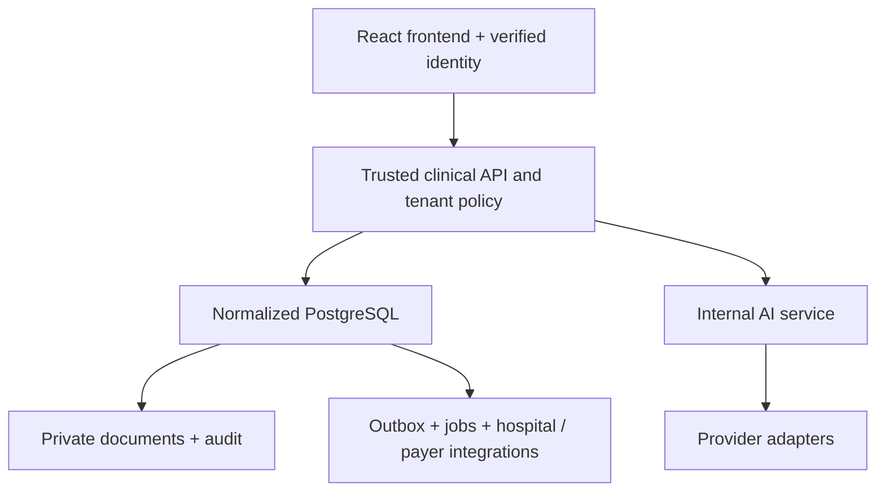

### 17.1 Trusted transactions and documents

For a command, the backend loads current scoped records, validates permission and transition, writes normalized changes, records audit/idempotency and inserts any outbox event in one database transaction. Record versions protect edits, while idempotency keys bind repeated client requests to the same result.

An outbox relay publishes committed integration work. Workers deduplicate and retry, preserving remote receipts and surfacing persistent failures. External payer calls do not become atomic SQL operations simply because a queue is present [8].

### 17.2 Deployment choices

A fuller AWS design uses a static frontend, containerized API/AI/worker, managed PostgreSQL, private object storage, queues and monitoring. The lean alternative on the next page shares a single runtime host. Both require trusted authorization and correct data ownership; infrastructure price does not remove those engineering obligations.

<!-- PAGEBREAK -->
## 17.3 Lean Shared Deployment for Five Hospitals

For an initial controlled pilot, one Lightsail server can host HTTPS, the React build, backend API, small jobs, AI gateway and PostgreSQL, with documents and database backups in private S3 storage. Hospital records share infrastructure while access remains isolated by verified membership and tenant scope.

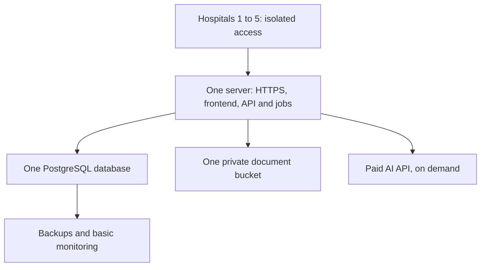

The dated planning estimate uses an 8-GB/2-vCPU server, modest on-demand AI, limited retained documents and a 20% buffer. For sites with 50 beds and 100 daily OPD visits each, the calculated monthly technology budgets are approximately:

| Shared hospitals | Total USD / INR | Per-hospital USD / INR |
| --- | --- | --- |
| Three | 122.11 / 11,603 | 40.70 / 3,868 |
| Four | 139.75 / 13,279 | 34.94 / 3,320 |
| Five | 157.39 / 14,955 | 31.48 / 2,991 |

These are assumptions from the dated cost guide [3], not current vendor quotes or capacity results. Taxes, implementation, payroll and human operating support are additional. All hospitals can be interrupted by a single-host failure; backups do not provide automatic high availability. Benchmark representative staff concurrency and restore behavior before expansion. The current demo still needs the backend and tenant-isolation implementation before this becomes a live product design.

<!-- PAGEBREAK -->
## 18 Implementation and Migration Strategy

Production migration should follow bounded vertical slices rather than rewriting every screen and integration simultaneously. Retain useful tested behavior while replacing its trust and persistence boundaries. Each slice needs one authoritative writer to avoid conflicting browser and backend records.

### 18.1 Sequence of implementation

- Establish current contracts, workflows, synthetic fixtures and reproducible checks.
- Introduce a dedicated API process with configuration validation, token verification, hospital policy, health endpoints and structured errors.
- Build one normalized patient/investigation slice and switch the frontend facade to it.
- Move requests, discharge, summaries and handovers to trusted transactional commands.
- Centralize claims, documents, receipts and durable integration delivery.
- Isolate provider execution, authorized context retrieval and AI/voice evaluations.
- Rehearse staging release, migration, restore and rollback before a controlled pilot.

### 18.2 Data and identity cutover

Map existing identities and record IDs, checkpoint writes, export versioned data, import idempotently, reconcile counts and relationships, and verify complete patient journeys before switching a feature. Browser claims, scratch notes and conversations need a per-device export/import decision; migrating Supabase alone cannot recover them.

The present dataset is synthetic, so a fresh product database may be appropriate after preserving the demonstration. If real data is later introduced, cutover and retention must follow the approved operational policy. Old frontend versions must not resume writing obsolete snapshots over authoritative new records.

### 18.3 Release and recovery

Publish compatible database changes before dependent application releases. Record commit, artifact versions, migration state and executed validation. A rollback plan must account for writes made after cutover; restoring yesterday's application image does not automatically undo a database migration or remote payer submission.

The first useful milestone is a securely scoped, centrally persisted clinical flow with measured failure handling. Adding orchestration infrastructure before establishing that behavior would not by itself make the product production-ready.

<!-- PAGEBREAK -->
## 19 Discussion, Limitations and Future Work

### 19.1 What the current design contributes

VDocs makes workflow dependencies explicit: result publication differs from review, response completion differs from acknowledgement, summary preparation differs from signing, and payer decisions differ from clinical discharge. Typed commands make these relationships inspectable, while the patient workspace keeps them connected to encounter context and source evidence.

The synthetic environment supports repeatable development and demonstrations. Separating deterministic preparation from provider-backed AI also permits useful workflows when model access is unavailable. These are architectural properties, not demonstrated clinical outcomes.

### 19.2 Present limitations

The hospital snapshot creates broad reads and a large concurrency boundary. Browser-side transition calculation and supplied actor/role values are insufficient for trusted product authorization. Separate browser, snapshot and insurer stores do not provide a single transactional clinical/financial record. Audit arrays and demo sign-off metadata are not immutable signed clinical archives.

External source/payer behavior remains synthetic or contract-level. AI citation membership does not prove factual grounding, and transcript cleanup does not prove preserved meaning. Current documentation and tests do not establish deployed RLS correctness, hospital-system compatibility, model quality, restoration targets or five-hospital capacity.

### 19.3 Future work

Priorities are backend-owned authorization, normalized transactional data, stable professional identity, source/result versioning, signed artifact integrity, durable integration delivery and hospital-specific clinical acceptance. AI improvements should focus on authorized context, provenance, measured grounding and graceful failure rather than expanding autonomous actions.

Operational work includes patching, dependency management, incident escalation, backup restoration, real workload measurement and cost controls. A shared pilot can reduce fixed expenditure, but its recovery and support commitments must match the service actually delivered. Future high-availability deployment should follow measured requirements and an agreed hospital operating model.

<!-- PAGEBREAK -->
## 20 Conclusion and References

VDocs is a patient-centered workflow application with explicit clinical commands, linked longitudinal records and human-reviewed AI assistance. Its current implementation demonstrates the relationships between investigations, referrals, coordination, discharge, handover and claims while exposing the persistence and trust limitations that must be addressed for a product.

The recommended evolution keeps the useful interface and business rules, moves authoritative commands to the backend, isolates hospital access, versions clinical artifacts and makes external delivery recoverable. A lean shared deployment is a practical pilot option when its capacity and failure tradeoffs are measured and accepted. Reliable clinical operation depends on those validated boundaries, not on the presence of an AI model or a particular cloud service.

### References

[1] [VDocs source repository](https://github.com/ctovdocs/vdocs-ai), reviewed baseline 7dd2f79, 19 October 2026. Source review is not deployed-environment verification.

[2] [VDocs developer handbook](https://github.com/ctovdocs/vdocs-ai/blob/main/docs/developer/README.md): architecture, file inventory, data storage and separate workflow guides.

[3] [Minimum shared deployment estimate](https://github.com/ctovdocs/vdocs-ai/blob/main/docs/developer/MINIMUM_SHARED_COST.md): dated assumptions and source prices; not a capacity guarantee.

[4] [Workflow command implementation](https://github.com/ctovdocs/vdocs-ai/blob/main/src/services/workflowEngine.ts) and [snapshot persistence implementation](https://github.com/ctovdocs/vdocs-ai/blob/main/src/services/workflowStore.ts).

[5] [Supabase row-level security documentation](https://supabase.com/docs/guides/database/postgres/row-level-security): grants, policies and database access boundaries.

[6] [Patient AI handler](https://github.com/ctovdocs/vdocs-ai/blob/main/server/patientAi.ts) and [voice cleanup handler](https://github.com/ctovdocs/vdocs-ai/blob/main/server/voiceCleanup.ts).

[7] [Production implementation roadmap](https://github.com/ctovdocs/vdocs-ai/blob/main/docs/developer/PRODUCTION_ROADMAP.md) and [AWS deployment guide](https://github.com/ctovdocs/vdocs-ai/blob/main/docs/developer/AWS_DEPLOYMENT.md).

[8] [AWS transactional outbox guidance](https://docs.aws.amazon.com/prescriptive-guidance/latest/cloud-design-patterns/transactional-outbox.html): database/event delivery consistency and idempotent consumers.

**Document basis:** academic presentation adapted from the supplied AI-AVC-5.pdf. Its speech-model architecture, experiments and performance claims are not evidence about VDocs and have not been transferred into this report.
