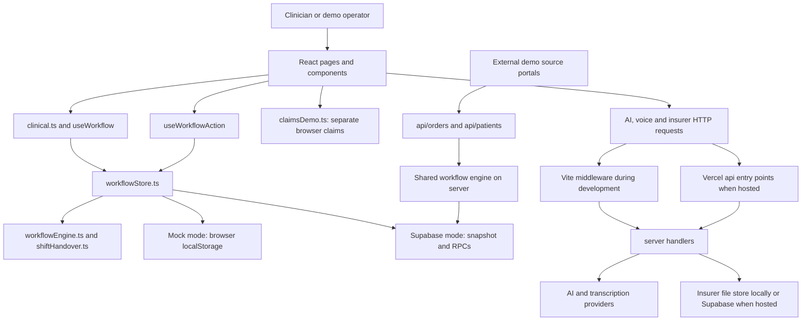
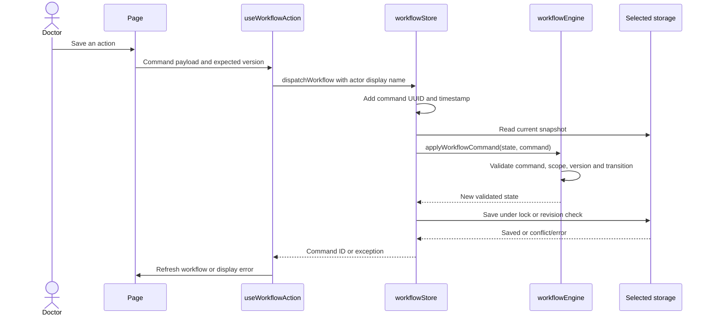

# Current architecture

[Handbook index](README.md) · [File map](FOLDERS_AND_FILES.md) · [Future architecture](PRODUCTION_ROADMAP.md)

## 1. The application in one picture

The current repository is one Vite/React project, with Vercel API entry points and reusable Node server handlers. It is not yet split into separately deployed frontend, clinical backend, and AI services.

The arrows show supported code paths. They do not establish that any external portal or hosted service is currently connected.

## 2. Startup and routing

1. [`index.html`](../../index.html) loads [`src/main.tsx`](../../src/main.tsx).
2. `main.tsx` installs the Ant Design theme, TanStack Query cache, React Router, and application styles.
3. [`App.tsx`](../../src/app/App.tsx) chooses the route and mounts the application shell.
4. [`AuthGate.tsx`](../../src/app/AuthGate.tsx) allows the mock experience directly. In Supabase mode it waits for a session or shows login.
5. The shell mounts the sidebar, doctor header, [`WorkflowSync`](../../src/app/WorkflowSync.tsx), and current page.

The `/insurer/*` branch renders separately, before the clinical `AuthGate` and voice provider. That is current demo behavior, not a complete insurer authentication boundary.

| Route | Screen / purpose |
| --- | --- |
| `/`, `/app` | Redirect to / display dashboard |
| `/app/patients` | Patient directory |
| `/app/patients/:patientId` | Patient chart and workspace |
| `/app/opd`, `/app/rounds` | Directory filtered to OPD or IPD |
| `/app/schedule` | Synthetic weekly roster |
| `/app/updates` | Doctor's derived update inbox |
| `/app/discharges` | Discharge worklist and closed records |
| `/app/discharges/:id/summary` | Structured discharge summary editor |
| `/app/referrals` | Specialist consultation worklist |
| `/app/requests` | Department coordination worklist |
| `/app/lab-orders`, `/app/imaging-orders` | Investigation worklists |
| `/app/results` | Published investigation results awaiting review |
| `/app/handovers` | Shift packets, archives, and legacy individual handovers |
| `/app/claims` | Hospital claims worklist |
| `/insurer/*` | Separate synthetic insurer portal |

## 3. Layers and responsibilities

| Layer | Responsibility | Important boundary |
| --- | --- | --- |
| `pages/` | Compose screens, filters, query state, and feature actions | Do not put a new persistence mechanism in a page |
| `components/` | Shared forms, drawers, tables, evidence viewers, and chart cards | A disabled button alone does not enforce a workflow rule |
| `domain/` | Zod schemas, types, commands, and structured document contracts | These describe records; they do not authenticate callers |
| `services/` | Reads, commands, transition rules, derived views, PDF/export logic | Some services use browser APIs; the folder is not a dedicated backend |
| `adapters/` | Earlier fixture / normalized Supabase repository implementations | Main active clinical reads use `workflowStore`, not these repositories |
| `data/` | Authored synthetic scenarios, catalogs, and demo seed builders | Demo seeding must not become production behavior |
| `lib/`, `hooks/` | Browser storage, environment, formatting, recording, shared helpers | Several helpers require `window`, storage, or media APIs |
| `api/` | Hosted Vercel HTTP entry points and privileged integration helpers | Separate from the Vite development middleware |
| `server/` | Node handlers and provider / insurer implementations | Reusable server code, not a standalone running HTTP service |
| `supabase/` | Database migrations and local Supabase configuration | Hosted application of these migrations is not proven by their existence |

## 4. A typical read

For a patient chart, `PatientPage.tsx` calls `patientService`, `labService`, and `imagingService` from `clinical.ts`. Those services read the workflow snapshot and select the requested records. Other screens use `useWorkflow()` directly and calculate their worklist from the same snapshot.

TanStack Query caches the results. Important query families include `workflow`, `workspace`, `history`, `activeDoctor`, and `claims-demo`. `WorkflowSync` explicitly invalidates `workflow`; other queries follow their own query settings and component behavior. If a chart stays stale while a worklist updates, inspect the actual query keys and invalidation before assuming that every cached view refreshed together.

## 5. A typical clinical write

Most clinical transitions are in [`workflowEngine.ts`](../../src/services/workflowEngine.ts). Multi-patient shift transitions delegate to [`shiftHandover.ts`](../../src/services/shiftHandover.ts). The engine also records timeline and audit entries for supported actions. See [persistence](DATA_AND_PERSISTENCE.md) for conflict behavior and exceptions.

**Current trust limitation:** the normal browser path constructs and validates the next clinical snapshot in the browser. Supabase RPCs enforce their SQL checks and revision handling, but do not reproduce every clinical transition rule on a trusted server. Actor names and some roles come from client state. This is one of the main production migration tasks.

## 6. Three execution environments

| Environment | What it runs | What it does not automatically run |
| --- | --- | --- |
| `npm run dev` | Vite frontend plus middleware for AI, voice, and insurer | The separate `api/orders/*` and `api/patients/*` Vercel functions |
| `npm run build` then `npm run preview` | Built static frontend | Vite development middleware or hosted Vercel functions |
| Vercel deployment | Built frontend and `api/*` serverless entry points | A dedicated backend process or an AWS service |

[`vite.config.ts`](../../vite.config.ts) registers local middleware. [`vercel.json`](../../vercel.json) rewrites SPA deep links and insurer subpaths. Copying `dist/` to S3 would only publish the frontend; it would not deploy those APIs.

## 7. Separate stores are intentional facts of the current demo

Clinical state, hospital-side claims, chat, scratch notes, voice preferences, and insurer receipts do not all share one transaction or database. Enabling Supabase clinical mode does not move every browser record into Supabase. Read the [storage inventory](DATA_AND_PERSISTENCE.md) before investigating a missing record or proposing a migration.

## 8. Present versus future

The current code is a useful workflow reference and synthetic demonstration. The [production roadmap](PRODUCTION_ROADMAP.md) explains how to retain its UI and business rules while moving trusted writes to a dedicated backend, isolating AI execution, normalizing persistent data, and deploying on AWS. None of those proposed services, containers, or infrastructure definitions exist yet.
