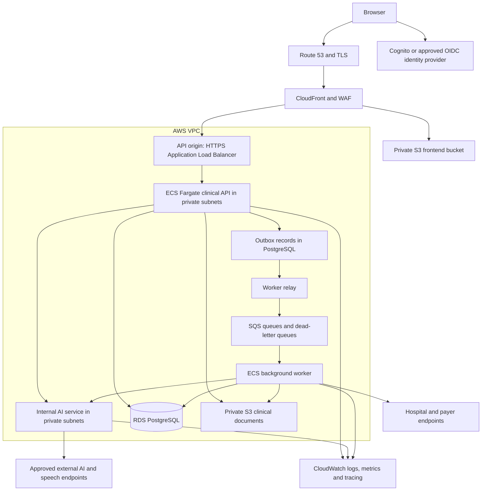
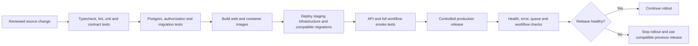

# AWS deployment and operations guide

[Handbook index](README.md) · [Production implementation roadmap](PRODUCTION_ROADMAP.md)

**Status:** proposed target and implementation instructions. This repository currently has no complete AWS deployment definition, product backend container, AI service container, worker, or production migration pipeline. The commands and resource names below describe what to implement, not infrastructure already available to run.

For researched prices and hospital-size budgets, see the [deployment and business cost estimate](COST_ESTIMATE.md). It prices an Amplify Hosting frontend variant of this design and includes an editable USD/INR calculator.

## 1. Target deployment

Use a static frontend behind CloudFront, a clinical API on ECS Fargate, a private AI service, a background worker, RDS PostgreSQL, and private S3 document storage. Keep the initial clinical backend modular and deploy AI separately. This fits the existing React/TypeScript code without requiring Kubernetes.

The S3/SQS boxes are managed-service access from the VPC, not services deployed into its subnets. Use appropriate VPC endpoints or controlled outbound networking. The private AI service should have service discovery/internal routing and authenticated service calls.

AWS documents Fargate as an ECS container runtime where the team defines CPU/memory, networking and IAM without managing EC2 server fleets. See [ECS Fargate](https://docs.aws.amazon.com/AmazonECS/latest/developerguide/AWS_Fargate.html). This is a deployment recommendation for this application, not a required AWS architecture.

## 2. Resource responsibilities

In the names below, ECS means Elastic Container Service, ECR means Elastic Container Registry, RDS means Relational Database Service, ALB means Application Load Balancer, SQS means Simple Queue Service, IAM means Identity and Access Management, and KMS means Key Management Service. A VPC is the application's private AWS network. Infrastructure as code (IaC) means versioned definitions used to create these resources consistently.

| Resource | What it does for VDocs |
| --- | --- |
| Route 53 / ACM | Product DNS and managed TLS certificates |
| CloudFront | Deliver versioned frontend assets and route `/api/*` to API origin |
| WAF | Edge request filtering/rate controls; application authorization remains in the backend |
| Private S3 web bucket | Store static `apps/web` build output only |
| ALB | HTTPS API origin, target health checks and traffic routing |
| ECS Fargate API service | Clinical authenticated reads/writes and product API |
| ECS Fargate AI service | Internal provider gateway, generation tasks and speech-related server functions |
| ECS worker service | Queue processing, integrations, PDFs and notifications |
| ECR | Store immutable images for API, AI and worker |
| RDS PostgreSQL | Normalized authoritative product records, audit/idempotency/outbox |
| Private S3 document bucket | Versioned PDFs, approved attachments, and other controlled artifacts |
| SQS / dead-letter queues | Durable asynchronous work and failed-job inspection |
| Secrets Manager / KMS / IAM | Server secrets, encryption keys and least-privilege service identities |
| CloudWatch and tracing | Logs, latency/error metrics, alarms and request correlation |
| Infrastructure as code | Recreate reviewed environment resources and policies |

Redis, a search cluster, a vector database, and Kubernetes are not prerequisites. Add them only when measured needs justify their operation. Initial patient search can use suitable PostgreSQL queries/indexes; initial AI can use explicit authorized chart context.

## 3. Environments and region

Create isolated development, staging, and production environments, preferably with separate AWS accounts for production. Use different databases, buckets, identity configuration, secrets, domains, and queues. Make the environment/account/region explicit in every pipeline.

Choose the AWS region with the hospital's data-location requirements, service availability, provider routes, latency, and recovery needs. Mumbai may be a candidate for an India-based deployment; it is not an automatic compliance decision. Decide whether CloudFront may handle only public frontend assets or also sensitive API traffic. If API processing at global edges is outside the approved data boundary, use a regional API hostname and controlled CORS instead of the same-origin API behavior.

Record operational owners, budget/cost alerts, backup policy, recovery targets, and environment access before a pilot. No fixed monthly cost is given here; RDS, load balancing, private egress/NAT, logs, model usage, and high-availability capacity all depend on workload and region.

## 4. Build infrastructure in this order

1. Set up account access, IaC state/locking, environment parameters, and deployment roles.
2. Create VPC networking across at least two availability zones, subnets, security groups, and necessary egress/endpoints.
3. Create encryption keys, secrets containers, private buckets, database/subnet groups, queues/dead-letter queues, and ECR repositories.
4. Create RDS PostgreSQL, restricted database users, migration role, backup settings, and monitored connection limits.
5. Create ECS cluster, task roles, log groups, service discovery/internal routing, task definitions, API load balancer, and health checks.
6. Create identity provider integration, DNS/TLS, CloudFront origins/behaviors, S3 access policy, and WAF rules.
7. Add alarms, dashboards, CI deployment trust, deployment controls, and restore/runbook resources.
8. Deploy synthetic staging, run smoke/recovery checks, and only then repeat the reviewed configuration for production.

Use one IaC tool, such as Terraform, with reviewed modules for networking, data, compute, edge, and observability. Keep infrastructure secrets out of checked-in state/config; protect remote state access. Avoid one-off console changes that cannot be reproduced.

## 5. Network and access boundaries

Allow RDS connections only from approved API/worker tasks and the restricted migration job. Give AI only the database access it truly needs; preferably the clinical API provides authorized context and owns result persistence. Keep document buckets private. Give each task its own IAM role and allow only needed secret, queue, bucket-prefix, and encryption actions.

Tasks in private subnets need deliberate outbound access to external AI/payer services. Consider egress cost, DNS, timeouts, and the effect of provider failure. Do not make PostgreSQL public simply to let CI run migrations; run a one-off migration task within the VPC.

If using a public ALB origin for CloudFront, restrict origin access using supported network controls and an origin-verification mechanism so requests cannot bypass intended edge controls. Application token verification still runs regardless of the entry path.

## 6. Frontend hosting and routing

Build React into static assets and upload to the private web bucket. CloudFront should use an S3 REST origin with Origin Access Control, rather than enabling a public S3 website bucket. [AWS's OAC guide](https://docs.aws.amazon.com/AmazonCloudFront/latest/DeveloperGuide/private-content-restricting-access-to-s3.html) describes this access boundary.

Cache hashed JavaScript/CSS assets with long immutable cache lifetimes. Give `index.html` a short lifetime/revalidation strategy so releases can load new asset references. Retain previous release assets long enough for existing tabs and rollback.

Implement SPA route fallback only for frontend navigation paths such as `/app/*`. Do not rewrite `/api/*` errors into `index.html` or a 200 HTML page. Disable caching for authenticated clinical API responses and forward the required authorization, content type, query, cookie, and method information according to the chosen auth model.

The future frontend must call the product API for all clinical mutations. Add the relevant frontend API configuration in the new app; the current repository does not have a complete general backend URL abstraction. Build-time frontend values are public. Server provider/service-role credentials belong only in backend secret configuration.

## 7. Backend and AI container requirements

Build independent images for API, AI and worker. Pin a supported runtime compatible with the code, install from lockfiles, compile TypeScript, run with a non-root user, and avoid embedding local `.env` files or source credentials. Scan dependencies/images as part of release.

The API needs `/health/live` for process health and `/health/ready` for readiness, graceful shutdown, bounded request bodies, request IDs, timeouts, database pooling, and structured errors. Do not make every API health check fail because an optional AI provider is unavailable. A worker needs graceful job draining; the AI runtime needs bounded concurrency and provider timeouts.

Use immutable image tags/digests. Configure ECS health checks, rolling deployment/circuit-breaker behavior, and sufficient task capacity. For a live availability target, place API capacity across zones; make worker concurrency and AI scaling independent. Scale on measured latency, CPU/memory, queue age/depth, and provider limits rather than traffic alone.

Temporary task files are disposable. `.insurer-inbox/` is not production shared storage. Move durable documents/results into the product storage model before scaling multiple tasks.

## 8. Database migrations and recovery

Keep ordered, versioned product migrations and validate them against a disposable PostgreSQL instance in CI. The existing Supabase migrations include demo-specific grants, RPCs, seed data, and `auth` assumptions; RDS PostgreSQL does not automatically supply Supabase Auth or its `auth.uid()` functions. Design new membership/session policies rather than copying all SQL unchanged.

Run migrations once per release as a controlled task, not independently from every API replica. Use expand-and-contract changes: add compatible structures first, deploy code supporting the transition, backfill, verify, then remove old structures in a later release. Back up and rehearse data migrations before cutover.

Choose RDS Multi-AZ according to the availability target and test failover. A traditional Multi-AZ DB instance standby supports failover and does not serve read queries; cluster options differ. See [RDS Multi-AZ](https://docs.aws.amazon.com/AmazonRDS/latest/UserGuide/Concepts.MultiAZ.html). Availability is not a substitute for backup: test restoration into an isolated environment and measure recovery time and acceptable data loss.

Use documented backup retention, point-in-time recovery where configured, document version recovery, and restore validation. A rollback should normally restore compatible application images; reversing a destructive schema/data change requires a separately rehearsed recovery plan.

## 9. Documents, jobs, and external delivery

Store document bytes in a private bucket and tenant-scoped metadata in PostgreSQL. An authorized API can issue short-lived presigned upload/download access for a specific object. Treat each URL as a temporary bearer capability, not proof that the downloader is still authorized; use expiry and logging accordingly. See [S3 presigned URLs](https://docs.aws.amazon.com/AmazonS3/latest/userguide/using-presigned-url.html).

For uploads, restrict intended type/size and validate the uploaded artifact before exposing it as a usable clinical document. Track checksums, scan status where required, versions, and signer/submission references. Keep signed summaries and submitted payer packets tied to immutable object versions.

Write outbox events in the same SQL transaction as clinical/submission changes. A relay sends jobs to SQS. Workers deduplicate, retry with backoff, cap attempts, and send persistent failures to a dead-letter queue with operator tooling. Store job status and external receipt IDs so a user can distinguish “saved”, “queued”, “delivered”, and “rejected”. Queue delivery is not a guarantee of exactly-once external effects.

## 10. CI/CD release sequence

This is the pipeline to create; no equivalent complete pipeline is checked in today.

Use a narrowly scoped short-lived CI identity, such as OIDC federation to the AWS deployment role, rather than committed/static AWS keys. Restrict the role trust to the intended repository, branch/environment and deployment actions. Separate staging and production roles.

Deploy backend-compatible changes before a frontend that depends on them. Publish assets and the new HTML only after required APIs are healthy. Record commit, image digests, frontend artifact version, migration versions, environment, and release result. Keep protected production deployment controls and a tested manual recovery path.

## 11. Observability and incident handling

Correlate browser-facing request IDs with API, AI, queue, and integration events. Collect request count/error/latency, database connection pressure/slow queries, conflict rates, queue age/retries/dead letters, provider timeout/usage, failed result imports, failed document access, and submission delivery status. Never make full charts, audio, secrets, or model prompts default log fields.

Application audit answers “who did what to which clinical record”; infrastructure logs answer deployment/access questions. Neither automatically replaces the other. Give audit storage restrictive write/read policies and retention appropriate to the agreed product requirements.

Alerts need named owners and response procedures. Write runbooks for provider outage, database failover/restore, stuck integration jobs, duplicate source results, failed migration, release rollback, and unavailable clinical workflows. Practice a downtime workflow with the hospital; do not improvise data reconciliation after an outage.

## 12. First deployment milestone

The first useful AWS milestone is a synthetic staging environment with a real dedicated API, one normalized clinical flow, authenticated hospital scope, private documents, isolated AI calls, and a repeatable deployment. Finish that vertical slice and its failure/recovery checks before migrating all flows at once. Complete the [production roadmap gates](PRODUCTION_ROADMAP.md) before treating the environment as a live clinical product.
