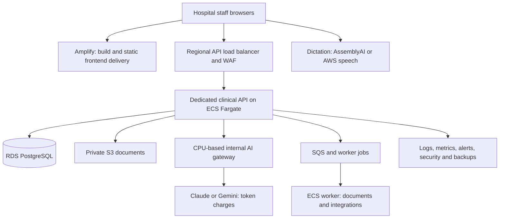

# VDocs deployment, AI usage, and business cost estimate

[Developer handbook](README.md) · [AWS design](AWS_DEPLOYMENT.md) · [Production work](PRODUCTION_ROADMAP.md)

**Researched on 19 October 2026.** Currency: USD and Indian rupees. Main infrastructure region: AWS Mumbai, `ap-south-1`. These are calculated planning estimates using published vendor rates and explicit workload assumptions. They are not a vendor quote, measured usage, a guaranteed minimum, or evidence that the proposed production services are already built.

## 1. What to budget first

For a **100-bed hospital with 200 OPD visits per day**, the standard dedicated-deployment example is approximately **$2,179 / ₹2.07 lakh per month**, including AI, dictation, staging, infrastructure allowances, AWS support, and a 20% contingency. That is approximately **$26,151 / ₹24.85 lakh per year** before taxes and your staff/business expenses. A 50-bed / 100-daily-OPD example is approximately **$1,215 / ₹1.15 lakh per month** under the same standard-use assumptions.

Those numbers assume all chart AI uses Sonnet 5.5. Using fewer AI calls, a cheaper evaluated model, shared infrastructure, or smaller proven database capacity can lower the cost. Heavy chart use can raise it substantially. Do not sell unlimited AI/voice based only on the number of beds.

This document separates four things:

1. **Vendor rates:** checked against official AWS catalogs or provider pricing pages.
2. **Usage assumptions:** how many encounters, AI calls, tokens, minutes, and documents the hospital generates.
3. **Technology budget:** vendor charges and stated infrastructure allowances, plus a reserve.
4. **Business budget:** delivery/support labor, engineering, sales/admin, onboarding, and cash runway.

## 2. Exchange rate, taxes, and estimate boundaries

The conversion is **$1 = ₹95.0194**, the FBIL reference shown by RBI for **16 October 2026 at 1 pm**, the latest dated reference verified during this research. This is not a claimed live 19 October settlement rate. See [RBI exchange rates](https://www.rbi.org.in/). Actual AWS INR billing, card conversion, and bank charges can differ.

All main totals are **before tax**, with no free-tier credits, promotional credits, reserved-instance discounts, Savings Plans, or negotiated enterprise rates deducted. Some recurring free allowances could reduce the bill, but a hospital contract should remain viable after promotions end.

AWS lists India at 18% in its [APAC VAT/GST table](https://aws.amazon.com/tax-help/apac-vat-rates/). For cash sensitivity only, multiplying the standard 100-bed budget by 1.18 gives approximately **₹2.44 lakh / $2,571.50 per month**. That uniform uplift is not an exact tax computation across all vendors or a statement about tax-credit eligibility. Calculate tax vendor by vendor and keep recoverable tax separate from underlying margin. The CSV includes a clearly named uniform-tax sensitivity column.

The infrastructure tables price a dedicated hospital deployment, including its own staging allowance. They are not marginal costs for adding a hospital to an already-running shared platform. The annual table annualizes the conservative **month-12 document storage snapshot**; it is not an exact month-by-month first-year invoice forecast.

## 3. Hospital size and activity assumptions

An IPD bed is capacity, not a new patient every day. We assume 80% occupancy and a four-day average length of stay. OPD figures mean visits per day, including repeat visits, over 30 operating days per month. Staff accounts, not patients, are the primary authenticated users in this model.

```text
Monthly OPD visits = daily OPD × 30
Monthly IPD patient-days = beds × 80% × 30
Monthly discharges/admissions at steady occupancy = patient-days ÷ 4-day stay
Monthly insured claim cases = discharges × 60%
```

<!-- BEGIN VOLUMES -->
| Hospital | OPD visits/month | Occupied IPD patient-days | Discharges/month | Claims/month | Staff MAU |
| --- | --- | --- | --- | --- | --- |
| 25 beds / 50 OPD | 1,500 | 600 | 150 | 90 | 40 |
| 50 beds / 100 OPD | 3,000 | 1,200 | 300 | 180 | 80 |
| 100 beds / 200 OPD | 6,000 | 2,400 | 600 | 360 | 160 |
| 200 beds / 500 OPD | 15,000 | 4,800 | 1,200 | 720 | 300 |
<!-- END VOLUMES -->

For 100 beds, this means 80 occupied beds on an average day, 2,400 occupied patient-days/month, about 600 completed stays/month, and 6,000 OPD visits/month. It does **not** mean 3,000 distinct new IPD patients every month. Admissions and discharges are assumed roughly balanced; opening inventory, seasonal changes, ICU mix, and long stays can change these numbers.

If OPD runs 26 days, 200 daily OPD becomes 5,200 visits, and the OPD-related variable costs fall by 13.3%. The IPD service still operates every day. Infrastructure does not fall by 13.3% simply because OPD closes on Sundays.

## 4. What architecture is being costed

The earlier AWS guide uses S3/CloudFront for frontend hosting. This cost model substitutes **Amplify Hosting for the static React frontend**, as requested. It keeps the dedicated API, internal AI service, worker, relational database, and document storage.



**Amplify does not include all backend costs.** Its frontend build, artifact storage, delivery, and optional WAF integration are separate from ECS, RDS, S3 clinical documents, authentication, and model usage. We do not add a second CloudFront frontend-delivery bill on top of Amplify. API/document download bytes are a separate assumed traffic stream.

**An AI service is not necessarily a GPU server.** Here it is a small CPU service that authenticates requests and calls paid model APIs. Its Fargate CPU/memory is counted in infrastructure; the provider's tokens are counted separately. Training/fine-tuning or self-hosting model weights is outside this baseline.

### Initial infrastructure sizes

These are budgeting configurations with headroom, not bed-count capacity guarantees. Benchmark the actual app/database before buying or reducing capacity.

| Hospital | Aggregate always-on CPU / memory | Database | Allocated DB storage | NAT gateways | Staging allowance |
| --- | --- | --- | --- | --- | --- |
| 25 beds / 50 OPD | 1 vCPU / 2 GB | `db.t4g.medium`, Single-AZ | 50 GB | 1 | $100 / about ₹9,502 monthly |
| 50 beds / 100 OPD | 1.75 vCPU / 3.5 GB | `db.t4g.medium`, Multi-AZ | 100 GB | 2 | $150 / about ₹14,253 monthly |
| 100 beds / 200 OPD | 3.5 vCPU / 7 GB | `db.m7g.large`, Multi-AZ | 200 GB | 2 | $200 / about ₹19,004 monthly |
| 200 beds / 500 OPD | 7 vCPU / 14 GB | `db.m7g.xlarge`, Multi-AZ | 400 GB | 2 | $300 / about ₹28,506 monthly |

For the 100-bed example, the aggregate compute represents two API tasks at 1 vCPU/2 GB each, two AI gateway tasks at 0.5 vCPU/1 GB each, and two workers at 0.25 vCPU/0.5 GB each. The 50-bed profile halves that aggregate; a single worker can restart if interrupted. The 25-bed Single-AZ database profile is a lean pilot with reduced failure tolerance, not the same availability design as the others.

Multi-AZ RDS rates below already include the selected primary/standby deployment rate. Do not multiply the listed instance or Multi-AZ storage rates by two again. RDS Graviton instances and x86 Fargate application tasks can coexist; the database is a network service.

## 5. Verified AWS unit prices

The following are on-demand first-tier rates checked in official Mumbai regional price catalogs. The [saved snapshot](../costing/pricing-snapshot-2026-10-19.json) keeps the rate, SKU, rate code, catalog publication date, and source URL for cross-checking. Links labelled “catalog” can be large JSON/CSV downloads. “Current” URLs change over time; the committed snapshot preserves the numbers used here.

<!-- BEGIN UNIT_RATES -->
| Service / meter | Billing unit | USD / INR per billing unit | Official rate evidence |
| --- | --- | --- | --- |
| Amplify standard build | minute | $0.01 / ₹0.95019 | [catalog](https://pricing.us-east-1.amazonaws.com/offers/v1.0/aws/AWSAmplify/current/ap-south-1/index.json) |
| Amplify frontend transfer | GB served | $0.15 / ₹14.253 | [catalog](https://pricing.us-east-1.amazonaws.com/offers/v1.0/aws/AWSAmplify/current/ap-south-1/index.json) |
| Amplify artifact storage | GB-month | $0.023 / ₹2.1854 | [catalog](https://pricing.us-east-1.amazonaws.com/offers/v1.0/aws/AWSAmplify/current/ap-south-1/index.json) |
| Amplify WAF integration surcharge | app-month | $15 / ₹1425.3 | [catalog](https://pricing.us-east-1.amazonaws.com/offers/v1.0/aws/AWSAmplify/current/ap-south-1/index.json) |
| Fargate Linux x86 CPU | vCPU-hour | $0.04256 / ₹4.044 | [catalog](https://pricing.us-east-1.amazonaws.com/offers/v1.0/aws/AmazonECS/current/ap-south-1/index.json) |
| Fargate Linux x86 memory | GB-hour | $0.004655 / ₹0.44232 | [catalog](https://pricing.us-east-1.amazonaws.com/offers/v1.0/aws/AmazonECS/current/ap-south-1/index.json) |
| RDS t4g.medium Single-AZ | hour | $0.084 / ₹7.9816 | [catalog](https://pricing.us-east-1.amazonaws.com/offers/v1.0/aws/AmazonRDS/current/ap-south-1/index.json) |
| RDS t4g.medium Multi-AZ pair | hour | $0.167 / ₹15.868 | [catalog](https://pricing.us-east-1.amazonaws.com/offers/v1.0/aws/AmazonRDS/current/ap-south-1/index.json) |
| RDS m7g.large Multi-AZ pair | hour | $0.479 / ₹45.514 | [catalog](https://pricing.us-east-1.amazonaws.com/offers/v1.0/aws/AmazonRDS/current/ap-south-1/index.json) |
| RDS m7g.xlarge Multi-AZ pair | hour | $0.958 / ₹91.029 | [catalog](https://pricing.us-east-1.amazonaws.com/offers/v1.0/aws/AmazonRDS/current/ap-south-1/index.json) |
| RDS gp3 Single-AZ | allocated GB-month | $0.131 / ₹12.448 | [catalog](https://pricing.us-east-1.amazonaws.com/offers/v1.0/aws/AmazonRDS/current/ap-south-1/index.json) |
| RDS gp3 Multi-AZ | allocated GB-month | $0.262 / ₹24.895 | [catalog](https://pricing.us-east-1.amazonaws.com/offers/v1.0/aws/AmazonRDS/current/ap-south-1/index.json) |
| RDS excess backup | GB-month above included allowance | $0.095 / ₹9.0268 | [catalog](https://pricing.us-east-1.amazonaws.com/offers/v1.0/aws/AmazonRDS/current/ap-south-1/index.json) |
| S3 Standard, first tier | GB-month | $0.025 / ₹2.3755 | [catalog](https://pricing.us-east-1.amazonaws.com/offers/v1.0/aws/AmazonS3/current/ap-south-1/index.json) |
| S3 PUT requests | 1,000 requests | $0.005 / ₹0.4751 | [catalog](https://pricing.us-east-1.amazonaws.com/offers/v1.0/aws/AmazonS3/current/ap-south-1/index.json) |
| S3 GET requests | 1,000 requests | $0.0004 / ₹0.038008 | [catalog](https://pricing.us-east-1.amazonaws.com/offers/v1.0/aws/AmazonS3/current/ap-south-1/index.json) |
| ALB | hour | $0.0239 / ₹2.271 | [catalog](https://pricing.us-east-1.amazonaws.com/offers/v1.0/aws/AWSELB/current/ap-south-1/index.json) |
| ALB capacity | LCU-hour | $0.008 / ₹0.76016 | [catalog](https://pricing.us-east-1.amazonaws.com/offers/v1.0/aws/AWSELB/current/ap-south-1/index.json) |
| NAT gateway | gateway-hour | $0.056 / ₹5.3211 | [catalog](https://pricing.us-east-1.amazonaws.com/offers/v1.0/aws/AmazonEC2/current/ap-south-1/index.csv) |
| NAT data processing | GB processed | $0.056 / ₹5.3211 | [catalog](https://pricing.us-east-1.amazonaws.com/offers/v1.0/aws/AmazonEC2/current/ap-south-1/index.csv) |
| Public IPv4 | address-hour | $0.005 / ₹0.4751 | [catalog](https://pricing.us-east-1.amazonaws.com/offers/v1.0/aws/AmazonVPC/current/ap-south-1/index.json) |
| Interface endpoint | endpoint-AZ-hour | $0.013 / ₹1.2353 | [catalog](https://pricing.us-east-1.amazonaws.com/offers/v1.0/aws/AmazonVPC/current/ap-south-1/index.json) |
| Internet outbound, first paid tier | GB | $0.1093 / ₹10.386 | [catalog](https://pricing.us-east-1.amazonaws.com/offers/v1.0/aws/AWSDataTransfer/current/ap-south-1/index.json) |
| Regional transfer | billed GB-side | $0.01 / ₹0.95019 | [catalog](https://pricing.us-east-1.amazonaws.com/offers/v1.0/aws/AWSDataTransfer/current/ap-south-1/index.json) |
| CloudWatch Standard log ingestion | GB | $0.67 / ₹63.663 | [catalog](https://pricing.us-east-1.amazonaws.com/offers/v1.0/aws/AmazonCloudWatch/current/ap-south-1/index.json) |
| CloudWatch retained logs | compressed GB-month | $0.03 / ₹2.8506 | [catalog](https://pricing.us-east-1.amazonaws.com/offers/v1.0/aws/AmazonCloudWatch/current/ap-south-1/index.json) |
| CloudWatch custom metrics | metric-month | $0.3 / ₹28.506 | [catalog](https://pricing.us-east-1.amazonaws.com/offers/v1.0/aws/AmazonCloudWatch/current/ap-south-1/index.json) |
| CloudWatch standard alarm | alarm-month | $0.1 / ₹9.5019 | [catalog](https://pricing.us-east-1.amazonaws.com/offers/v1.0/aws/AmazonCloudWatch/current/ap-south-1/index.json) |
| WAF ACL | ACL-month | $5 / ₹475.1 | [catalog](https://pricing.us-east-1.amazonaws.com/offers/v1.0/aws/awswaf/current/ap-south-1/index.json) |
| WAF rule | rule-month | $1 / ₹95.019 | [catalog](https://pricing.us-east-1.amazonaws.com/offers/v1.0/aws/awswaf/current/ap-south-1/index.json) |
| WAF requests | million requests | $0.6 / ₹57.012 | [catalog](https://pricing.us-east-1.amazonaws.com/offers/v1.0/aws/awswaf/current/ap-south-1/index.json) |
| Cognito Essentials gross paid tier | MAU | $0.015 / ₹1.4253 | [catalog](https://pricing.us-east-1.amazonaws.com/offers/v1.0/aws/AmazonCognito/current/ap-south-1/index.json) |
| Secrets Manager | secret-month | $0.4 / ₹38.008 | [catalog](https://pricing.us-east-1.amazonaws.com/offers/v1.0/aws/AWSSecretsManager/current/ap-south-1/index.json) |
| KMS managed key version | key-version-month | $1 / ₹95.019 | [catalog](https://pricing.us-east-1.amazonaws.com/offers/v1.0/aws/awskms/current/ap-south-1/index.json) |
| KMS symmetric requests | 10,000 requests | $0.03 / ₹2.8506 | [catalog](https://pricing.us-east-1.amazonaws.com/offers/v1.0/aws/awskms/current/ap-south-1/index.json) |
| SQS Standard | million billed request units | $0.4 / ₹38.008 | [catalog](https://pricing.us-east-1.amazonaws.com/offers/v1.0/aws/AWSQueueService/current/ap-south-1/index.json) |
| SES basic outbound | 1,000 emails, attachment data extra | $0.1 / ₹9.5019 | [catalog](https://pricing.us-east-1.amazonaws.com/offers/v1.0/aws/AmazonSES/current/ap-south-1/index.json) |
| ECR private image storage | GB-month | $0.1 / ₹9.5019 | [catalog](https://pricing.us-east-1.amazonaws.com/offers/v1.0/aws/AmazonECR/current/ap-south-1/index.json) |
| Textract text detection | page | $0.0015 / ₹0.14253 | [catalog](https://pricing.us-east-1.amazonaws.com/offers/v1.0/aws/AmazonTextract/current/ap-south-1/index.json) |
| Textract forms | page | $0.05 / ₹4.751 | [catalog](https://pricing.us-east-1.amazonaws.com/offers/v1.0/aws/AmazonTextract/current/ap-south-1/index.json) |
| Textract tables | page | $0.015 / ₹1.4253 | [catalog](https://pricing.us-east-1.amazonaws.com/offers/v1.0/aws/AmazonTextract/current/ap-south-1/index.json) |
| Lambda x86 duration | million GB-seconds | $16.6667 / ₹1583.7 | [catalog](https://pricing.us-east-1.amazonaws.com/offers/v1.0/aws/AWSLambda/current/ap-south-1/index.json) |
| Lambda requests | million requests | $0.2 / ₹19.004 | [catalog](https://pricing.us-east-1.amazonaws.com/offers/v1.0/aws/AWSLambda/current/ap-south-1/index.json) |
| API Gateway HTTP API | million requests | $1.05 / ₹99.77 | [catalog](https://pricing.us-east-1.amazonaws.com/offers/v1.0/aws/AmazonApiGateway/current/ap-south-1/index.json) |
<!-- END UNIT_RATES -->

Other small meters used in the totals are Route 53 ($0.50 per zone-month and $0.40 per million standard queries), a $3/dashboard-month gross paid CloudWatch rate, Secrets Manager API requests at $0.05/10,000, and AssemblyAI/model rates below. These also appear with evidence in the saved snapshot. Some Route 53 aliases, CloudWatch dashboards/metrics/alarms, SQS requests, Cognito MAUs, and internet transfer may qualify for recurring free allowances. We have deliberately not deducted them.

**AWS support:** Business Support+ is the greater of $29/account-month or tiered percentage charges: 9% up to $10,000, then 7%, 5%, and 3% in the published bands. See [AWS Support pricing](https://aws.amazon.com/premiumsupport/pricing/). The model applies this to assumed AWS service spend, including AWS staging/security allowances. External AI/voice, domain registration, and external CI are excluded. Marketplace model charges can have different support eligibility; do not blindly add the support percentage to every model dollar.

The calculated support row is a single-account planning calculation. If production and staging each buy their own support plan, calculate each account separately and apply its minimum; the total can be higher. This is also why a shared SaaS account and several separately billed hospital accounts have different fixed costs.

## 6. Detailed 100-bed infrastructure calculation

This table is monthly, for 730 provisioned hours. It includes all three usage profiles' fixed baseline; only chart AI and speech/cleanup vary between light/standard/heavy below. Rows explicitly marked **ALLOWANCE** are our editable planning budgets, not published prices for a fully specified configuration.

<!-- BEGIN INFRA -->
| Monthly infrastructure item | USD | INR |
| --- | --- | --- |
| Amplify: 300 build minutes, 5 GB artifacts, frontend delivery | $18.12 | ₹1,721 |
| Fargate API + AI gateway + worker | $132.53 | ₹12,593 |
| RDS PostgreSQL instances | $349.67 | ₹33,225 |
| RDS gp3 allocated storage | $52.40 | ₹4,979 |
| RDS backups above included allowance | $4.75 | ₹451 |
| S3 documents: retained month-12 snapshot | $11.25 | ₹1,069 |
| S3 document PUT and GET requests | $0.08 | ₹8 |
| API/document internet delivery, separate from Amplify | $10.93 | ₹1,039 |
| ALB hours plus assumed average LCUs | $23.29 | ₹2,213 |
| NAT gateway provisioned hours | $81.76 | ₹7,769 |
| NAT processed traffic | $3.36 | ₹319 |
| Public IPv4: ALB and NAT, minimum assumed count | $14.60 | ₹1,387 |
| CloudWatch log ingestion and retained compressed volume | $21.00 | ₹1,995 |
| CloudWatch custom metrics, alarms, one dashboard | $10.00 | ₹950 |
| WAF: Amplify integration, 2 ACLs, 10 rules, requests | $36.20 | ₹3,440 |
| Cognito Essentials staff MAUs at gross paid rate | $2.40 | ₹228 |
| Secrets Manager: 10 secrets and 20,000 requests | $4.10 | ₹390 |
| KMS: 4 key versions and 100,000 requests | $4.30 | ₹409 |
| SQS: 1 million billed request units | $0.40 | ₹38 |
| SES: 10,000 basic outbound emails | $1.00 | ₹95 |
| ECR: 10 GB image storage | $1.00 | ₹95 |
| Route 53: zone and 1 million standard DNS queries | $0.90 | ₹86 |
| Cross-AZ/internal transfer ALLOWANCE | $20.00 | ₹1,900 |
| Security/data-event monitoring ALLOWANCE | $25.00 | ₹2,375 |
| Separate staging/development AWS ALLOWANCE | $200.00 | ₹19,004 |
| AWS Business Support+ planning charge | $92.61 | ₹8,800 |
| Container CI build runner ALLOWANCE | $20.00 | ₹1,900 |
| Domain registration ALLOWANCE: $20/year | $1.67 | ₹158 |
| TOTAL infrastructure and allowances | $1,143.31 | ₹1,08,637 |
<!-- END INFRA -->

Important quantity assumptions behind the table:

- **Frontend:** 300 standard build minutes, 5 GB stored build artifacts, and 100 GB of delivered static assets. Amplify WAF integration costs $15/app-month before WAF resources. See [Amplify pricing](https://aws.amazon.com/amplify/pricing/).
- **Database:** 200 GB provisioned gp3 and 50 GB of chargeable backups above whatever included backup allocation is available. Logs, WAL, index growth, snapshots, and restore copies require observation.

- **Network:** one ALB at an assumed average 1 LCU; two NAT gateways; 60 GB NAT processing; four public IPv4 addresses for minimum assumed ALB/NAT usage; 100 GB separate API/document internet delivery. NAT has both hourly and per-GB charges; it does not include internet egress. Use S3 gateway endpoints to keep applicable S3 traffic off NAT. See [VPC pricing](https://aws.amazon.com/vpc/pricing/).
- **Observability:** 30 GB logs ingested and separately assumed 30 GB compressed retained logs, 20 custom metrics, 10 standard alarms, one dashboard. This is a quantity assumption, not an assumed universal log compression ratio. Verbose chart/audio logging is not intended.
- **WAF:** one Amplify app integration plus two ACLs and ten total billable rules, with two million combined inspected requests. Premium managed rule groups, bot/fraud products, excess WCU/body inspection, and additional ACLs are extra.
- **Authentication:** 160 staff MAUs at the gross paid Essentials rate. Eligible direct/social sign-ins may fit within Cognito's 10,000-MAU recurring free tier; enterprise federation, M2M and message charges have different rules. See [Cognito pricing](https://aws.amazon.com/cognito/pricing/).
- **Staging/security:** allowances cover a smaller separate nonproduction footprint and basic security/data-event monitoring. They are not a claim that $25 buys every security service or a formal audit. Validate exact GuardDuty/Security Hub/CloudTrail scanning/event quantities during implementation.

The RDS budget assumes a normally supported PostgreSQL version, ordinary included gp3 performance for the selected size, and no extra provisioned IOPS/throughput or Extended Support. Those add-ons, sustained burst CPU credits on `t4g` profiles, migration services and restored test databases are additional if used.

Interface VPC endpoints are not provisioned in the baseline. At the verified $0.013 per endpoint-AZ-hour, five interface services across two AZs would add **$94.90 / about ₹9,017 monthly**, plus data processing, before support/reserve. Compare that with the traffic/routing it replaces; do not assume every endpoint removes NAT because external AI/payer traffic still needs egress.

## 7. AI usage model: what is a call?

A call is one paid model request. Opening a patient chart is not automatically a new AI call if a valid brief is reused. Conversely, one user action can trigger more than one call if it generates a draft, asks follow-up questions, retries, or invokes tools. The existing app sends chart/history/report context; without limits, that can be much bigger than a short question.

The workflow engine, ordinary searches, result review, discharge blocker checks, and current deterministic handover/summary prefill do not require a model call. Discharge/claims AI quantities below assume future **optional AI assistance** is enabled; they do not assert that today's deterministic functions already incur tokens.

| Usage profile | OPD chart calls/visit | IPD calls/occupied day | Extra calls/discharge | Extra calls/insured claim | Average input / billed output tokens per chart call |
| --- | --- | --- | --- | --- | --- |
| Light | 0.5 | 1 | 2 | 2 | 3,000 / 400 |
| Standard | 2 | 4 | 4 | 4 | 6,000 / 700 |
| Heavy | 6 | 10 | 10 | 10 | 15,000 / 1,500 |

Standard OPD can mean one brief and one question. IPD can mean two refreshed briefs and two chart questions. Discharge/claim allowances cover drafting, extraction, review assistance, or regeneration. They are incremental to chart calls. Setting a feature to deterministic-only should remove its extra AI allowance.

All calls and voice usage get a **10% retry/reprocessing allowance**. Input includes the system prompt, retrieved chart, question, and prior conversation. Output must include any **billable reasoning/thinking tokens**, not only visible text. The 700-token standard assumption must be tested with the chosen model/settings; models with adaptive thinking can exceed it.

<!-- BEGIN USAGE -->
| 100-bed hospital | Chart calls before retries | Billed chart calls | Input/output million tokens | Voice hours before retries |
| --- | --- | --- | --- | --- |
| light | 7,320 | 8,052 | 24.156 / 3.221 | 110 |
| standard | 25,440 | 27,984 | 167.904 / 19.589 | 370 |
| heavy | 69,600 | 76,560 | 1148.400 / 114.840 | 1,020 |
<!-- END USAGE -->

Standard 100-bed calculation:

```text
OPD:        6,000 visits × 2                  = 12,000 calls
IPD:        2,400 patient-days × 4            =  9,600 calls
Discharge:    600 discharges × 4              =  2,400 calls
Claims:       360 insured claims × 4          =  1,440 calls
Total before retries                         = 25,440 calls
After 10% allowance                          = 27,984 calls
Input: 27,984 × 6,000 / 1,000,000             = 167.904 million tokens
Output: 27,984 × 700 / 1,000,000              = 19.5888 million tokens
Sonnet 5.5: 167.904 × $2 + 19.5888 × $10      = $531.696
```

## 8. Claude, Gemini, and AWS Bedrock comparisons

These are list-price comparisons at the **same assumed billable token volumes**. They are not equivalent clinical-quality, tokenizer, latency, or reasoning-cost guarantees. Evaluate clinical grounding and preservation before routing a task to a cheaper model.

Claude native rates come from [Anthropic's official pricing](https://platform.claude.com/docs/en/about-claude/pricing); Gemini text rates come from [Google's official paid-tier pricing](https://ai.google.dev/gemini-api/docs/pricing). The Bedrock rows use the exact model/routing billing SKUs saved from the AWS Mumbai foundation-model catalog, not a generic assumption that every Claude route costs the same.

<!-- BEGIN MODELS -->
| Chart AI model | Input / output USD per 1M tokens | Monthly chart AI: USD / INR |
| --- | --- | --- |
| Claude Haiku 5.5 | $0.1 / $0.5 | $26.58 / ₹2,526 |
| Claude Haiku 4.5 | $1 / $5 | $265.85 / ₹25,261 |
| Claude Sonnet 5.5 | $2 / $10 | $531.70 / ₹50,521 |
| Claude Sonnet 4.6 | $3 / $15 | $797.54 / ₹75,782 |
| Claude Opus 5.5 | $4 / $20 | $1,063.39 / ₹1,01,043 |
| Gemini 2.5 Flash | $0.3 / $2.5 | $99.34 / ₹9,440 |
| Gemini 2.5 Flash-Lite | $0.1 / $0.4 | $24.63 / ₹2,340 |
| Bedrock Sonnet 5.5 global | $2 / $10 | $531.70 / ₹50,521 |
| Bedrock Sonnet 5 standard regional SKU | $2.2 / $11 | $584.87 / ₹55,574 |
| Bedrock Haiku 4.5 standard regional SKU | $1.1 / $5.5 | $292.43 / ₹27,787 |
| 80% Haiku 5.5 + 20% Sonnet 5.5 | Weighted by equal-size request share | $127.61 / ₹12,125 |
<!-- END MODELS -->

The full technology budget changes as follows, with the same infrastructure and standard dictation:

<!-- BEGIN MODEL_TOTALS -->
| 100 beds / 200 OPD, standard use | Total monthly budget +20%, USD / INR |
| --- | --- |
| All Haiku 5.5 | $1,573.10 / ₹1,49,475 |
| All Gemini 2.5 Flash | $1,660.41 / ₹1,57,772 |
| 80% Haiku 5.5 + 20% Sonnet 5.5 | $1,694.33 / ₹1,60,994 |
| All Sonnet 5.5 | $2,179.24 / ₹2,07,070 |
| All Sonnet 4.6 | $2,498.26 / ₹2,37,383 |
| All Opus 5.5 | $2,817.27 / ₹2,67,696 |
| Bedrock Sonnet 5 regional price SKU | $2,243.04 / ₹2,13,132 |
<!-- END MODEL_TOTALS -->

Haiku 5.5's low price shown here applies only to prompts up to 100,000 tokens. The verified higher tier is $0.50 input / $2.50 output per million. A long full-chart request can cross that threshold. Sonnet 4.6 is included to show the effect of an older higher-priced model; do not assume a model's availability or lifecycle from this static estimate.

**AWS location and routing matter:** the verified Sonnet 5.5 Bedrock model card lists Mumbai as **global inference available, in-region/geo unavailable** for its `bedrock-runtime` route. A Mumbai endpoint or billing SKU does not prove processing stays in India. See [the official Sonnet 5.5 availability/routing table](https://docs.aws.amazon.com/bedrock/latest/userguide/model-card-anthropic-claude-sonnet-5-5.html). If India-only processing is a contractual requirement, select and verify a supported model/profile and recost it; the global price is not evidence of that requirement being met.

Native API and Bedrock are alternative billing paths for a given call. Do not pay/budget both for the same inference. The current code has direct Anthropic/Gemini adapters; using Bedrock needs an implementation change. Consumer Claude Pro/Max or other chat subscriptions are not a substitute for your product's metered API budget.

Prompt-cache hits and batch jobs can reduce eligible token charges, but the main estimate assumes neither. The current Anthropic adapter does not explicitly configure prompt-cache checkpoints. Cache creation, reads, TTLs, invalidation, model support and chart changes matter. Implement and measure savings before promising a discount. Batch savings apply only where the exact route/model supports it and delayed results fit the workflow.

## 9. Dictation and transcript cleanup

Voice is counted separately from chart AI. Current push-to-talk uses AssemblyAI's **Sync API**, not its cheaper asynchronous endpoint. Its listed rate is $0.30/audio-hour with keyterms included. Live streaming has a different model and billing basis. See [AssemblyAI pricing](https://www.assemblyai.com/pricing).

| Profile | OPD minutes/visit | IPD minutes/occupied day | Extra minutes/discharge |
| --- | --- | --- | --- |
| Light | 0.5 | 1 | 2 |
| Standard | 2 | 3 | 5 |
| Heavy | 6 | 8 | 10 |

For standard 100-bed use: `6,000×2 + 2,400×3 + 600×5 = 22,200 minutes = 370 hours`, then 10% reprocessing gives 407 billed hours. This is short dictation, not recording every entire OPD consultation or each staff shift.

<!-- BEGIN VOICE -->
| Speech option | USD/audio or connection hour | Standard 100-bed monthly speech cost USD / INR |
| --- | --- | --- |
| AssemblyAI Sync: current push-to-talk path | $0.30 | $122.10 / ₹11,602 |
| Async Universal-3.5 Pro + keyterms: code change | $0.26 | $105.82 / ₹10,055 |
| Universal-Streaming + keyterms: if connection hours equal audio hours | $0.19 | $77.33 / ₹7,348 |
| Universal-3.6 Pro Realtime: code change | $0.45 | $183.15 / ₹17,403 |
| Amazon Transcribe standard batch: code change | $0.36 | $146.52 / ₹13,922 |
| Amazon Transcribe standard streaming: code change | $0.60 | $244.25 / ₹23,208 |
| Gemini cleanup, separate from speech | 500 input + 250 output tokens per 1-minute clip | $18.93 / ₹1,798 |
<!-- END VOICE -->

The AWS speech alternatives use verified Mumbai standard batch/streaming catalog rates; see [Amazon Transcribe pricing](https://aws.amazon.com/transcribe/pricing/). They require adapter work, supported-language/clinical-quality checks, and any extra storage/network/job costs. They are not Transcribe Medical or medical add-on prices.

Cleanup assumes one one-minute clip per billed minute, with 500 input tokens including instructions and 250 billed output tokens, using paid Gemini 2.5 Flash. It is a separate model bill. Long prompts, many tiny clips, reasoning tokens, translation, or speaker diarization change the result.

AssemblyAI streaming is billed for the time the WebSocket stays open, including silence, not just spoken audio; see [AssemblyAI's billing explanation](https://www.assemblyai.com/docs/faq/how-to-get-your-api-key). If 30 users leave live dictation connected for eight hours/day over 26 days, that is **6,240 connection-hours**, not 407. At $0.19/hour with the specified keyterms add-on, speech alone becomes **$1,185.60 / about ₹1.13 lakh monthly**, before cleanup. Enforce short sessions and explicit stop/timeout behavior.

Retaining raw audio is not included in the base storage estimate. Neither is a call-center voice agent, telephone carrier, text-to-speech, automatic translation, medical mode, or every optional speech add-on. Quote them as separate enabled features.

## 10. Monthly and annual technology budgets

The following includes infrastructure plus Sonnet 5.5 chart AI, current Sync dictation, Gemini cleanup, and a 20% technology reserve. It excludes payroll and tax. Standard rows use the scenario-specific infrastructure sizes above; the light/heavy comparison keeps that scenario's infrastructure unchanged, so it is a usage-cost sensitivity rather than a load-tested autoscaling prediction.

<!-- BEGIN TOTALS -->
| Hospital | Light monthly budget USD / INR | Standard monthly budget USD / INR | Heavy monthly budget USD / INR |
| --- | --- | --- | --- |
| 25 beds / 50 OPD | $532.37 / ₹50,586 | $697.46 / ₹66,272 | $1,645.83 / ₹1,56,386 |
| 50 beds / 100 OPD | $884.75 / ₹84,069 | $1,214.92 / ₹1,15,441 | $3,111.67 / ₹2,95,669 |
| 100 beds / 200 OPD | $1,518.91 / ₹1,44,326 | $2,179.24 / ₹2,07,070 | $5,972.74 / ₹5,67,526 |
| 200 beds / 500 OPD | $2,699.17 / ₹2,56,474 | $4,184.81 / ₹3,97,638 | $12,782.01 / ₹12,14,539 |
<!-- END TOTALS -->

Standard-use breakdown, with USD / INR in each monetary cell:

<!-- BEGIN STANDARD -->
| Hospital | Infrastructure | Chart AI | Speech + cleanup | Before reserve | Budget +20% | Annual budget |
| --- | --- | --- | --- | --- | --- | --- |
| 25 beds / 50 OPD | $413.03 / ₹39,246 | $132.92 / ₹12,630 | $35.26 / ₹3,350 | $581.21 / ₹55,227 | $697.46 / ₹66,272 | $8,369.47 / ₹7,95,262 |
| 50 beds / 100 OPD | $676.07 / ₹64,240 | $265.85 / ₹25,261 | $70.51 / ₹6,700 | $1,012.43 / ₹96,200 | $1,214.92 / ₹1,15,441 | $14,578.99 / ₹13,85,287 |
| 100 beds / 200 OPD | $1,143.31 / ₹1,08,637 | $531.70 / ₹50,521 | $141.03 / ₹13,400 | $1,816.03 / ₹1,72,558 | $2,179.24 / ₹2,07,070 | $26,150.86 / ₹24,84,839 |
| 200 beds / 500 OPD | $1,978.39 / ₹1,87,985 | $1,188.79 / ₹1,12,958 | $320.17 / ₹30,422 | $3,487.34 / ₹3,31,365 | $4,184.81 / ₹3,97,638 | $50,217.76 / ₹47,71,662 |
<!-- END STANDARD -->

For standard 100-bed use, the model's unreserved technology estimate is approximately **$1,816 / ₹1.73 lakh**; the monthly planning budget is approximately **$2,179 / ₹2.07 lakh**. Reserve is an allowance for uncertainty, not a vendor charge. Keep its balance separate from actual monthly bills.

## 11. Documents, OCR, retention, and data growth

The baseline assumes 2 MB of stored documents per OPD visit, 5 MB per occupied IPD day, and 10 MB extra per discharge, with a 25% version/duplicate headroom factor. That is **30 GB of new source documents/month** for the 100-bed scenario. At the end of month 12, retained source documents plus versions occupy approximately 450 GB. We count existing JSON/chart data in RDS storage separately.

<!-- BEGIN RETENTION -->
| 100-bed document retention snapshot | Stored GB including versions | S3 Standard monthly USD / INR |
| --- | --- | --- |
| End of year 1 | 450 | $11.25 / ₹1,069 |
| End of year 3 | 1,350 | $33.75 / ₹3,207 |
| End of year 7 | 3,150 | $78.75 / ₹7,483 |
<!-- END RETENTION -->

This table assumes no archive-tier transitions and unchanged volume. It is a cost illustration, not a recommended legal retention period. Lifecycle transitions can reduce some storage charges but introduce retrieval, minimum-storage-duration, restore, and access-latency considerations. Backups and legal holds may retain additional copies.

Scanned-report OCR is **optional and not included** in the standard budgets. The verified Mumbai first-tier Textract rates are $0.0015/page for text, $0.05/page for forms, and $0.015/page for tables. For **10,000 pages/month**:

| Processing | Additional vendor cost USD / INR |
| --- | --- |
| Plain text detection | $15 / about ₹1,425 |
| Form extraction | $500 / about ₹47,510 |
| Table extraction | $150 / about ₹14,253 |
| Forms + tables when both are billed | $650 / about ₹61,763 |

See [Textract pricing](https://aws.amazon.com/textract/pricing/) and the saved SKUs. LLM interpretation after OCR is another token charge. Do not use the plain text price to quote structured insurance/billing extraction.

The baseline excludes raw CT/MRI studies and PACS/DICOM hosting. For scale, 10 TB in S3 Standard at the quoted first tier is about **$250 / ₹23,755 monthly** for bytes alone, before versions, viewing/egress, backups, requests, and a diagnostic viewer. Scanned PDFs and full imaging studies have very different storage/access patterns.

## 12. Dedicated, shared, and serverless alternatives

### Current browser-only demo

With the specific 300-build-minute, 5-GB-artifact and 100-GB-frontend-delivery assumptions, Amplify Hosting by itself is about **$18.12 / ₹1,721 monthly** before WAF, APIs, provider usage and tax. The current mock-mode chart stores its workflow in the browser. That low static-hosting figure does not buy the dedicated backend, central product database, operational support, integrations or durability described in the production roadmap. It is a useful demo bill, not a comparable live-product estimate.

### Dedicated hospital deployment

This document's main budgets buy a separate database/compute/network baseline and a staging allowance. This can fit hospitals that require deployment isolation or bespoke integration. It has a substantial fixed floor even with very little AI use. A 100-bed hospital does not automatically need `m7g.large`; the chosen configuration is a conservative starting budget to validate.

### Smaller proven high-availability footprint

For the same 100-bed traffic, moving from the selected `m7g.large` Multi-AZ instance to the priced `t4g.medium` Multi-AZ pair would reduce instance charges by **$227.76 / about ₹21,642 monthly**, before support/reserve. It also reduces memory/compute capacity and can introduce burst-credit costs under sustained CPU use. Load-test first. Reducing application replicas, database availability, backups, or monitoring changes the service being sold and should be disclosed.

### Shared SaaS platform

Multiple hospitals can share some frontend, backend, load balancer, queues, monitoring, staging, and database capacity if the product implements and tests tenant isolation. Shared costs must be allocated; variable AI/voice/storage do not disappear.

```text
Per-hospital technology cost =
    allocated shared platform cost
  + tenant-specific storage, integration and monitoring
  + actual model tokens and speech minutes
  + support allocation and reserve
```

For an illustrative allocation only, a **$2,000/month shared platform pool across five hospitals** allocates $400/hospital before tenant-specific charges. It is an internal budget assumption, not a verified five-hospital capacity configuration. Do not multiply a single low-traffic server quote by patient count or promise one database can support all tenants without measurement.

### Serverless API option

An alternative is API Gateway HTTP API + Lambda instead of always-on application tasks for suitable request/job workloads. Verified Mumbai rates are $1.05/million HTTP API requests, $0.20/million Lambda invocations, and $0.0000166667/GB-second for the selected x86 Lambda duration tier.

At two million requests/month, one GB memory, and **200 ms billed duration**, these three meters total about **$9.17 / ₹871** before free allowances. That is **only this narrow API execution example**, not a complete hospital deployment. Database, authentication, WAF, networking, logs, storage, long AI waits, queues, provisioned concurrency if used, and any database proxy remain additional. A 10-second rather than 200-ms function can change duration cost dramatically. Compare a complete architecture, not $9.17 with the entire $2,179 technology budget.

## 13. Sensitivities that can break the budget

| Change | Effect / action |
| --- | --- |
| Full chart grows from 6,000 to 30,000 input tokens/call | Input charges become five times as high; output charges do not automatically multiply |
| Reasoning output exceeds 700 tokens | Use actual billed output/reasoning tokens, set supported limits and measure by task |
| Five regenerated briefs instead of one reused brief | Up to five generation charges for that activity |
| OPD adoption rises from 50% to 100% | Scale adopted workflow calls/minutes, not every fixed AWS resource |
| Occupancy rises from 80% to 95% | IPD day/discharge/claim variable quantities rise 18.75%, at unchanged length of stay |
| Stay length rises from four to eight days | IPD daily work remains occupancy-based; monthly discharges/claim cases halve |
| Live recording left connected | Connection-hour speech billing can dominate |
| OCR forms replaces plain text extraction | Much higher per-page price; quote the intended APIs |
| Thousands of per-patient custom log metric dimensions | Custom metric count and cardinality rise; use controlled dimensions |
| Cross-region replicas, DR, extra snapshots | Additional compute/storage/replication and transfer charges |
| New interface endpoints across two AZs | Fixed hourly charges even with little data |
| Frontend artifact history is never cleaned | Amplify stored artifact GB can grow across releases |
| Currency moves | USD costs unchanged, INR cost changes proportionally |

For the standard $2,179.24 technology budget, conversion at ₹90/$ is approximately ₹1.96 lakh; at ₹100/$ it is ₹2.18 lakh; at ₹105/$ it is ₹2.29 lakh. Keep FX/repricing terms in annual commercial contracts rather than treating today's rupee conversion as permanent.

## 14. Expenses beyond cloud and AI

The following do not become free because AWS is cheap. Budget them explicitly and label internal labor allocations separately from external invoices.

| Expense | How to estimate it |
| --- | --- |
| Product/backend/frontend engineering | Loaded monthly salary/contractor cost × staff-months |
| AI implementation/evaluations | Engineering, clinical case review, test tokens/audio, provider integration |
| Clinical review | Clinician time for workflow rules, summaries, safety review, acceptance testing |
| QA and reliability | Workflow/concurrency tests, security/access tests, release verification, restore drills |
| Hospital onboarding | Discovery, user setup, data mapping, training, travel and migration |
| HIS/LIS/RIS/payer integration | Your engineering plus any vendor access/license/certification fees |
| Support and on-call | Hours, shifts, escalation coverage, incident recovery and SLA commitments |
| Security/privacy work | External review/pentest, fixes, audit work, retention controls, incident planning |
| Sales/customer success | Demo effort, procurement cycles, account management, travel and collection time |
| Business overhead | Devices, tools, internet, office, accounting/legal, insurance and payment fees |
| Communications | SMS/WhatsApp/telephony/OTP/attachment delivery, only if enabled |
| Recovery/availability upgrades | Cross-region copies, standby environments, extra operational testing |

No independently sourced salary or integration-vendor market quote is claimed below. These are editable founder budgeting assumptions. Replace them with your actual employment offers, contractor quotes, hospital interface fees and operating commitments.

## 15. What to charge a hospital

Separate customer subscription price from your raw AWS invoice. A practical commercial structure is:

1. A one-time implementation/onboarding fee.
2. A monthly platform/support fee for the agreed sites, users, availability and integrations.
3. An included allowance for model requests/tokens, dictation minutes, OCR pages and storage.
4. Published overage prices, approval limits, annual repricing/FX terms and a definition of exceptional custom work.

The illustrative monthly allocations here are ₹25,000/₹35,000/₹65,000/₹1,15,000 for the four hospital sizes, covering support, some shared product engineering, and admin. These are **allocation assumptions**, not your company's entire engineering payroll. Whether those allocations are sufficient depends on how many paying clients fund the team.

```text
Allocated service cost = technology budget + support/product/admin allocation
Price for target contribution margin m = allocated service cost / (1 - m)
```

<!-- BEGIN QUOTES -->
| Hospital | Technology budget | Support/product/admin allocation | Allocated monthly cost | Price at 40% contribution margin | Price at 60% contribution margin |
| --- | --- | --- | --- | --- | --- |
| 25 beds / 50 OPD | $697.46 / ₹66,272 | $263.10 / ₹25,000 | $960.56 / ₹91,272 | $1,600.93 / ₹1,52,120 | $2,401.40 / ₹2,28,180 |
| 50 beds / 100 OPD | $1,214.92 / ₹1,15,441 | $368.35 / ₹35,000 | $1,583.26 / ₹1,50,441 | $2,638.77 / ₹2,50,734 | $3,958.15 / ₹3,76,101 |
| 100 beds / 200 OPD | $2,179.24 / ₹2,07,070 | $684.07 / ₹65,000 | $2,863.31 / ₹2,72,070 | $4,772.18 / ₹4,53,450 | $7,158.27 / ₹6,80,175 |
| 200 beds / 500 OPD | $4,184.81 / ₹3,97,638 | $1,210.28 / ₹1,15,000 | $5,395.09 / ₹5,12,638 | $8,991.82 / ₹8,54,397 | $13,487.73 / ₹12,81,596 |
<!-- END QUOTES -->

These are **cost-based price floors for the specified allocation and target margin**, not market-validated willingness-to-pay or a recommendation that every 100-bed hospital will accept that price. The contribution-margin calculation includes product/admin allocations, so it is not a strict accounting gross-margin measure. “60% margin” is also not “add 60% to cost”: dividing by 0.4 is the relevant formula.

At standard use, a 50-bed site consumes about 13,992 billed chart calls and 12,210 billed dictation minutes/month. A 100-bed site consumes 27,984 calls and 24,420 minutes. Use those as starting allowance discussions, then validate adoption. Charge overages from actual model/voice unit cost plus your chosen reserve/margin; do not advertise those allowances as measured hospital demand.

## 16. One-time delivery and fundraising example

An illustrative onboarding package is 120 delivery hours at ₹1,500 loaded/hour plus ₹50,000 travel/training: **₹2.30 lakh / about $2,421 of cost**, before a commercial margin. This is not the cost of building the whole production product. External HIS/payer fees and unusual migration complexity can add materially.

For fundraising, the editable example uses the following monthly **budget inputs**, not researched salary benchmarks:

| Role / expense | Monthly INR | Approximate USD |
| --- | --- | --- |
| Founder/product | ₹1,00,000 | $1,052 |
| Two full-stack engineers, combined | ₹2,50,000 | $2,631 |
| Backend/DevOps engineer | ₹1,50,000 | $1,579 |
| AI engineer | ₹1,50,000 | $1,579 |
| QA | ₹75,000 | $789 |
| Support | ₹50,000 | $526 |
| Part-time clinical advisor | ₹40,000 | $421 |
| Added employment/contracting overhead | 20% of the role subtotal | Calculated in the table below |
| Office/tools/legal/admin | ₹75,000 | $789 |

The example funds six months of production implementation and twelve months of operation with one standard 100-bed customer. The build period uses $229/month of staging/support, not a second full production deployment. The operation period counts the unreserved technology estimate, then applies a single 20% reserve to the whole runway calculation. Internal onboarding labor is already in payroll, so only its external cash/travel allowance is added again. A ₹2 lakh external security-review allowance and ₹3 lakh external HIS-vendor integration allowance are separate assumed invoices; obtain actual quotes.

<!-- BEGIN FUNDING -->
| Illustrative startup budget | USD / INR |
| --- | --- |
| Team including 20% employment overhead / month | $10,292.63 / ₹9,78,000 |
| Office, tools, legal and admin / month | $789.31 / ₹75,000 |
| 6-month build: team/admin + $229/month staging, before reserve | $67,865.68 / ₹64,48,557 |
| 12-month operation with one standard 100-bed client, before reserve | $154,775.75 / ₹1,47,06,699 |
| Onboarding cash travel/training allowance (delivery labor already in team payroll) | $526.21 / ₹50,000 |
| External security review and HIS vendor integration fee ALLOWANCES | $5,262.08 / ₹5,00,000 |
| 18-month build + operate + one-time external cash, with one 20% reserve | $274,115.67 / ₹2,60,46,307 |
| Standalone onboarding cost example, including allocated delivery labor | $2,420.56 / ₹2,30,000 |
<!-- END FUNDING -->

This example is approximately **₹2.60 crore / $274,116 for 18 months**, before tax cash-flow differences, revenue, financing costs and other extraordinary items. It is a worked plan for that staffing model, not the minimum capital needed for VDocs. A founder-led smaller team can have a much lower burn; several hospitals, 24×7 coverage, slower procurement, or custom integrations can raise it.

Do not add the per-hospital product/support allocations from section 15 to this full company payroll again. The two tables answer different questions: one allocates company costs to customer pricing, and the other funds actual company cash outflow.

## 17. How to verify and refresh the estimate

1. Open the official [AWS Pricing Calculator](https://calculator.aws/) and select Mumbai for regional services.
2. Enter the exact ECS task counts/CPU/memory and 730 hours; select Linux x86 on-demand for these application rates.
3. Select the matching RDS PostgreSQL instance, traditional Multi-AZ versus Single-AZ, gp3 storage and chargeable excess backup. Do not accidentally select a three-node readable Multi-AZ cluster or Aurora and reuse these rates.
4. Add Amplify build minutes/artifact storage/frontend GB, ALB/LCUs, NAT count/GB, IPv4 addresses, RDS/S3 downloads, WAF quantities, logs/metrics, authentication, queues, secrets, keys and email.
5. Add explicit staging and the support plan. Use account-wide eligibility to check free allowances/discounts rather than deducting the same allowance for every hospital.
6. Cross-check provider/model identifiers, current token prices, speech endpoint/add-ons, reasoning tokens, caching support, routing and region restrictions. Current prices do not establish clinical quality or provider data-processing acceptability.
7. Save a calculator estimate/export and actual supplier quotes with the commercial proposal. This repository does not contain an AWS-generated calculator share link; the tables are a reproducible independent calculation from source rates.
8. Run a two-to-four-week synthetic/approved pilot and measure real billable tokens, connection minutes, documents, CPU, memory, DB load, queries and egress per hospital/feature. Replace assumptions with those measurements before signing an unlimited or fixed annual agreement.

### Editable artifacts

- [Inputs and usage assumptions](../costing/inputs.json): change hospital size, occupancy, days, stay length, calls, tokens, voice, infrastructure quantities and business budgets.
- [Dated pricing snapshot](../costing/pricing-snapshot-2026-10-19.json): official-source rate evidence, including model SKUs and FX source.
- [Calculation script](../costing/cost_model.py): standard-library Python, no cloud account or API key required.
- [All 12 scenario totals as CSV](../costing/scenario-totals.csv): open in Excel/Google Sheets; USD/INR, annual totals and tax sensitivity.

```sh
python3 docs/costing/cost_model.py
```

The script makes no network requests and changes no infrastructure. It regenerates the marked tables in this document and the CSV, with arithmetic checks. Narrative example amounts and dates outside those tables must also be reviewed when inputs/prices change. The saved snapshot is not automatically updated from the internet.

## 18. Official references

| What to cross-check | Official source |
| --- | --- |
| Currency and source date | [RBI / FBIL reference display](https://www.rbi.org.in/) |
| Full AWS estimate | [AWS Pricing Calculator](https://calculator.aws/) |
| AWS catalog service index | [AWS public price-list index](https://pricing.us-east-1.amazonaws.com/offers/v1.0/aws/index.json) |
| Frontend rates and WAF integration | [Amplify pricing](https://aws.amazon.com/amplify/pricing/) |
| Application containers | [Fargate pricing](https://aws.amazon.com/fargate/pricing/) |
| Database configuration and storage | [RDS PostgreSQL pricing](https://aws.amazon.com/rds/postgresql/pricing/) |
| Documents, requests and transfer | [S3 pricing](https://aws.amazon.com/s3/pricing/) |
| NAT, endpoints and IPv4 | [VPC pricing](https://aws.amazon.com/vpc/pricing/) |
| Load balancer / capacity units | [Elastic Load Balancing pricing](https://aws.amazon.com/elasticloadbalancing/pricing/) |
| Logs, metrics, dashboards | [CloudWatch pricing](https://aws.amazon.com/cloudwatch/pricing/) |
| Authentication and free-tier differences | [Cognito pricing](https://aws.amazon.com/cognito/pricing/) |
| Support minimums and percentage bands | [AWS Support pricing](https://aws.amazon.com/premiumsupport/pricing/) |
| Native Claude token rates | [Claude Platform pricing](https://platform.claude.com/docs/en/about-claude/pricing) |
| AWS model pricing and routing | [Bedrock pricing](https://aws.amazon.com/bedrock/pricing/), [Sonnet 5.5 model card](https://docs.aws.amazon.com/bedrock/latest/userguide/model-card-anthropic-claude-sonnet-5-5.html) |
| Gemini paid-tier text and reasoning | [Gemini pricing](https://ai.google.dev/gemini-api/docs/pricing) |
| Speech endpoint/add-on rates | [AssemblyAI pricing](https://www.assemblyai.com/pricing), [Amazon Transcribe pricing](https://aws.amazon.com/transcribe/pricing/) |
| Streaming connection billing | [AssemblyAI account/billing FAQ](https://www.assemblyai.com/docs/faq/how-to-get-your-api-key) |
| OCR API-specific pricing | [Textract pricing](https://aws.amazon.com/textract/pricing/) |
| Optional serverless design | [Lambda pricing](https://aws.amazon.com/lambda/pricing/), [API Gateway pricing](https://aws.amazon.com/api-gateway/pricing/) |
| Smaller supporting services | [SQS](https://aws.amazon.com/sqs/pricing/), [SES](https://aws.amazon.com/ses/pricing/), [Secrets Manager](https://aws.amazon.com/secrets-manager/pricing/), [KMS](https://aws.amazon.com/kms/pricing/), [ECR](https://aws.amazon.com/ecr/pricing/), [Route 53](https://aws.amazon.com/route53/pricing/) |
| Tax cash sensitivity | [AWS India tax help](https://aws.amazon.com/tax-help/india/), [AWS APAC tax-rate table](https://aws.amazon.com/tax-help/apac-vat-rates/) |

The rate snapshot was checked on the research date. Recheck it before issuing a commercial quote, changing the region/model, or committing to a long contract.
