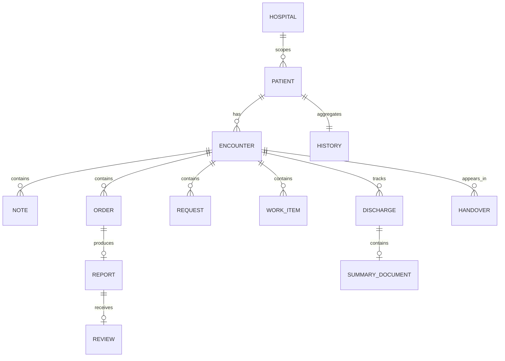
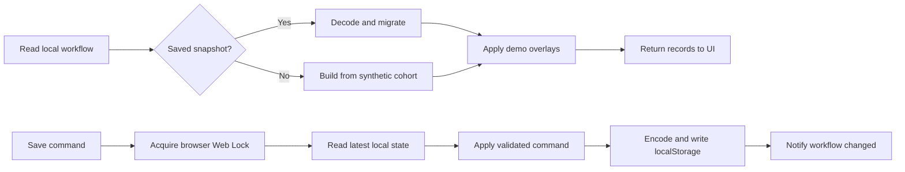

# Data, storage, and consistency

[Handbook index](README.md) · [Architecture](ARCHITECTURE.md)

## 1. Record relationships

The diagram is a conceptual view of the current TypeScript records. It is not a claim that every record already has its own production SQL table.

`PatientHistory` aggregates context, encounters, notes, vitals, medications, orders, requests, work items, timeline, and immunizations. The full `WorkflowState` also includes patients, reports, discharges, handovers, reviews, processed command IDs, audit entries, and optional update receipts. See [`domain/workflow.ts`](../../src/domain/workflow.ts), [`longitudinal.ts`](../../src/domain/longitudinal.ts), and [`models.ts`](../../src/domain/models.ts).

Use `patient_id` for the internal UUID. Use `uhid` for readable patient lookup and display. Use `encounter_id` to scope a clinical event to the correct visit/admission. Do not attach an old report to a new admission merely because the patient matches.

## 2. Storage inventory

| Data | Current home | Shared across devices? |
| --- | --- | --- |
| Clinical workflow in mock mode | Encoded browser `localStorage` snapshot | No; same-origin tabs on the same browser can see it |
| Clinical workflow in Supabase mode | `demo_workflow_state` for the fixed demo hospital | Yes, if callers use the same project and have access |
| Normalized `demo_*` clinical records | Supabase seed/source tables | Shared, but most ongoing workflow changes live in the snapshot |
| Hospital claims worklist | Browser storage through `claimsDemo.ts` | No, even when clinical mode is Supabase |
| AI conversation | Browser storage through `aiChatStore.ts` | No; keyed by doctor and patient |
| AI brief cache | Browser `localStorage` through `aiBriefCache.ts`, keyed by patient | No; a cache, not a durable clinical record |
| Scratch doctor notes | Browser storage through `doctorNotesStore.ts` | No; separate from workflow clinical notes |
| Demo author/role and view preferences | Browser storage | No; not an authorization source |
| Local insurer packets and files | `.insurer-inbox/` through file backend | Local server filesystem only |
| Hosted insurer packets and files | `demo_insurer_claims`, `demo_insurer_files` | Through hosted insurer APIs |
| Exported cohort and shift data | `data/generated/` files | Build/export artifacts, not automatic runtime sync |

Browser storage is scoped to the origin. `localhost`, `127.0.0.1`, different ports, and different deployment hostnames do not share it. Clearing browser storage can remove demo workflows, claims, notes, and conversations. Export anything needed before a reset.

## 3. Mock mode read/write flow

[`workflowStore.ts`](../../src/services/workflowStore.ts) reads the stored state or constructs a synthetic initial state from the cohort. Reads also apply missing-patient/legacy migration logic and in-memory ward-round/discharge-summary seeds. These overlays explain why some demo content can appear without a new explicit user command.

The main storage key is `vdoc.workflow.india-high-acuity-50-v2.v1`. The name is historical; do not infer the current patient count from it. The codec supports compressed snapshots and old uncompressed data.

Clinical writes require Web Locks and fail if the browser cannot provide the required locking support. A storage write error is surfaced rather than treated as a successful save. This protects tabs in one browser; it is not a distributed locking solution.

## 4. Supabase mode read/write flow

1. Read `demo_workflow_state` for `DEMO_HOSPITAL_ID`.
2. If it exists, validate the state and apply the relevant demo read migrations/overlays.
3. If it does not exist, load normalized seed tables in pages of 500 rows, build an initial state, and try to install it using `save_demo_workflow` with `expected_revision = -1`.
4. On a normal write, apply the command in TypeScript, calculate a patch with `workflowDiff.ts`, and call `save_demo_workflow_patch`.
5. A `PATCH1` response triggers a full-state RPC fallback. A `40001` conflict triggers a fresh read and retry, up to the store's three attempts.
6. Notify the browser and refresh the workflow query after success.

These are optimistic concurrency checks: the save succeeds only when the caller's expected revision matches the stored revision. A stale individual record can still be rejected by its `expected_version` even after a fresh snapshot read. The UI should ask the user to review the latest record, not silently overwrite it.

`api/_lib/workflowState.ts` has a separate service-role path: read snapshot, run the same command engine on the server, and update by matching the previous revision, with up to five attempts. It does not use exactly the same browser patch/RPC path.

## 5. Synchronization and caches

`WorkflowSync.tsx` watches the custom workflow event and browser storage events. Every five seconds, while visible, it invalidates the local workflow or checks the remote revision before refetching. Supabase reads also use a short in-process promise cache to avoid repeated large reads.

This is polling and cache invalidation, not a guaranteed real-time message stream. Other browser query keys and local claims caches have their own refresh behavior. Trace each query if two screens disagree.

## 6. Migration inventory

Read these files in filename order. For an existing database, first inspect its migration history; do not blindly rerun them.

| Migration | Purpose |
| --- | --- |
| `202609070001_foundation.sql` | Hospitals, memberships, initial patients/reports, access policies |
| `202609070002_longitudinal_cohort.sql` | Longitudinal source tables and hospital access policies |
| `202609070003_workflow_state.sql` | Shared workflow snapshot and save RPC |
| `202609080001_seed_synthetic_cohort.sql` | Synthetic cohort seed migration |
| `202609110001_anon_demo_read.sql` | Anonymous reads for selected fixed-hospital patient/encounter/report demo records |
| `202609110003_fast_save_demo_workflow.sql` | Revised full snapshot save implementation |
| `202609120001_patch_save_demo_workflow.sql` | Patch save RPC |
| `202610080001_insurer_demo.sql` | Insurer records/files protected from ordinary client access by RLS |

The older `supabase/seed.sql` is a small foundation dataset. `npm run data:export` produces the current full cohort and expansion SQL. Full seeding, expansion, and resetting an existing snapshot are different actions. Read the generated SQL before applying it.

## 7. Important integrity and access limitations

The normal browser workflow validates clinical transitions locally. The snapshot's audit array is editable data in that snapshot, not an immutable external audit trail. A summary's demo sign-off records a supplied actor/role and credentials; it is not a verified signature service.

The anonymous demo-read migration is an intentional repository fact. A login screen does not revoke those database permissions. Service-role API clients can bypass RLS; the current API handlers do not implement a complete trusted user/service authorization layer. API CORS configuration only controls browser cross-origin behavior and does not authenticate callers. Production must address these boundaries explicitly; [Supabase's RLS guide](https://supabase.com/docs/guides/database/postgres/row-level-security) explains grants, policies, and service-role behavior.

`api/patients/register.ts` performs normalized patient insertion, encounter insertion, and snapshot update as separate operations. A failure can leave partial data. Hospital claims and insurer updates can also commit separately. The production plan replaces these gaps with transactional writes, idempotency, and durable event delivery.

## 8. How to add a field safely

1. Extend the correct domain schema and command contract.
2. Update the engine to validate and apply the field.
3. Check snapshot decode, remote patch behavior, and legacy saved records.
4. Update the form, derived worklists, PDFs, handover sources, and AI context if relevant.
5. Update fixtures and exports only if the field belongs in synthetic source data.
6. Add a focused test for meaningful acceptance/rejection or persistence behavior.
7. Document any migration needed for already-saved data.

Do not fix a missing active workflow field by updating only `supabaseRepository.ts` or a seed SQL row. Existing snapshots usually remain the active source for workflow screens.
