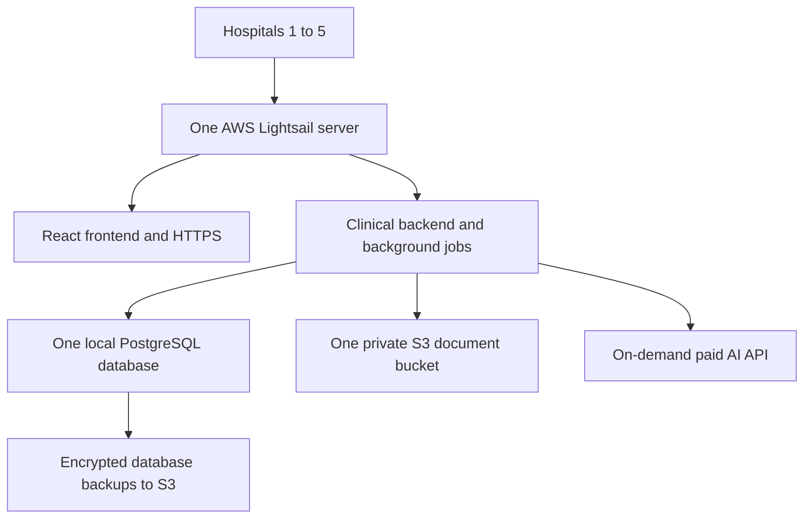

# Minimum shared cost: up to five hospitals

[Handbook](README.md) · [Detailed pricing evidence](COST_ESTIMATE.md)

**Planning date: 19 October 2026.** Use one shared server, one PostgreSQL database, one frontend, and one document bucket. For a lean pilot, budget **₹15,000–₹20,000/month total for five smaller hospitals**, or approximately **₹3,000–₹4,000 per hospital**. This includes modest on-demand AI and a buffer; taxes, implementation, payroll and human support are separate.

This is a simpler alternative to the earlier dedicated-deployment estimate. It is a proposed setup to build and test, not infrastructure already deployed or a proven five-hospital capacity limit. Conversion: **$1 = ₹95.0194**, the 16 October FBIL reference verified from [RBI](https://www.rbi.org.in/).

## 1. Only the essentials

- **Server:** one Linux Lightsail instance, **8 GB RAM, 2 vCPU, 160 GB SSD, public IPv4: $44/month**. Serve the built React app and API through Caddy/Nginx. The AI gateway and small jobs run on the same machine.
- **Database:** PostgreSQL on that server. No separate RDS bill. Keep its port private; index and authorize records by hospital.
- **Documents:** one private S3 bucket with hospital-scoped records/access. The database stores metadata; PDFs live in S3.
- **Login:** one shared identity setup, with server-verified hospital membership. Allow a small Cognito budget; eligible recurring free allowances may reduce it.
- **Backups:** daily database backups plus retained server snapshots and a tested restore procedure. Basic logs, disk/error alerts and HTTPS remain necessary.

Keep patient charts, notes, orders/results, referrals, coordination, discharge and handover. Their normal workflow logic does not need an AI call. Generate a short AI brief only when requested and reuse it until the relevant chart changes. Staff can type notes; voice is optional below.

There are no separate AI servers, GPUs, Kubernetes, load balancers, NAT gateways, managed queues, paid WAF integration or always-on staging environment in this budget. Frontend hosting is included on the shared server rather than charged again through Amplify.

## 2. Usage assumed for each smaller hospital

| Item | Monthly assumption per hospital |
| --- | --- |
| Hospital size | 50 IPD beds and 100 OPD visits/day |
| Occupancy / average stay | 80% / four days |
| OPD visits | 3,000 |
| Occupied IPD patient-days | 1,200 |
| Discharges | 300 |
| Staff accounts active that month | 80 |
| AI requests | One per OPD visit, IPD patient-day and discharge: 4,500, plus 10% retries = **4,950** |
| Average AI input / billed output | **3,000 / 400 tokens** per request |
| Document storage budget | **100 GB retained per hospital**, excluding diagnostic imaging and raw audio |
| Document downloads | 10 GB direct S3 delivery per hospital |

AI uses paid **Gemini 2.5 Flash** at $0.30/million input and $2.50/million output tokens: approximately **$9.41 / ₹894 per hospital/month**. This is a cost assumption, not a clinical-quality certification. Staff review generated text. The current full-chart AI payload needs context limits to fit this small-input budget; do not assume it already does.

## 3. Monthly bill for five smaller hospitals

| Expense | All five: USD/month | All five: INR/month |
| --- | ---: | ---: |
| One shared Lightsail server | $44.00 | ₹4,181 |
| Server snapshots: 120 GB total billed retention × $0.05 | $6.00 | ₹570 |
| Database backup storage: 40 GB in S3 | $1.00 | ₹95 |
| Basic logs/alerts allowance | $5.00 | ₹475 |
| Domain allowance: $20/year; Lightsail DNS included | $1.67 | ₹158 |
| S3 documents: 500 GB × $0.025 | $12.50 | ₹1,188 |
| S3 request/backup-operation allowance | $2.50 | ₹238 |
| S3 document delivery: 50 GB × $0.1093 | $5.47 | ₹519 |
| Staff authentication: 400 MAUs × $0.015, before free allowances | $6.00 | ₹570 |
| AI: 24,750 requests at the stated token sizes | $47.03 | ₹4,468 |
| **Subtotal** | **$131.16** | **₹12,462** |
| **Budget including 20% buffer** | **$157.39** | **₹14,955** |

Calculations use unrounded amounts; displayed rows may differ slightly when summed. The $5 monitoring amount and domain/request budgets are allowances. Other rates are published unit prices. No introductory credits or free trial are needed to reach this estimate.

## 4. Three, four, or five hospitals

The fixed shared setup is **$57.67/month**. Each smaller hospital adds approximately **$14.70/month** for documents, delivery, authentication and AI. Divide the fixed cost across active hospitals, then add their own usage and the 20% buffer.

| Smaller hospitals sharing everything | Total monthly budget: USD / INR | Each hospital's share: USD / INR |
| --- | ---: | ---: |
| 3 | $122.11 / ₹11,603 | $40.70 / ₹3,868 |
| 4 | $139.75 / ₹13,279 | $34.94 / ₹3,320 |
| 5 | $157.39 / ₹14,955 | $31.48 / ₹2,991 |

If **every hospital is 100 beds and 200 daily OPD**, double the visit-related AI, staff and download/request quantities, retaining the same 100-GB document budget per hospital:

| Larger hospitals sharing everything | Total monthly budget: USD / INR | Each hospital's share: USD / INR |
| --- | ---: | ---: |
| 3 | $166.03 / ₹15,776 | $55.34 / ₹5,259 |
| 4 | $198.30 / ₹18,842 | $49.58 / ₹4,711 |
| 5 | $230.58 / ₹21,909 | $46.12 / ₹4,382 |

**Example of different hospital sizes sharing the same setup:**

| Hospital | Size | Allocated monthly budget: USD / INR |
| --- | --- | ---: |
| Hospital 1 | 50 beds / 100 daily OPD | $31.48 / ₹2,991 |
| Hospital 2 | 50 beds / 100 daily OPD | $31.48 / ₹2,991 |
| Hospital 3 | 50 beds / 100 daily OPD | $31.48 / ₹2,991 |
| Hospital 4 | 100 beds / 200 daily OPD | $46.12 / ₹4,382 |
| Hospital 5 | 100 beds / 200 daily OPD | $46.12 / ₹4,382 |
| **Total, calculated before rounding** | **One shared server and database** | **$186.66 / ₹17,737** |

These are technology-cost allocations, not hospital subscription prices. Implementation and your support time still need to be recovered through pricing.

## 5. Small additions only when needed

- **Voice dictation:** 1,000 spoken minutes/hospital/month, plus 10% retries, current AssemblyAI Sync and Gemini cleanup, adds **$6.35/hospital before buffer**. Across five hospitals, budget approximately **$38.12 / ₹3,622 extra including buffer**. That brings the five-smaller-hospital budget to about **₹18,577/month**. Live sessions left open cost more.
- **More server capacity:** the priced 16-GB/4-vCPU Lightsail plan is $84/month. Upgrading from $44 adds **$48 / ₹4,561/month including buffer for the whole platform**, approximately ₹912 each across five hospitals.
- **Growing documents:** an extra 100 GB in S3 costs **$2.50 / ₹238/month before buffer**. The 100-GB-per-hospital allowance is an initial budget, not a retention cap to enforce by deleting records. Using the detailed guide's growth assumptions, five smaller hospitals could reach 1,125 GB after a year; that raises this budget by about **₹1,782/month**, before any additional backup/network growth.

## 6. Conditions for this low cost to work

Share infrastructure, **not access to another hospital's records**. The backend must verify identity, membership and hospital scope for every read, write, document and AI request. The current demo's fixed hospital identifiers, browser-controlled actors and browser-only claim records need the backend/tenant work described in the [production roadmap](PRODUCTION_ROADMAP.md). This document estimates hosting after that work; it does not implement it.

One server is a shared point of failure: an outage or maintenance can interrupt every hospital. Daily backups can still lose changes since the latest backup. Someone must patch the server, monitor disk/database growth and test restoration. This is a lean controlled-pilot design with no high-availability SLA. Load-test realistic concurrent staff and chart queries before onboarding all five; increase capacity when measurements require it.

Costs exclude tax, engineering, on-call/support labor, paid integrations, SMS/WhatsApp, bulk OCR, PACS/imaging storage and unlimited AI/voice. The AI assumptions also depend on an approved provider/data-routing arrangement; Mumbai infrastructure alone does not keep external model processing in India.

**Practical starting budget:** keep **₹20,000/month for the shared technology bill for five smaller hospitals**, or **₹25,000–₹30,000 for five larger hospitals**, with the usage controls above. These rounded envelopes provide some room beyond the calculated totals; human operating costs remain separate.

## Official prices to cross-check

- [AWS Lightsail plans, included resources, snapshots and Mumbai transfer allowance](https://aws.amazon.com/lightsail/pricing/): the selected public-IPv4 plan is $44; snapshots are $0.05/GB-month. Mumbai receives half the headline transfer allowance, so its 5-TB bundle headline means **2.5 TB included** there. Traffic beyond the bundle is extra.
- [AWS S3 pricing](https://aws.amazon.com/s3/pricing/) and [saved Mumbai rates](../costing/pricing-snapshot-2026-10-19.json): $0.025/GB-month for the selected standard tier; direct document delivery is budgeted separately from server transfer.
- [Gemini paid API pricing](https://ai.google.dev/gemini-api/docs/pricing): selected Flash text input/output prices; billed output must include reasoning tokens if used.
- [Cognito pricing](https://aws.amazon.com/cognito/pricing/) and [AssemblyAI pricing](https://www.assemblyai.com/pricing): login and optional short dictation.

The only newly priced infrastructure here is Lightsail; other rates and FX reuse the dated evidence from the detailed estimate. This simple scenario is not generated by the dedicated-deployment calculator.
