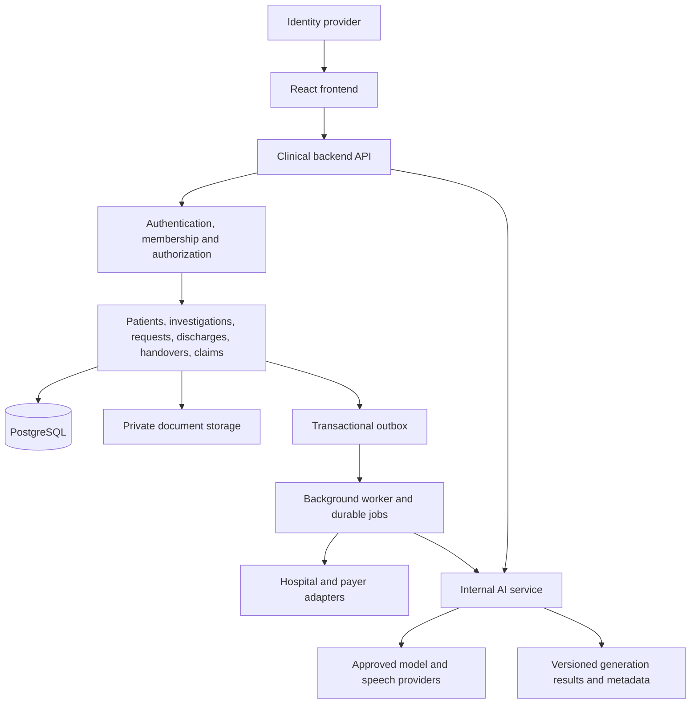

# From the current demo to a production product

[Handbook index](README.md) · [Current architecture](ARCHITECTURE.md) · [AWS deployment](AWS_DEPLOYMENT.md)

**Status:** implementation plan, not completed infrastructure or a production-readiness claim. This guide describes engineering work to build next. It does not change the current app's behavior.

## 1. The recommended starting point

Keep the React frontend and useful TypeScript workflow rules. Build one dedicated clinical backend with clear feature modules, a separately deployable internal AI service, and a background worker. Use PostgreSQL for authoritative records and private object storage for documents. Deploy the frontend, API, AI service, and worker independently on AWS.

Start with a modular backend rather than a service for every feature. Discharge, investigations, and referrals share transactional clinical facts. Splitting them into separate databases immediately would add distributed consistency work before the core product is reliable. The AI runtime deserves its own boundary because it has provider credentials, different latency/cost controls, and different failure behavior.



## 2. Concrete gaps in this repository

| Current evidence | Why it matters | Work to do |
| --- | --- | --- |
| `workflowStore.ts` computes clinical mutations in the browser | A modified client can bypass UI/TypeScript rules | Execute commands and authorization on the server |
| One `demo_workflow_state` object per hospital | Broad reads and hospital-wide conflict contention | Normalize records and expose scoped/paginated queries |
| `workingAs.ts`, supplied command actor/role, demo doctor mapping | Display names are not trusted identities | Use authenticated user IDs, memberships, roles and permissions |
| Anonymous demo-read migration | Some records can be read without clinical login if applied | Replace demo grants/policies and test actual access boundaries |
| Privileged API helper with fixed hospital/project and service role | Caller scope is not derived from verified identity | Runtime config, user/service authentication, tenant validation |
| AI/voice/insurer endpoint wrappers lack a complete access/quota layer | UI login alone does not protect APIs | Shared auth, limits, resource scope and audit middleware |
| Hospital claims, chat, scratch notes in browser storage | Important work can be device-bound or lost | Centrally persist product records; define local draft policy |
| Patient/encounter/snapshot writes occur separately | Registration can partially succeed | One backend database transaction |
| Local claims and insurer updates commit separately | Delivery and local state can disagree | Idempotency, durable submissions, outbox and reconciliation |
| Audit and signing metadata stored in editable snapshot | Does not provide immutable clinical history | Restricted append-only audit and versioned signed artifacts |
| Insurer PDF contents stored as base64 SQL rows | Document access/lifecycle not independently managed | Private object storage and document metadata/version records |
| No AWS IaC, service containers, or independent backend startup | Static build cannot deploy all functions | Add runtime apps, infrastructure, pipelines and runbooks |
| Tests focus on local rules and synthetic examples | Does not verify deployed RLS, external interfaces or recovery | Backend integration, tenant isolation, migration, failure and operational testing |

These observations are about the checked-in code. They are not evidence of an exploited deployment or a live environment assessment.

## 3. Proposed repository layout

Keep a single repository initially so contracts, migrations, UI, and backend changes can be reviewed together. The following folders are **proposed**; they do not exist yet.

```text
apps/
  web/                         Current React UI, browser-only concerns
  api/
    src/
      main.ts                  Start HTTP server and graceful shutdown
      config.ts                Validate runtime server configuration
      middleware/              Auth, request IDs, limits, errors
      modules/
        patients/              Registration, directory, encounters
        investigations/        Orders, results, observations, review
        coordination/          Requests, referrals, assignment, response
        discharges/            Readiness, summaries, signing, completion
        handovers/             Shift packets, capture, approval, receive
        claims/                Packets, payer submissions, remittance
        identity/              Hospital membership and access policy
        documents/             Upload/download and artifact versions
        notifications/         Inbox and delivery state
      infrastructure/          SQL transactions and external clients
  ai/
    src/
      main.ts                  Internal service entry
      providers/               Current provider adapters, with limits
      tasks/                   Brief, chart answer, transcription, cleanup
      prompts/                 Versioned prompt definitions
      validation/              Input/output and grounding checks
    evals/                     Synthetic evaluation cases and results
  worker/
    src/
      main.ts                  Poll queues and process jobs
      jobs/                    PDF, integrations, notifications, replay
packages/
  contracts/                   HTTP request/response schemas and OpenAPI
  clinical-domain/             Pure business rules and value objects
  test-fixtures/               Synthetic records used by tests/demo
database/
  migrations/                  Product schema and access changes
  tests/                       Constraints, transactions and isolation tests
infra/
  terraform/                   AWS infrastructure definitions
docs/
  developer/                   Current guide, kept up to date
  runbooks/                    Release, incident, restore and integration procedures
```

Within a backend module, use `routes.ts` for HTTP mapping, `schemas.ts` for validated input/output, `service.ts` for the use case, `repository.ts` for SQL operations, and `policy.ts` for permissions where needed. Keep workflow rules reusable and independent of the HTTP framework. A TypeScript server using Fastify is a reasonable default; explicitly integrate the chosen contract schemas rather than assuming existing Zod schemas automatically become Fastify route validation. See the [Fastify validation documentation](https://fastify.dev/docs/latest/Reference/Validation-and-Serialization/).

## 4. How to extract the existing code

| Existing code | Future home / treatment |
| --- | --- |
| `src/pages`, `components`, styling | `apps/web`; preserve UI and replace persistence calls behind services |
| Pure domain schemas / transition rules | `packages/clinical-domain`; remove seed, browser and fixed-hospital dependencies |
| Public command/DTO shapes | `packages/contracts`; publish explicit request/response contracts |
| `workflowStore.ts` | Keep as demo adapter; build frontend HTTP client and backend repositories for production |
| `server/patientAi.ts`, `aiProviders.ts`, cleanup/transcription | `apps/ai`, after input/output/auth/timeout refactor |
| `api/*` | Migrate into API routes and services; remove Vercel-specific request types from core logic |
| Claim transitions / PDF building | Backend claims domain and document worker; preserve useful tests |
| `server/insurer.ts` | Explicit test/demo simulator; build separate adapters for real payers |
| `src/data/*` and seeding | Test/demo fixtures; exclude automatic synthetic overlays from production |

The current engine imports demo catalogs, owners, seed builders, and role helpers. Do not simply copy it into a server and declare the extraction finished. Replace those dependencies with injected product configuration and split rules by feature while preserving tested behavior.

## 5. Authentication and authorization

Select one production identity provider. A practical AWS destination is Cognito or the hospital's existing OIDC identity provider. To reduce simultaneous migration, the first dedicated API may validate existing Supabase identities before a later identity cutover. Do not switch identity and database ownership without a user/membership mapping plan.

For every clinical request:

1. Verify the access token with the configured issuer and keys, expiration, intended client/audience as appropriate, and token use. For Cognito-specific rules, follow the [official JWT verification guide](https://docs.aws.amazon.com/cognito/latest/developerguide/amazon-cognito-user-pools-using-tokens-verifying-a-jwt.html).
2. Resolve the stable user and active hospital membership server-side.
3. Check feature permission and resource scope: patient/encounter/hospital, care-team assignment, and requested action.
4. Set actor identity and trusted timestamps on the server. Treat supplied display names, roles, tenant IDs, and document signatories as untrusted input.
5. Record access/mutation audit as required by the approved product policy.

Use a permission matrix, reviewed with the product/hospital team. Example permissions are `order:create`, `report:publish`, `request:respond`, `summary:prepare`, `summary:sign`, `discharge:complete`, `handover:approve`, and `claim:submit`. “Doctor” alone may not answer whether a user can sign a document for this patient at this hospital.

Authenticate service integrations separately from human users. Use scoped machine identities, replay protection, and rotated credentials or agreed signed requests. The AI service should accept only authenticated internal calls; network placement alone is not its whole trust model.

## 6. Database and consistency model

Create product tables for hospitals, users/memberships, patients, encounters, clinical notes/amendments, orders, report versions, observations, result reviews, requests/responses/reviews, tasks, discharges, summary versions/signatures, handover packets/patient snapshots, claims, submissions, payer events, documents, inbox receipts, audit events, idempotency records, and outbox events.

Use stable UUIDs, timestamps, tenant scope, foreign keys, unique constraints, and per-record versions. Define uniqueness such as `(hospital_id, uhid)` and external-source identifiers. A foreign key or query must not allow an encounter from hospital A to attach to a patient in hospital B. Enforce tenant consistency structurally where possible, with application authorization and tested database policies as additional controls.

For a clinical command, open one transaction, load/check current records, apply rules, write the change, increment its version, append the audit event, and insert any outbox event before commit. Multi-row discharge and registration must either commit together or roll back. [PostgreSQL transactions](https://www.postgresql.org/docs/current/tutorial-transactions.html) provide that all-or-nothing boundary.

An idempotency record should bind tenant, actor/client, operation, request key, and payload hash to the result. A repeated key/payload returns the prior result; a reused key with a different payload is rejected. Per-record version conflicts return an explicit conflict response so users can review current data.

Use an outbox for DB changes that must trigger external work. A relay publishes durable events after commit; consumers track event IDs and tolerate duplicates. This addresses the database-plus-message failure gap described by the [AWS transactional outbox pattern](https://docs.aws.amazon.com/prescriptive-guidance/latest/cloud-design-patterns/transactional-outbox.html). It does not make a remote payer call part of the SQL transaction.

## 7. Proposed API shape

These routes are examples to build, not existing endpoints. Publish the final contract and response schemas before migrating callers.

| Area | Example contract |
| --- | --- |
| Patient directory | `GET /v1/patients?search=&cursor=&limit=` |
| Patient chart | `GET /v1/patients/:id/encounters`, `GET /v1/encounters/:id/chart` |
| Investigations | `POST /v1/encounters/:id/orders`, `POST /v1/orders/:id/results` |
| Review | `POST /v1/reports/:id/reviews`, `POST /v1/requests/:id/reviews` |
| Requests/referrals | `POST /v1/encounters/:id/requests`, explicit accept/start/respond/cancel actions |
| Discharge | Create process; update checklist; mark ready; sign summary; complete; reverse |
| Handover | Create packet; edit patient draft; refresh sources; approve; acknowledge |
| Claims | Create/review packet; submit; read delivery/payer state; reconcile |
| Documents | Request scoped upload/download; finalize verified artifact metadata |
| AI | Ask/generate against authorized patient/encounter/context version |
| Integrations | Authenticated import/webhook routes with source event IDs |

Return structured errors with a safe message, stable code, field errors where appropriate, and request ID. Use validation errors for invalid input, authentication/authorization errors for access, conflicts for stale versions, and unavailable/timeouts for dependencies. Avoid returning raw database/provider exceptions to the user.

Example proposed write envelope:

```json
{
  "expectedVersion": 4,
  "idempotencyKey": "a-client-generated-unique-request-id",
  "payload": {
    "response": "The receiving clinician's documented assessment"
  }
}
```

The server derives actor/hospital membership and validates the target resource. It must not trust a client role field to authorize the response.

## 8. AI and voice as a product service

The clinical API authorizes a patient/encounter request and builds the minimum context from authoritative records. It then calls the internal AI service with a context version and task type. The AI service controls prompts, provider/model configuration, retries/timeouts, output validation, and usage limits.

Store generation ID, tenant/user, task, source record versions, prompt/model version, timestamps, latency, token/cost metadata, validation outcome, and accepted/rejected result as appropriate. Decide retention of raw prompts, chart text, transcripts, and audio explicitly; default application logs should not contain them.

Keep chat/brief output as assistance, separate from signed clinical facts. A human action should be required to save generated content into the chart. Build an evaluation set for unsupported claims, citation support, historical/current confusion, conflicting records, prompt injection, medication/number/negation preservation, provider outages, and interrupted dictation. Citation-ID existence alone is insufficient.

Initially retain approved external providers behind adapters. Bedrock or AWS speech services are future adapter choices only after model/region capability, clinical quality, and data handling evaluation; AWS hosting does not require changing the model provider immediately. The system must keep ordinary clinical workflows usable when AI is unavailable.

## 9. Production changes by flow

| Flow | Required product behavior |
| --- | --- |
| Patient/registration | Transactional patient + encounter creation, duplicate handling, central chart/note history |
| Investigations | Authenticated source import, external ID mapping, versioned corrections, review acknowledgements |
| Referral/coordination | Verified sender/receiver, assignment history, response amendments, escalation and durable delivery |
| Discharge | Backend blocker checks at commit, signer authorization, immutable signed document version, controlled reversal |
| Handover | Transactional packet approval, retained source versions, correct incoming-clinician acknowledgement |
| Claims | Central claim ledger, frozen submitted packet, real payer receipts/callbacks, finance reconciliation |
| AI/voice | Scoped context, service auth, evaluations, usage controls, original transcript recovery |
| Updates | Durable notifications and per-user receipts, distinct from clinical review |

## 10. Ordered implementation plan

### Phase 0: Establish the boundary

Capture current behavior with existing tests and synthetic flow examples. Inventory all API endpoints, storage keys, demo grants, seed overlays, hardcoded identifiers, and external credentials. Agree the first hospital/user roles and first supported real integration. Keep demonstration data separate from future real data.

**Exit:** an agreed scope, access matrix, data ownership map, and reproducible current demo.

### Phase 1: Create a dedicated API

Introduce the workspace/app layout, contracts, API process, config validation, health endpoints, structured errors, token verification, tenant middleware, and SQL transaction helper. Migrate one vertical slice: authenticated patient read plus investigation creation/review. Replace the frontend service implementation behind its existing facade.

**Exit:** the frontend completes that slice through the backend; forged actor/tenant fields and cross-hospital resource IDs are rejected.

### Phase 2: Make clinical records authoritative

Add normalized schema and backend modules for requests, discharges, and handovers. Preserve existing rule tests and add transactional, concurrency, and authorization tests. Move central notes/receipts into the backend. Disable production browser snapshot writes and synthetic read overlays.

**Exit:** all clinical mutations use server rules; concurrent saves, registration, and discharge cannot partially commit.

### Phase 3: Documents, claims, and integration delivery

Add private document storage, immutable artifact versions, central claims/submissions, outbox/worker queues, source identities, callback validation, retry/dead-letter processing, and operator reconciliation views. Keep mock insurer code available only for tests/demo environments.

**Exit:** duplicate imports/submissions do not duplicate clinical or financial effects; interrupted deliveries recover through durable state.

### Phase 4: Isolate and evaluate AI

Move provider calls to the internal AI runtime, add authorized context retrieval, budgets, evaluation suite, generation tracking, and speech recovery controls. Migrate browser-only conversation state if it is part of the product record.

**Exit:** evaluated behavior and graceful provider failure, with no direct public route to unbounded provider usage.

### Phase 5: Deploy a staging product on AWS

Follow the [AWS guide](AWS_DEPLOYMENT.md): infrastructure as code, environment isolation, independent builds, database migration job, monitoring, backup/restore drill, staged rollout, and rollback.

**Exit:** repeatable staging releases, recovery evidence, deployment smoke checks, and named operational owners.

### Phase 6: Migrate and run a controlled pilot

Map identities and records, rehearse data migration, complete hospital/user acceptance testing, define downtime/escalation processes, train staff, and roll out to an agreed limited scope. Review hospital requirements for data handling, access, clinical safety, and operational acceptance before live use.

**Exit:** the release gates below are evidenced and the responsible product/hospital owners accept the pilot scope.

## 11. Data cutover and rollback

Do not dual-write browser snapshots and normalized product tables indefinitely. Move one bounded feature at a time, give it a single authoritative writer, and use a compatibility read adapter during transition if necessary.

For each cutover: freeze or checkpoint writes, export versioned source data, validate schema and tenant ownership, map IDs, import idempotently, reconcile row counts/relationships and sample full patient journeys, switch a feature flag, and monitor. Browser claims/notes/chat require an explicit per-device export/import decision; they cannot be recovered by migrating Supabase alone.

Existing data is synthetic; the team may choose a fresh product database after preserving the demo. If any real records are introduced later, migration and retention decisions must follow the approved product policy. Rollback must account for writes after cutover. An old frontend bundle must never resume writing an obsolete snapshot over newer authoritative data.

## 12. Release gates

Before a real pilot, require evidence for tenant/role isolation, server validation of each critical transition, duplicate/concurrent request handling, signed document version integrity, source integration failure/replay, backup restoration, operational alert delivery, and deploy/rollback rehearsal. Add end-to-end journeys for discharge, referral/response review, result review, handover approval/receive, and claim submission/reconciliation.

Set workload-specific performance targets, recovery time, recovery point, and capacity limits with the team, then measure them on representative data. Do not invent production readiness from a successful static build. A hospital workflow product also needs clinical/content review, support ownership, documented incident escalation, and a tested downtime procedure.
