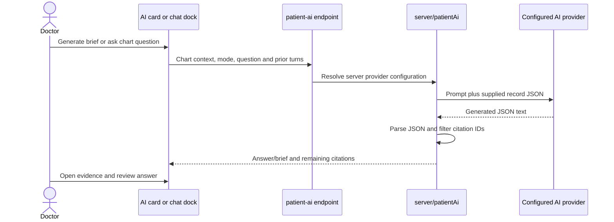

# AI assistance and voice input

[Handbook index](../README.md) · [Production roadmap](../PRODUCTION_ROADMAP.md)

## 1. Chart summary and conversation

The patient chart includes an optional AI brief and chart question assistant. `src/services/aiAssistant.ts` sends patient/history/report context to the configured `VITE_AI_PROXY_URL`. This is separate from deterministic chart cards, handover drafting, and discharge-summary prefill.

`server/aiProviders.ts` contains Anthropic, OpenAI, and Gemini adapters. Provider/model/credentials are server configuration. The handler instructs the provider to use supplied records and return JSON. It removes citations whose record type/ID is not in the supplied context.

An existing citation ID does not prove that the generated sentence is supported by that source. The top-level summary and answer are not fully clinically fact-checked by the filter. Current context also comes from the browser, rather than a backend-authorized chart lookup. Those are explicit production gaps.

Chat history uses browser storage, scoped by doctor key and patient. Brief caching is a separate optimization. The assistant does not automatically execute workflow commands from generated text.

## 2. Push-to-talk dictation

`useVoiceRecorder.ts` manages capture, conversion, transcription, and cleanup. `server/transcribe.ts` handles the provider call. Voice text does not save the clinical form on its own.

## 3. Live dictation

`useLiveVoiceRecorder.ts` asks `POST /api/transcribe-token` for a temporary token, captures PCM audio using `pcmCapture.ts`, and connects the browser directly to AssemblyAI over a WebSocket. Text arrives as turns. Disconnect/termination handling attempts to return recovered text with a warning when incomplete.

Audio therefore has two different routes: batch audio passes through the server transcription endpoint; live audio streams from the browser to the provider after server token issuance. An AWS design must account for both egress and token access.

The app-wide mode lives in `voiceMode.tsx` and defaults to push-to-talk. The shell currently hides `VoiceModeToggle`, but the stored mode can still affect behavior.

## 4. Conservative cleanup and safe insertion

`server/voiceCleanup.ts` uses Gemini to remove fillers and fix punctuation/grammar without adding clinical facts. `src/lib/voiceCleanup.ts` validates the output and checks protected content. Missing Gemini configuration, provider failure, timeout, or rejected cleanup retains the original transcript with a warning.

`useDictationField.tsx` compares the field with the value at recording start. If the user changed the field while processing, the hook avoids blindly inserting over their work and offers recovery controls. Users can inspect/insert the original and undo cleanup when the current field still matches the inserted result.

These controls reduce accidental text changes; they do not establish clinically accurate speech recognition or perfect semantic equivalence.

## 5. Server execution and errors

Vite middleware mounts these routes for local development; `api/*.ts` wraps the hosted version. Missing chart AI/transcription configuration produces unavailable/error responses. Cleanup deliberately falls back to the original. Static `vite preview` does not supply these APIs.

Current handler files do not provide a complete user-authentication, hospital-scope, quota, and abuse-control layer. Batch audio handling also needs consistent size/time limits across environments. Do not use the browser's AuthGate as API authentication.

## Files and tests

Read [`aiAssistant.ts`](../../../src/services/aiAssistant.ts), [`patientAi.ts`](../../../server/patientAi.ts), [`aiProviders.ts`](../../../server/aiProviders.ts), [`useVoiceRecorder.ts`](../../../src/hooks/useVoiceRecorder.ts), [`useLiveVoiceRecorder.ts`](../../../src/hooks/useLiveVoiceRecorder.ts), and the cleanup hook/helpers. `src/lib/voiceCleanup.test.ts` covers cleanup invariants. There is no equivalent comprehensive live-provider accuracy/evaluation suite in the current test set.

## Production work

Authenticate API callers, retrieve permitted chart context on the backend, minimize provider input, and record model/prompt/context versions. Isolate provider credentials in an AI service, apply quotas/timeouts, and evaluate clinical grounding and dictation preservation before release. Keep user review and explicit workflow commands. Decide provider retention, region, and data-use requirements with the hospital before sending real records or audio. Add failure/latency monitoring and graceful degradation so a provider outage does not stop ordinary clinical work.
