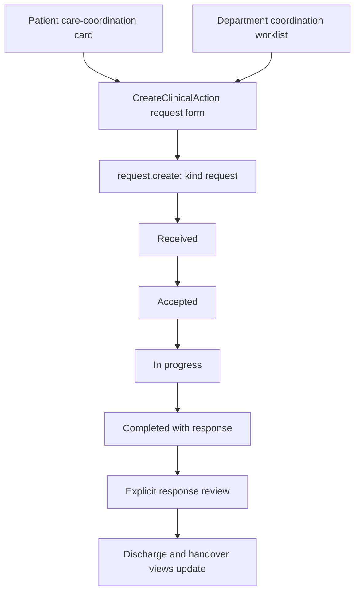

# Care coordination and work items

[Handbook index](../README.md) · [Referrals](REFERRALS.md)

## Purpose and difference from referrals

Care coordination asks another team to answer a specific question or perform a collaborative action. A referral asks for specialist assessment of the patient. Both currently use the same request record and transition engine; coordination uses `kind = 'request'`, while referrals use `kind = 'referral'`.

The department worklist is `/app/requests`. The patient's `CareCoordinationCard.tsx` summarizes requests/work items and offers an add-request action.

Open requests can also be cancelled with a reason. Saving an assignment or response draft need not advance the status.

## Step by step

1. Select the patient and department, describe the requested collaboration, assign a named clinician/team, and set priority. Optional purpose/contact information gives the recipient useful context.
2. The shared `request.create` command validates active encounter, allowed destination, patient-owned source reports, and duplicate open requests.
3. The receiving team accepts and starts work through `request.update`.
4. Staff can save a response draft while work continues. The final completion action requires the response.
5. The requesting team explicitly reviews the completed response through `request.review`.
6. Worklists, patient cards, handover snapshots, doctor updates, and discharge blockers read the changed workflow state.

Despite the broader product wording, the current request engine still limits destinations to its configured clinical departments and rejects the primary department. Adding billing, nursing, pharmacy, or a same-department request needs deliberate contract/validation changes; it is not just another label in a dropdown.

## Requests versus work items

`history.requests` records collaboration with its own lifecycle, owner, response, and review. `history.work_items` represents separate tasks/review items. `work.complete` marks a task complete, but rejects a work item of kind `discharge`: discharge must go through its own checklist. Completing a generic task does not complete a referral or review a report.

Example: a completed coordination response can still show as needing review. The user must review it; marking an unrelated review task complete will not automatically stamp `request.reviewed_at`.

## Files and tests

Read [`CareCoordinationCard.tsx`](../../../src/components/CareCoordinationCard.tsx), [`CoordinationPage.tsx`](../../../src/pages/CoordinationPage.tsx), [`RequestDetail.tsx`](../../../src/components/RequestDetail.tsx), and `request.*` / `work.complete` in [`workflowEngine.ts`](../../../src/services/workflowEngine.ts). Use `workflowEngine.test.ts` for lifecycle, validation, and downstream rules.

## Production work

Define real team types, task ownership, permitted destinations, escalation, due times, and response-review responsibility. Run these permissions and transitions on the backend. Store request and task histories separately. Add reliable delivery/acknowledgement rather than relying on a periodically refreshed worklist as the only notification mechanism.
