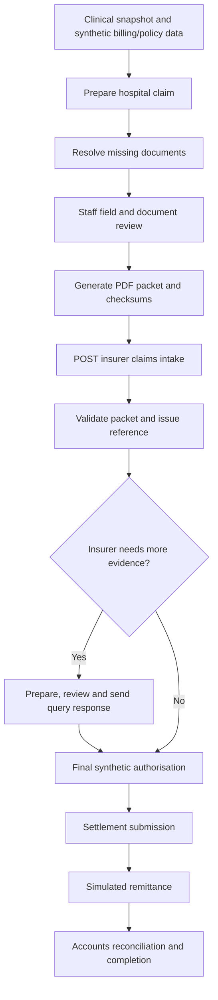

# Cashless claims and the synthetic insurer

[Handbook index](../README.md) · [Discharge](DISCHARGE.md)

## Two sides and two sources of state

`/app/claims` is the hospital worklist. `/insurer/*` is a separate fictional insurer portal. Hospital claim state lives in browser storage through `claimsDemo.ts`. The insurer has its own records/files, stored locally in `.insurer-inbox/` during Vite development or in demo Supabase tables through the hosted API.

Supabase clinical mode does not make hospital claims centrally persisted. The insurer transfer is an actual HTTP/PDF demonstration, but authorisation, settlement, and payment remain synthetic events.

## Hospital lifecycle

The worklist seeds ten cases with a mix of early, in-flight, and completed examples. Inspect `initialStatuses` and `seedWorklist()` in the current source rather than relying on old demo counts.

The main status path is `draft → needs_documents → review → submitted`. A query leads through `query → response_review → response_submitted`. Final progress is `authorised → settlement_submitted → payment_received → completed`. Review/completeness gates and scenario actions control which steps can be taken; it is not a generic arbitrary status editor.

1. Preparation gathers patient/episode context, synthetic bill/policy/authorisation data, summary, and required documents.
2. Missing evidence must be attached and staff must review the packet before submission. Form changes can require fresh review.
3. `claimsExport.ts` renders PDF attachments, calculates SHA-256 checksums, and builds the submission fields.
4. `ClaimsPage.tsx` validates the transition before sending. The insurer receipt reference is then saved in the hospital's local claim.
5. A query asks for additional supporting material, such as an itemised pharmacy bill. The response has its own review and submitted packet history.
6. Presenter/insurer controls simulate authorisation and payment. Accounts reconciliation verifies the synthetic authorised, paid, patient-payable, and bill amounts before closing.

## Insurer API and validation

| Endpoint under `/api/insurer` | Purpose |
| --- | --- |
| `POST /claims` | Initial packet intake |
| `GET /claims`, `GET /claims/:ref` | List/read insurer records |
| `POST /claims/:ref/response` | Receive supporting response packet |
| `POST /claims/:ref/query` | Record an insurer document query |
| `POST /claims/:ref/events` | Record synthetic authorisation/settlement/payment/reconciliation |
| `POST /reset` | Reset demo insurer storage; keep out of a production API |

`server/insurer.ts` validates required initial fields/documents, nonempty narrative, PDF header, declared byte length, file size, and checksum. It provides file/memory backends and record/file operations. `api/_lib/insurerSupabase.ts` implements hosted storage with base64 file contents in a database table. These are mock payer contracts, not real insurer APIs.

## Failure behavior to understand

Submitting the insurer packet and saving the local hospital claim are separate operations. An interrupted request can leave a remote receipt without the expected local transition. Intake includes duplicate-detection logic, but it is not a substitute for transactional server-side idempotency under concurrent requests.

Some synthetic events save the hospital action first and then mirror an insurer event. If the mirror fails, the UI warns that local state saved but the insurer did not update. `claimsInsurerSeed.ts` can replay authored in-flight history. Treat that as demonstration setup, not general-purpose production recovery.

## Files and tests

Read [`ClaimsPage.tsx`](../../../src/pages/ClaimsPage.tsx), [`InsurerPortalPage.tsx`](../../../src/pages/InsurerPortalPage.tsx), [`claimsDemo.ts`](../../../src/services/claimsDemo.ts), [`claimsExport.ts`](../../../src/services/claimsExport.ts), [`server/insurer.ts`](../../../server/insurer.ts), and [`domain/insurer.ts`](../../../src/domain/insurer.ts). Relevant tests are `claimsDemo.test.ts`, `claimsExport.test.ts`, `claimsInsurerSeed.test.ts`, and `server/insurer.test.ts`.

## Production work

Create backend-owned claims, document versions, reviews, submissions, receipts, payer messages, remittances, and reconciliation records. Replace demo decisions with authenticated payer responses and verified finance records. Use durable queues, idempotency, signed/verified callbacks, and an outbox for delivery. Store documents in private object storage with metadata in SQL. Keep clinical discharge, insurer approval, and money received as distinct facts.
