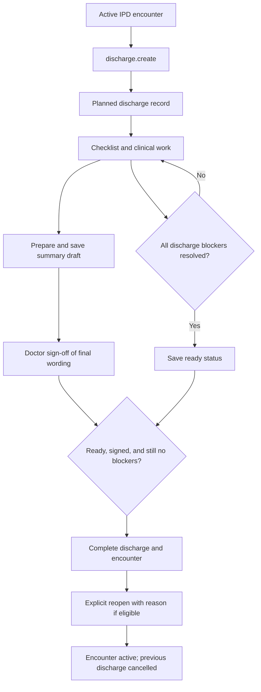

# Discharge and discharge summaries

[Handbook index](../README.md) · [Requests](CARE_COORDINATION.md) · [Investigations](INVESTIGATIONS.md)

## Purpose and entry points

Discharge is an explicit process for an IPD admission. It is not a task checkbox or the same event as claim authorisation. Start from the patient workspace's “Send to discharge process” action or use `/app/discharges`. Edit a document at `/app/discharges/:id/summary`.

The main lifecycle is `planned → in_progress → ready → discharged`, with `cancelled` as a closed alternative. The engine does not enforce every adjacent step in that drawing: the strict completion requirements are that readiness was saved first, all blockers pass again, and the summary document is signed.

## Step by step and rules

1. `discharge.create` requires an active IPD encounter. Another non-cancelled discharge for that encounter is rejected. The engine adds a discharge record and a progress note.
2. `DischargesPage.tsx` shows active, discharged, and cancelled views. A non-cancelled discharge routes the encounter out of the normal worklist through `worklistSelectors.ts`.
3. `discharge.update` checks entity version and encounter ownership. Closed records cannot be edited through this action.
4. `dischargeBlockers()` checks current-encounter investigations, requests, report reviews, response reviews, review tasks, clinical clearance/rationale, summary text, medication reconciliation, follow-up, and documents.
5. Saving `ready` runs those checks. New work can introduce blockers later, so readiness alone is not a permanent permission to finish.
6. Completing requires the previous status to be `ready`, a signed structured summary, and a fresh blocker check. It completes the encounter, records the discharge time, updates the patient's encounter display, completes related discharge work items, and adds a discharge note.

## What blocks discharge

| Current condition | Required next action |
| --- | --- |
| Lab/imaging order pending or processing | Publish a valid result or cancel with a reason |
| Referral/coordination request still open | Complete the lifecycle or cancel with a reason |
| Completed request response unreviewed | Explicitly review the response |
| Published current-encounter report unreviewed | Explicitly review the result |
| Pending review work item | Complete the required review task |
| Clinical clearance/rationale missing | Record both |
| Summary, medication check, follow-up or documents incomplete | Complete those checklist items |
| Final document unsigned | Save and sign through the summary flow |

There is no claim-payment gate in `dischargeBlockers()`. Do not add a billing shortcut that bypasses clinical readiness or assume the current demo already models a hospital's full discharge policy.

## Structured summary and PDF

`dischargeSummaryBuilder.ts` builds a draft from chart data. Sections include patient details, diagnoses, complaints/history/examination, investigations, hospital course, procedures, condition, medications, advice, warning signs, and follow-up. The editor can reset individual sections from the record or reset the whole unsaved draft.

`discharge.summary.save` persists the document in `summary_doc`, updates plain summary text, records edit metadata, and clears an existing signature. Any edit requires a new final sign-off. `discharge.summary.sign` requires the supplied role to be `doctor`, a saved document, and no `summarySignGaps()`. It stores the supplied signatory details. `dischargeSummaryPdf.ts` creates the preview/download/print PDF in the browser.

These are demo sign-off mechanics. Role selection and signatory details are not independently verified by a trusted server. Synthetic summary seeds can also prepopulate demonstration records.

## Reopen behavior

`discharge.reopen` requires a completed discharge, a matching version, no currently active encounter, and the latest admission. It reactivates that encounter and cancels the old discharge record. It adds a reversal note with the reason; it does not erase the historical event. A new discharge process can then be started. Production needs an approved reversal policy and immutable amendment trail.

## Files and tests

Read [`DischargesPage.tsx`](../../../src/pages/DischargesPage.tsx), [`DischargeSummaryPage.tsx`](../../../src/pages/DischargeSummaryPage.tsx), [`workflowEngine.ts`](../../../src/services/workflowEngine.ts), [`dischargeSummary.ts`](../../../src/domain/dischargeSummary.ts), and the builder/PDF files in `src/services/`. Tests include `workflowEngine.test.ts`, `dischargeSummary.test.ts`, and `worklistSelectors.test.ts`.

## Production work

Execute readiness, signing, and completion on the backend in a transaction against current records. Verify signer identity and permission server-side. Store signed document versions with checksums and controlled access. Model edits as amendments, and define who may reverse discharge. Keep the generated PDF tied to the exact signed version rather than rebuilding an old signed artifact from changing chart data.
