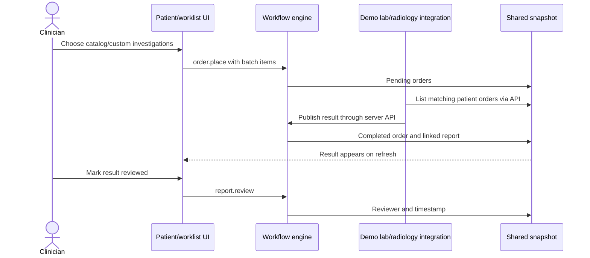

# Investigations: orders, reports, and review

[Handbook index](../README.md) · [Discharge](DISCHARGE.md)

## Purpose and entry points

Clinicians order lab tests or imaging, then review the published result. Routes are `/app/lab-orders`, `/app/imaging-orders`, and `/app/results`. Orders can also start in the patient chart through `NewOrderMenu.tsx` and `OrderBasket.tsx`.

The source-portal arrows describe the API contracts present in this repository. Their deployment/connectivity must be checked separately.

## Ordering

`order.place` supports a basket of investigations with a shared `batch_id`, indication, kind, and priority. It requires an active encounter, valid catalog matches, and no duplicate active investigation titles in the basket or the current encounter. Custom lab items need a specimen; custom imaging needs a modality.

`order.create` is the simpler single-order command used by integration paths. It also rejects duplicate active orders. Do not assume every creation path has identical catalog requirements; inspect the command schema and engine case you use.

Orders start as `pending`. `order.status` can change an open order's status, with entity-version validation. A cancellation needs a reason. Completed or cancelled orders cannot be updated through that action. The UI offers `processing`, but publication can accept either pending or processing orders.

## Publication and review

`order.publish` validates the order/version, collection or study time between placement and publication, and report data. Lab results need at least one observation with a unique test name and a value. It creates a report, links `result_id`, and marks the order completed.

The report stores current source labels `MockLIS` or `MockRIS`. Imaging contains findings/impression and study metadata; this is not a PACS/DICOM viewer. `report.review` records actor and time separately in `state.reviews`. The Results page lists linked results without that review metadata.

Publishing the result is not the clinician's review. Both pending orders and unreviewed current-encounter reports can block discharge. Reports also feed history, AI context, evidence drawers, lab trends, and handover sources.

## Local versus hosted source actions

`InvestigationsPage.tsx` contains processing/publishing controls behind `simulator=true`. Current clinical routes do not pass that flag, so normal worklists tell users to await the source portal. Do not expect the clinical route to expose simulator publication controls.

| API file | Role |
| --- | --- |
| `api/orders/list.ts` | Fetch patient orders/reports by UHID and kind |
| `api/orders/create.ts` | Create a single investigation |
| `api/orders/walkin.ts` | Handle the demo walk-in order path |
| `api/orders/publish.ts` | Publish a source report |
| `api/patients/register.ts` | Register a synthetic patient and encounter |
| `api/_lib/workflowState.ts` | Service-role persistence and compare-and-swap retry |

These integration functions are not mounted by ordinary Vite dev middleware. They use a fixed demo project/hospital, not a verified caller-derived tenant. CORS allowlisting is not authentication. Patient registration also performs multiple database/snapshot writes outside one transaction.

The walk-in endpoint represents an investigation performed before its order was recorded: it creates a synthetic order five minutes before the supplied performed time, then publishes the report in the same snapshot command batch. This backdating is demo behavior. A product integration should preserve actual source event times and separately record when VDocs received them.

## Files and tests

Read [`OrderBasket.tsx`](../../../src/components/OrderBasket.tsx), [`InvestigationsPage.tsx`](../../../src/pages/InvestigationsPage.tsx), [`orderCatalog.ts`](../../../src/data/orderCatalog.ts), and the `order.*` / `report.review` cases in [`workflowEngine.ts`](../../../src/services/workflowEngine.ts). Tests include `orderFlow.test.ts`, `workflowEngine.test.ts`, and `labTrends.test.ts`.

## Production work

Authenticate source systems, validate tenant/patient/encounter scope, map external IDs, and make result imports idempotent. Normalize orders, report versions, observations, and reviews. Preserve amended/corrected reports. Implement retry/dead-letter handling and delivery receipts for integrations. Agree actual HIS/LIS/RIS contracts with each hospital rather than treating these mock endpoints as certified interfaces.
