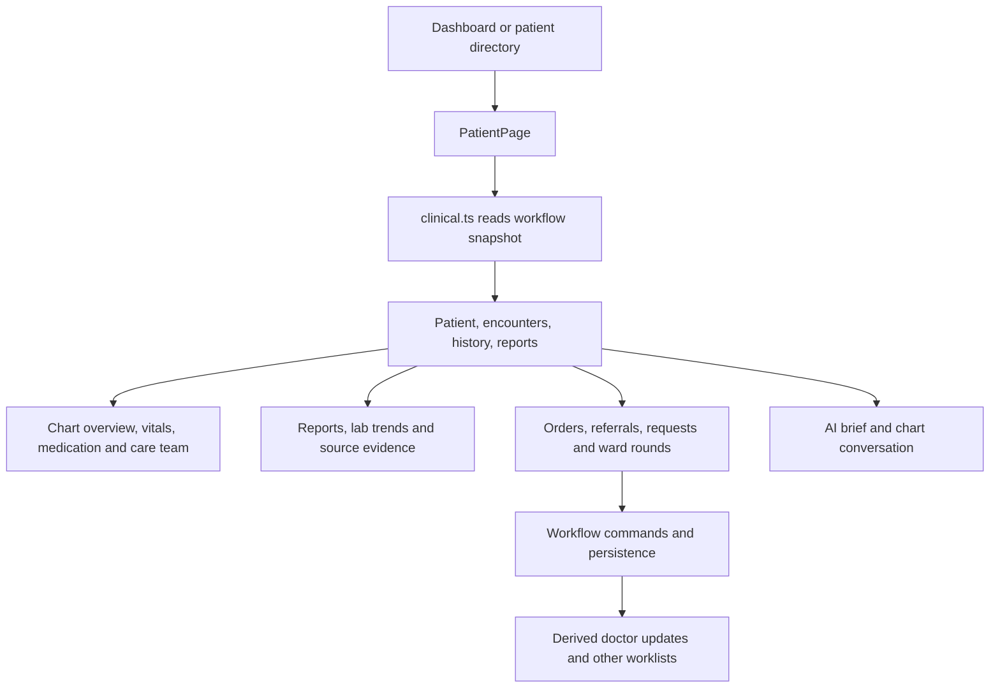

# Patient workspace, notes, and updates

[Handbook index](../README.md) · [Storage](../DATA_AND_PERSISTENCE.md)

## Purpose and entry points

The workspace brings one patient's chart, reports, outstanding actions, and history into one place. Open it from the dashboard, directory, OPD/IPD views, referral list, or another worklist. The route is `/app/patients/:patientId`.

## Step by step

1. `PatientDirectoryTable.tsx` supplies search, filters, encounter views, and pagination. `worklistSelectors.ts` separates normal worklists from patients routed into a discharge process.
2. `PatientPage.tsx` reads patient/lab/imaging through `clinical.ts`, history through `patientService.history`, and the workflow query for actions and discharge state.
3. The active encounter controls available actions. IPD-specific actions include ward rounds, discharge planning, and shift handover.
4. Reports appear through `ReportList.tsx`; a `?report=` link can focus a report. Lab trend points link back to source reports.
5. `PatientHistoryPanel.tsx` and `historyView.ts` organize longitudinal records. History includes previous encounters; it is not all current-admission data.
6. `ClinicalSummaryCard.tsx` presents deterministic chart information. `AiBriefCard.tsx` is the separate optional provider-backed summary.
7. `EvidenceDrawer.tsx` opens a supporting record when an AI citation or evidence reference is selected.

The specialty lens is currently hidden behind `SHOW_SPECIALTY_LENS = false`; the data/configuration remains in the repository. The weekly schedule is authored synthetic data, not live appointment booking.

## Notes and rounds

`round.create` requires an active IPD encounter and nonempty findings/plan. The engine writes a progress note titled `Ward round`, associated with the encounter. The patient page renders notes whose titles start with `Ward round`. Synthetic ward-round read overlays also exist, so not every displayed round came from a user command.

`note.create` creates a workflow clinical progress note for an active encounter. Separately, `doctorNotesStore.ts` saves browser scratch text. Treating those two mechanisms as the same record would lose provenance and synchronization expectations.

## Doctor identity and updates

`activeDoctor.ts` defaults to a demo doctor. In Supabase mode it looks up a membership display name and maps that name to the synthetic department owners. `workingAs.ts` is a separate browser-controlled author/role preference used by some flows. These are not a complete authorization system.

`doctorUpdates.ts` derives inbox events from workflow records; `UpdatesPage.tsx` displays them. `updates.read` stores read receipts for the actor in the workflow state. Marking an inbox item read does not automatically mean a report or referral response has been clinically reviewed; those have their own commands.

## Files to read

Start with [`PatientPage.tsx`](../../../src/pages/PatientPage.tsx), [`clinical.ts`](../../../src/services/clinical.ts), [`worklistSelectors.ts`](../../../src/services/worklistSelectors.ts), [`historyView.ts`](../../../src/services/historyView.ts), and [`doctorUpdates.ts`](../../../src/services/doctorUpdates.ts). Relevant tests include `historyView.test.ts`, `worklistSelectors.test.ts`, `doctorUpdates.test.ts`, and `wardRoundSeed.test.ts` under `src/services/`.

## Production work for this flow

Move patient search/history to authorized, paginated backend reads. Model clinician assignments and hospital membership by stable user IDs. Persist clinical notes centrally with amendments and provenance. Give notification delivery/read receipts a clear backend contract. Keep unsaved scratch text visibly separate from saved clinical notes. Ensure tenant changes and sign-out clear sensitive caches.
