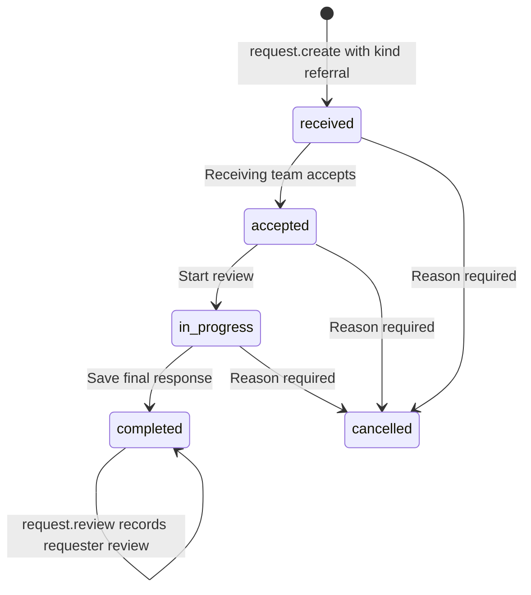

# Specialist referral flow

[Handbook index](../README.md) · [Coordination](CARE_COORDINATION.md) · [Discharge](DISCHARGE.md)

## Purpose

A referral asks another department/clinician to assess the patient and return a specialist opinion. It is represented as a request record with `kind = 'referral'`. It does not change the patient's primary department or transfer the admission in the current engine.

Open `/app/referrals`, create a referral through the shared action form, or follow a patient's care-coordination details.

Review is metadata on a completed request, not a separate lifecycle status.

## Creation, assignment, response, and review

1. `CreateClinicalAction.tsx` collects patient, receiving department, owner, reason, priority, and optional attached reports/context.
2. `request.create` requires an active encounter. The destination must be a supported department different from the patient's primary department. Attached report IDs must belong to that patient.
3. The engine rejects an identical open request with the same encounter, kind, destination, and reason. A record starts as `received`, with sender, source department, owner, and timestamps.
4. `CoordinationPage.tsx` builds the referral worklist. `referralViews.ts` calculates incoming/outgoing scope and date matching. Doctor/department selection changes the displayed scope; it does not grant permissions.
5. `RequestDetail.tsx` shows the clinical question, patient context, attached reports, assignment, response draft, and lifecycle actions.
6. `request.update` permits assignment/priority/draft changes and enforces sequential status advancement. Completion requires a nonempty response; cancellation requires a reason. Closed requests cannot be edited through that command.
7. `request.review` requires a completed request and matching entity version. It stamps the review time. Current code does not establish trusted requester-only authorization for this action.

The referral worklist stores filters and selected record in URL parameters. A pinned default doctor is a browser preference. Read/archive filters do not remove records from the underlying snapshot.

## Downstream effects

An open referral appears in care coordination and relevant handover sources. A completed response is available as clinical context but remains outstanding for discharge until reviewed. Completion adds a progress note and workflow timeline/audit metadata. The patient's clinical owner is not automatically replaced by the specialist.

Example: the primary team refers a patient for a cardiology opinion. Cardiology accepts, starts review, and completes with its assessment. The primary team must still review that response. Skipping directly from `received` to `completed` is rejected by the engine.

## Files and tests

Read [`CoordinationPage.tsx`](../../../src/pages/CoordinationPage.tsx), [`RequestDetail.tsx`](../../../src/components/RequestDetail.tsx), [`CreateClinicalAction.tsx`](../../../src/components/CreateClinicalAction.tsx), [`referralViews.ts`](../../../src/services/referralViews.ts), and the `request.*` cases in [`workflowEngine.ts`](../../../src/services/workflowEngine.ts). Relevant tests include `referralViews.test.ts` and `workflowEngine.test.ts`.

## Production work

Use stable clinician/team IDs, enforce sender/receiver permissions on the backend, keep assignment history, and define consultation turnaround/escalation rules. Add durable notifications and explicit acknowledgement. Separate consultation from transfer-of-care if the real product needs both. Preserve response amendments after completion rather than silently replacing a specialist's signed opinion.
