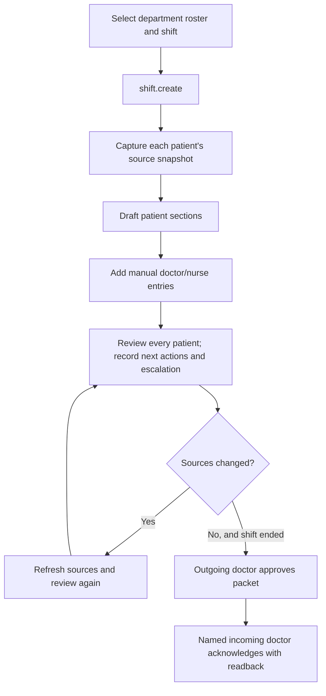

# Shift handover

[Handbook index](../README.md) · [Patient workspace](PATIENT_WORKSPACE.md)

## Purpose

A handover passes current patient information and unfinished work from an outgoing clinician to an incoming clinician. `/app/handovers` uses `ShiftHandoversPage.tsx`; its legacy tab still renders `HandoversPage.tsx` for individual handovers.

The current shift implementation groups multiple per-patient handover records by `shift_id`. It captures evidence from the chart rather than generating a provider-backed AI summary.

## Creation and source capture

`shift.create` checks that the shift has started, has an end after the start, and is no longer than 24 hours. Patient IDs must be distinct and belong to the allowed department roster with active IPD encounters. The same outgoing doctor cannot duplicate an existing packet for the same department/time window.

`captureShift()` collects encounter context, relevant notes, orders, reports, requests/responses, medications, vitals, pending work items, and discharge process information. It separates events from this shift from carried-forward context, such as an earlier pending order or unreviewed report. Snapshot entries include source ID/type, author, time, body, and scope.

The generated sections cover situation, background, recent events, completed actions, pending items, and next actions. They are deterministic drafts for human review.

## Editing and approval

`shift.entry` adds/edits/deletes manual entries only while a record is a draft. Editing/deleting checks the supplied author and role against the original entry. This is a demo authorship check, not server-verified identity.

Patient sections use the handover save contract. `shift.refresh` retains manual entries, recaptures chart sources, and clears the reviewed flag. `shiftChanged()` compares captured non-manual content with current source capture.

`shift.approve` checks the expected whole-state revision, outgoing actor, draft status, shift end time, fresh sources, and every patient's reviewed flag, situation, next actions, and escalation instructions. A changed chart requires source refresh and renewed review. Approval affects the packet's patient records together in the returned state.

`shift.receive` requires an approved packet and an actor matching the named incoming doctor. It records acknowledgement time and readback. Timeline/audit entries are written for affected patients.

## Legacy individual handovers

The `handover.create/save/approve/receive` commands remain in `workflowEngine.ts`. They represent individual records and have their own validation. Do not remove their page or commands assuming that the shift UI made them unreachable; the main shift page still includes the legacy view.

## Files and tests

Read [`ShiftHandoversPage.tsx`](../../../src/pages/ShiftHandoversPage.tsx), [`shiftHandover.ts`](../../../src/services/shiftHandover.ts), [`shiftArchive.ts`](../../../src/services/shiftArchive.ts), and the handover schemas in [`workflow.ts`](../../../src/domain/workflow.ts). Relevant tests include `shiftHandover.test.ts`, `shiftArchive.test.ts`, and `src/data/shiftDemo.test.ts`.

## Production work

Store packets and immutable approved versions centrally, verify clinician identities, and enforce department access. Distinguish acknowledgement from acceptance of specific clinical responsibilities according to the hospital's agreed process. Add durable escalation/delivery, recovery from partial notifications, clear timezone rules, and transactional packet approval. Retain captured source versions so an old handover can be reconstructed after the chart changes.
